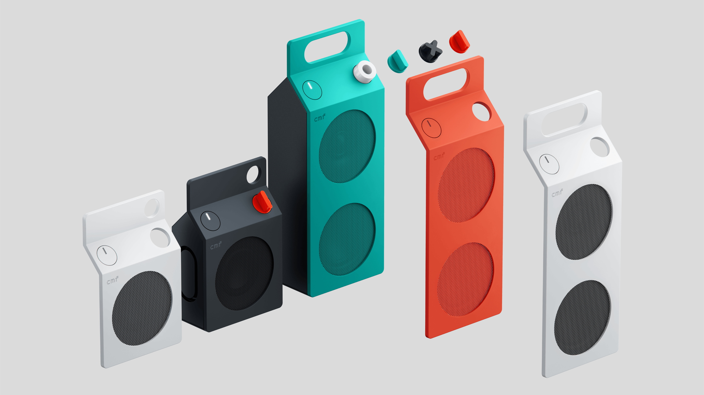

CMF, Nothing's budget subbrand, has unveiled its first Bluetooth speakers: the Speaker S and Speaker M. The small model starts at $59 (£49) and the large one at $109 / £99, both available in four finishes —white, dark grey, orange, and turquoise—. The novelty follows the recent Nothing Headphone (1) Pro headphones and marks the brand's entry into budget portable audio.

## Two formats, two uses

The Speaker S is the most compact and is intended to be carried around for listening outside the home. It features a 45 mm "custom-tuned" driver and two passive radiators, the usual solution in small enclosures to reinforce bass without relying on a large transducer.

The Speaker M changes the focus: it is more bulky and aims to fill a room, with a declared frequency range of 60 Hz to 20 kHz. Compared to the S, here priority is given to coverage rather than portability.

## What they share: Bluetooth 6.0 and 18 hours

Despite the size difference, both models share much of the technical sheet. The declared autonomy is 18 hours of playback at 50% volume with the Ultra Bass mode activated, an enhancement that adds weight to tracks that need it; a fast charge of 10 minutes provides one more hour of use.

In terms of connectivity, both adopt Bluetooth 6.0, with an announced range of more than 100 meters between speaker and device, and support dual connection, allowing you to switch between two devices without re-pairing each time. For daily life, that translates into something simple: switching from mobile phone to laptop without interrupting playback.

As for the overall audio experience, CMF offers two modes. The Stereo Mode converts two units —from either the S or the M— into a stereo pair with left and right channels. The Party Mode goes further and allows pairing both models to increase volume, even with compatible enclosures from other brands.

## Design and customization: the real hook

What has put the focus on these speakers is their aesthetics. Their silhouette recalls a milk carton, a visual twist that distances them from competitors in the entry segment. On top of this, CMF adds an uncommon element: the front panels of both models are removable and can be swapped for one of a different color.

The brand goes one step further and encourages those with 3D printers to manufacture their own panels and volume controls, with a guide published in its community. It is an extra that does not affect the sound, but rather the perceived lifespan of the product and its fit into home decor.

## Is it worth it?

On paper, the starting quality-price ratio is reasonable: Bluetooth 6.0, 18 hours, and dual connection are competitive figures for a portable speaker at this price. It is advisable to separate the measurable from what is not yet: CMF declares frequency range and autonomy, but there are no independent measurements of distortion or real response yet, so audio performance remains to be checked in tests. The strong argument today is design and customization; sound will have to be judged by listening to it.
