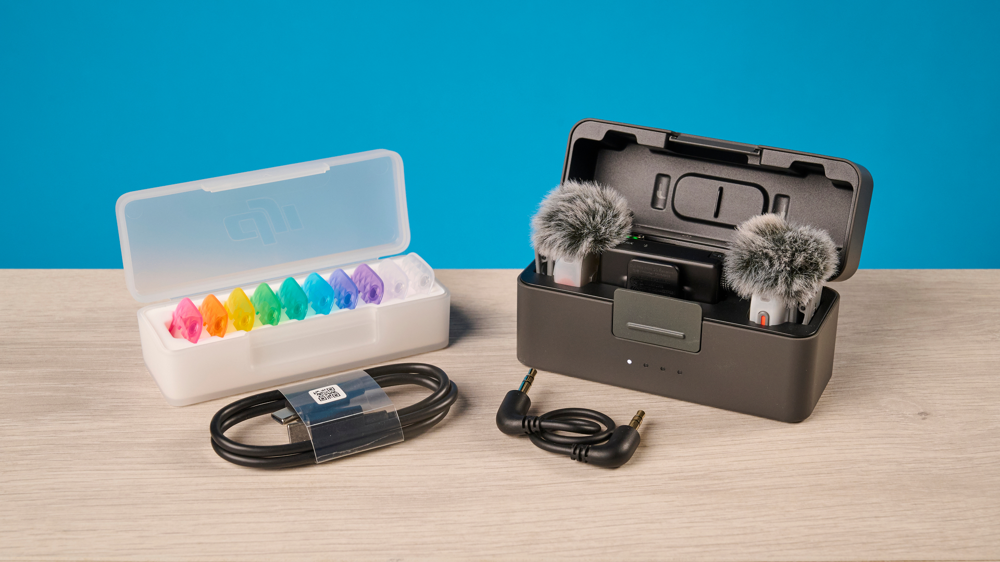
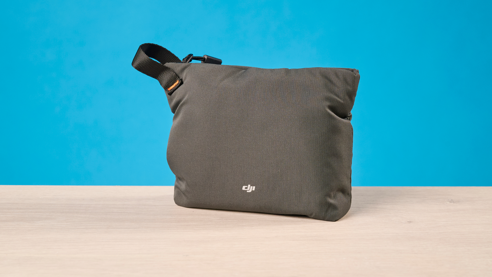
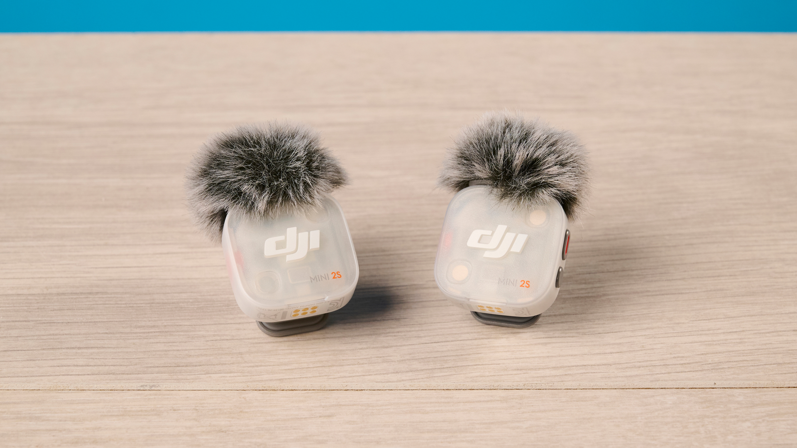
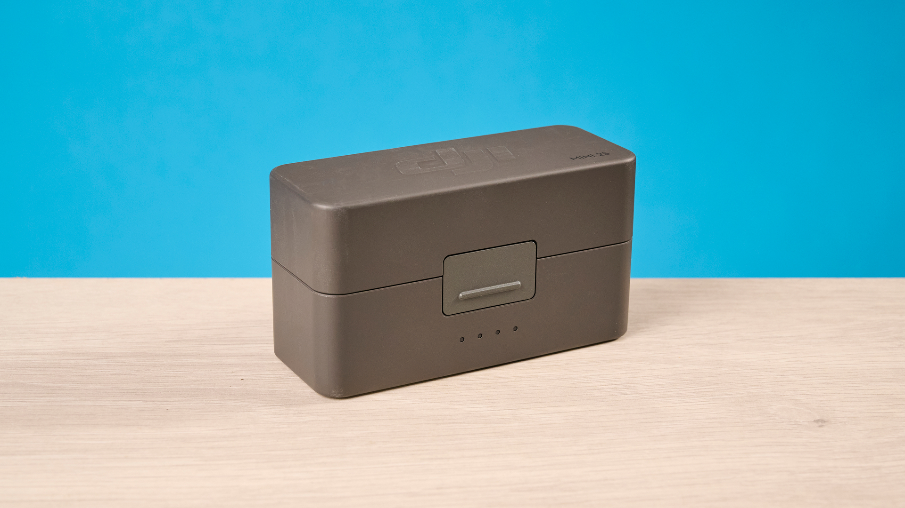
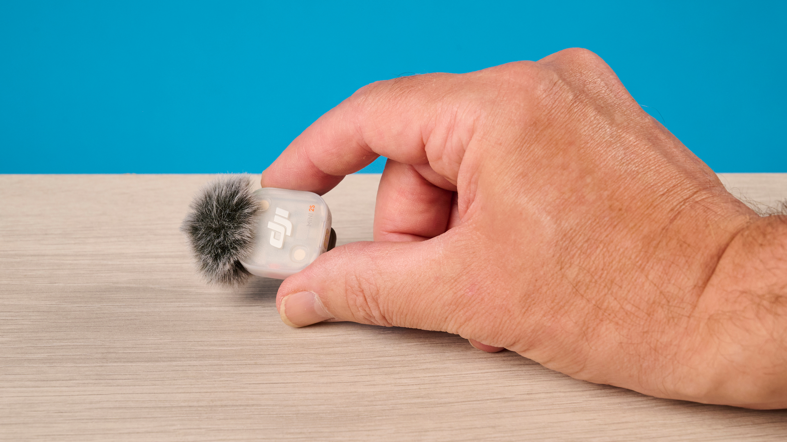
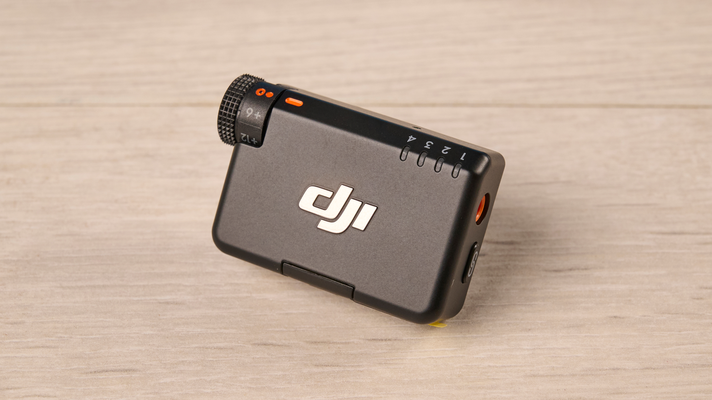
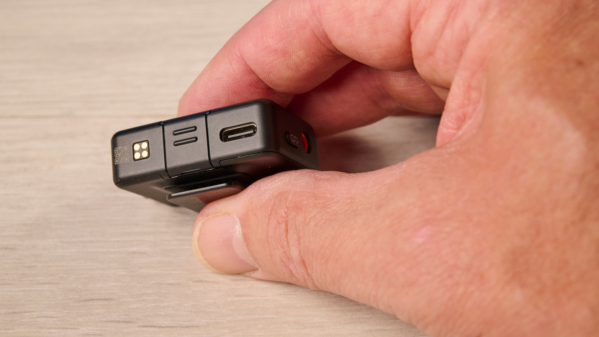

The DJI Mic Mini 2S sells in the United Kingdom for £169 on the two-transmitter kit, one receiver and charging case; the single-transmitter version costs £79. At that price, it sits well below the DJI Mic 3 (£259) without sacrificing internal 32-bit float recording, a feature the Mic 3 includes but previous Mini models did not offer. Tom's Guide published its analysis on November 3rd and awards it 4.4 out of 5, with the Editor's Choice label and two specific objections: plosive pop and receiver volume.

## What It Is and How Much It Costs

The Mic Mini 2S is a two-piece wireless system: a clip-on transmitter and a receiver that plugs in via USB-C. It is designed for recording voice on video and podcasts from mobile phones, computers or cameras, and according to the review the receiver also supports traditional cameras via 3.5 mm cable and Bluetooth connection. With DJI cameras, the system works within the OsmoAudio ecosystem without needing a receiver.

Availability is the least comfortable part for a reader outside the United Kingdom. The United States does not have the product on sale due to current regulatory and import restrictions against DJI, and there the previous model, the Mic Mini, remains available for $99. The price cited in the analysis is in pounds, so to buy in Spain it is advisable to confirm the amount and stock at the DJI store before making a final payment.

| Data | Value |
| --- | --- |
| Transmitter | 28.7 × 27.9 × 13.5 mm and approx. 12 g |
| Receiver | 46.5 × 29.7 × 19.3 mm and approx. 19 g |
| Case | 106.4 × 59.2 × 42.4 mm and approx. 160 g |
| Capsule | Omnidirectional |
| Internal Recording | 32-bit float, 14.5 GB |
| Connectivity | Bluetooth 6.0, USB-C and 3.5 mm |
| Range | Up to 400 m |
| Battery Life | 11 h per transmitter, 10 h for the receiver, 40 h with case |

The measurements in millimeters and grams are conversions of the inches and ounces published in the analysis.

The images from the analysis show two hair windscreens, a set of coloured pieces to distinguish emitters and the two cables, the USB-C and the 3.5 mm one. The rigid case, which also charges the transmitters, and a fabric bag complete the kit.

## 32-bit Recording, Noise Cancellation and Sibilance

The 32-bit float recording is the technical novelty that carries most weight in the review. It captures a very wide dynamic range, so quieter parts can be boosted in post-production and very loud sounds, such as a shout, are not clipped: they can be lowered afterwards. The internal storage of 14.5 GB allows for about 22 hours at 32-bit or about 28 hours at 24-bit, according to the calculations handled by Tom's Guide. Anyone already working at 32-bit will find the same principle in the [Insta360 Mic with e-ink display screen](/noticias/audio/insta360-mic-pantalla-tinta-electronica-grabacion-32-bits/), although there the product focus is different.

On sibilance and fricatives, those s, sh and f sounds that usually produce annoying hisses, the microphone stands well: in the analysis tests they appeared clean and without audible distortion. The environmental noise cancellation works at two levels and, in the author's recording, it eliminated completely the laptop warnings that sounded in the same room. The comparison with the Mic Mini 2 is the most useful data point in the text: in that same situation, the previous model left the audio with an "underwater" effect.

## Battery Life and Connectivity of the DJI Mic Mini 2S

Each transmitter lasts 11 hours and the receiver 10; with the case, the total figure reaches 40 hours. That is three more hours per transmitter than the eight declared by the Mic 3, enough for several recording days without passing through the charger. The case adds cable-free charging, and the review describes it as the accessory that solves a weekend outing.

On connectivity, the review highlights simplicity: USB-C receiver for mobile or computer, 3.5 mm cable for camera and Bluetooth as a third path. The transmitters and receiver are backward compatible with those of the Mic Mini and Mic Mini 2, and up to four can be paired. That allows adding a 2S transmitter to a previous kit and gain noise cancellation and 32-bit without changing everything. The Mic Mini 2, in contrast, admits two microphones on the receiver. If the main use is recording with the mobile via USB-C, the [Sony ECM-AX10](/noticias/audio/sony-ecm-ax10-microfono-espacial/) is another path that does not depend on an independent receiver.

## Plosives, Receiver and Verdict

The first defect is acoustic and appears in plosives, the consonants that push air against the capsule: p, b, d and g. In the analysis recordings, the p at the start of a word sounded hard, with audible air entering the microphone, and the result tires when listening. The Mic Mini 2 did not show that problem. The author warns that distance to the mouth influences it, so part of the behaviour depends on how the mic is placed; even so, she describes it as a product defect and not just a technique issue.

The second is design-related. The receiver measures approx. 46 × 30 × 19 mm and, when plugged into the mobile, prevents laying it flat or standing it up, in addition to loading weight on the top part. Tom's Guide points out the Insta360 Mic Air as a more manageable alternative in that aspect, although with fewer functions.

The price comparison collected by the review makes clear the product's position:

| Model | Price in Analysis |
| --- | --- |
| Insta360 Mic Air | £69 |
| DJI Mic Mini 2 | £89 |
| Rode Wireless Micro | £139 |
| DJI Mic Mini 2S | £169 |
| DJI Mic 3 | £259 |

Tom's Guide verdict is favourable on the essentials: for £169 you get high-end traits, such as 32-bit, effective noise cancellation and 40 hours with case, at a price well lower than the Mic 3. The recommendation is directed to creators who record outside, with ambient noise around, and those making the jump to a wireless mic for the first time. For demanding professional work, the review itself asks to look at other options due to plosive pop and receiver bulk.

> Worth it? If the main use is voice outdoors and budget weighs heavily, yes: the difference with the Mic Mini 2 is justified by noise cancellation and 32-bit recording. If recording in a studio, with the mic close to the mouth and no margin for retaking a take, the savings against the Mic 3 do not compensate the risk of an explosive p.

> Scope: this article summarizes the Tom's Guide analysis published on November 3rd, 2026 and signed by Ashley Thieme. The measurements, listening impressions and score are from that medium; here the product was not tested.
