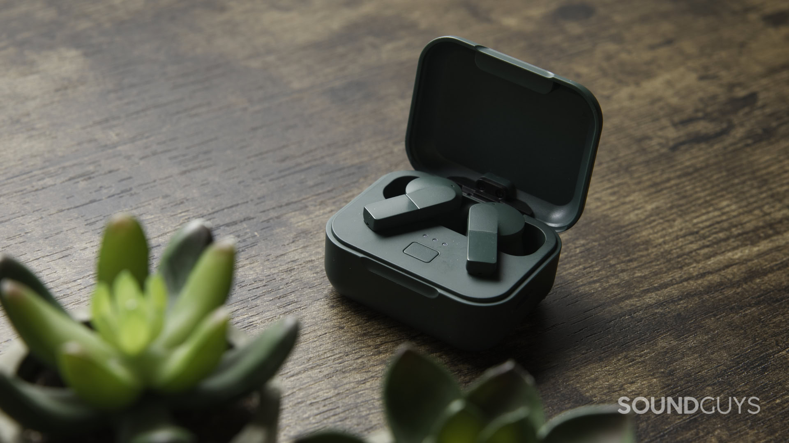
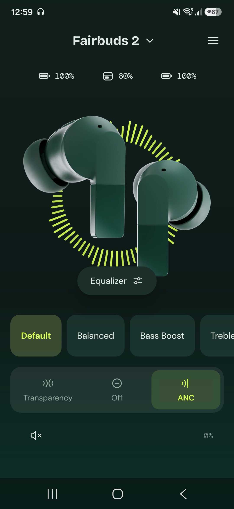
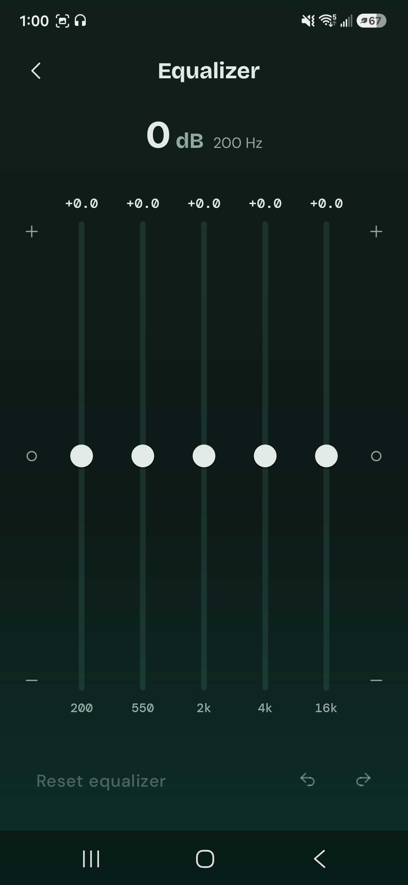
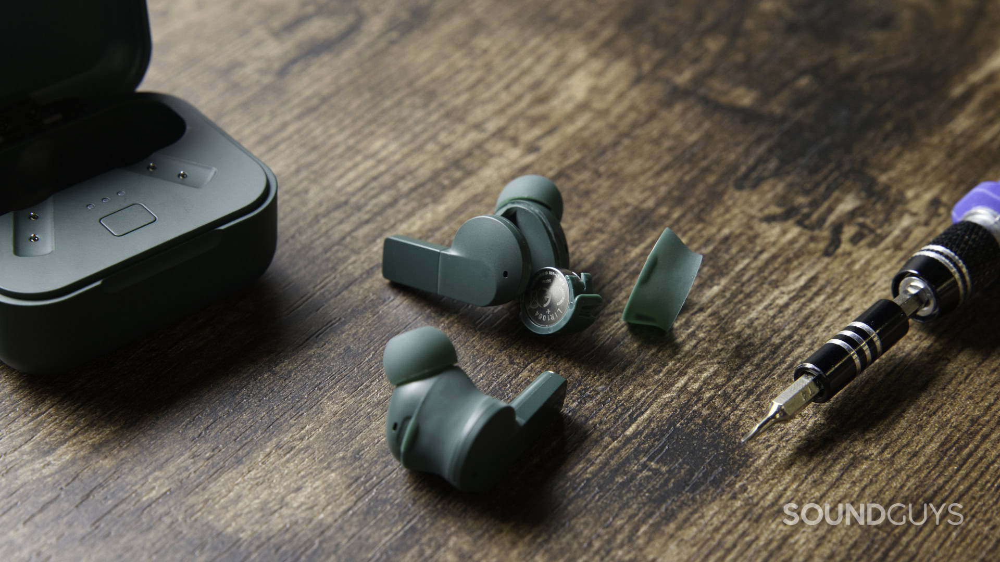

The **Fairphone Fairbuds 2** have an original price of **119 euros** and a launch date set for **November 2, 2026**, according to the review published by SoundGuys. Their main selling point is not a software feature: the batteries in both the earbuds and the case can be replaced. As of October 30, that date is still in the future; publication of the review should not be confused with commercial availability.

The outlet tested a unit supplied by Fairphone for three days, combining its impressions with laboratory measurements. The result points to a purchase with clear priorities: easy maintenance in exchange for accepting limitations in sound, the app and calls. This is not a test conducted by TechSpain24.

## What can be repaired in the Fairbuds 2

To access each earbud's battery, SoundGuys explains that you simply remove the silicone cover and open the compartment. The cell used is a **LIR 1054**. The case battery is also accessible, although this requires removing a screw with a Torx T4 bit.

The practical difference is being able to intervene when the battery wears out, rather than treating the whole product as finished. That does not amount to a promise of unlimited service life: repairability describes access to components, not a guarantee that other faults will never occur.

The review also warns about an assembly detail: a small tab must be aligned correctly when closing the compartment. The earbuds are IP54-rated, and the silicone cover must protect the battery area. They are therefore not an invitation to use them in the shower.

## Measured battery life and cancellation: two different figures

With active noise cancellation enabled, SoundGuys recorded **5 hours and 29 minutes** in its standardized battery test. That is slightly below the six hours the review itself attributes to Fairphone. The measured figure reflects the outlet's laboratory conditions: it does not guarantee that every user will obtain exactly that runtime.

Active cancellation reduced noise by around 81% according to the perceived-loudness metric used by SoundGuys. That does not mean it removes 81% of every sound in every environment. The author notes that some high-pitched noises still get through, an important distinction for anyone seeking earbuds to block out noise while commuting.

For connectivity, the review's specifications list Bluetooth 6.0, SBC, AAC, LC3 and LDAC codecs, and multipoint connectivity with two simultaneous devices. However, the tester encountered a pairing issue between the earbuds that was resolved only with a factory reset. That is an observation about that unit, not a proven widespread fault.

## Sound and microphones: where the compromises lie

Compared with the original Fairbuds, SoundGuys describes improvements in sound and everyday use, but retains reservations about their tonal tuning. The app includes a five-band equalizer that, according to the outlet, is not enough to correct the tuning problems. Being able to change the tonal profile does not imply particularly flexible adjustment.

The other compromise appears in calls: the review finds difficulties rejecting noise and highlights wind as a problematic scenario. They can be used for conversations, but the outlet's recommendation is less favorable for people who regularly intend to talk while walking outside.

For anyone who values keeping their earbuds longer, replaceable batteries are the central argument for these Fairbuds 2. For those prioritizing sound or outdoor calls, the review's reservations weigh more heavily than that advantage. Replaceable batteries also appear in other formats, such as the [Sonos Ace Ultra headphones](/noticias/audio/sonos-ace-ultra-analisis/), but that does not automatically make the two products equivalent alternatives. Before buying these Fairphone earbuds, check actual availability after the launch date reported by SoundGuys.
