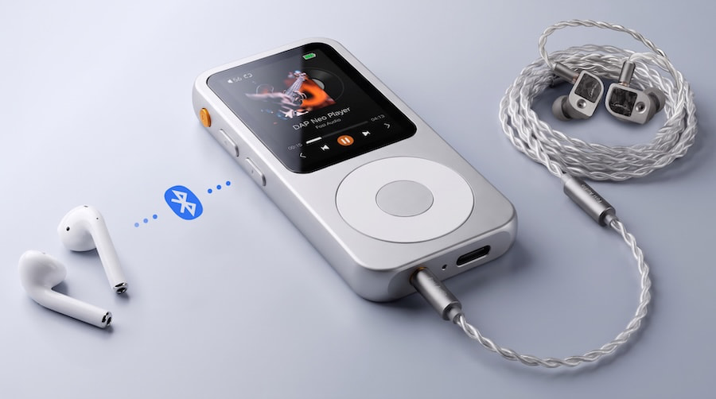

79.99 is the starting price of the Fosi Audio DAP Neo, a portable digital audio player (DAP) that recovers the iPod formula: compact metal casing, tactile control wheel, and expandable storage. There are no streaming apps, notifications, or algorithms deciding what plays next. The question, at this point in 2026, is whether that is still a selling argument or just nostalgia.

The DAP Neo is the third product of the new **Fosi Moment** line, which the company associates with the idea of "intentional listening." It is accompanied by the DISC Nano portable CD player at $99 and the Merak CD player at $140. Fosi already showed an early prototype at CanJam London 2026, and its simplicity was precisely what attracted those who tested it.

## A Named DAC and Wide Format Support

Under its retro exterior, the DAP Neo mounts a **Cirrus Logic CS43198** DAC and plays MP3, FLAC, WAV, APE, M4A, and DSD files. It is a reasonable base for anyone who wants to build their own portable library, although Fosi has not detailed the maximum PCM sampling rates or supported DSD resolutions. The company declares a signal-to-noise ratio of 127 dB and a headphone output power of 129 mW, without clarifying at what impedance that figure was measured.

The headphone output is 3.5 mm single-ended, and Bluetooth remains as a wireless option with a clear limitation: it only supports the basic SBC codec, without aptX, LDAC, or AAC. Anyone who wants to squeeze a lossless collection will have to use cable. There is also no 4.4 mm balanced output, something that at this price is not surprising.

Storage comes with a 16 or 64 GB microSD card included depending on the version, expandable up to 256 GB. The screen is a 2.4-inch TFT LCD panel with a resolution of 320 × 240, housed in a CNC-machined metal chassis measuring 3.82 x 1.85 x 0.42 inches and weighing up to 75 grams. Fosi keeps physical buttons on the side and a control wheel, so you don't rely solely on touch to change tracks.

## What Changes for the User

The DAP Neo is offered in two finishes, Galaxy and Obsidian, with autonomy rated at up to 12 hours per charge, enough for daily commutes and long sessions. It includes a USB cable for charging and file transfer.

The proposal has a concrete goal: bring younger listeners the idea of owning and playing their own music without relying on a smartphone or a subscription. The obstacle is the same that plagues every dedicated player: it requires downloading, organizing, and managing files, something much of today's audience has never done.

## Price, Competition, and What's Still Unknown

There are two versions already available, in silver or black:

- Fosi Audio DAP Neo (16 GB): $79.99.
- Fosi Audio DAP Neo (64 GB): $119.99.

The direct rivals that are usually cited are the FiiO JM21 ($259.99) and the FiiO M21 ($369.99), both with Android, streaming, more powerful amplification, and balanced outputs. They play in a different price league, so the comparison makes sense only as a reference of what you gain by moving up a segment.

Is it worth it? For $80, the DAP Neo brings a dedicated DAC, lossless format support, Bluetooth, and expandable storage into a 75-gram metal body. Anyone looking for a distraction-free player to carry around has an affordable entry point here. Anyone who depends on streaming or demanding headphones should wait until Fosi publishes the maximum resolutions and reference impedance: without those data points, there is no way to know how it will behave with models that demand more current.
