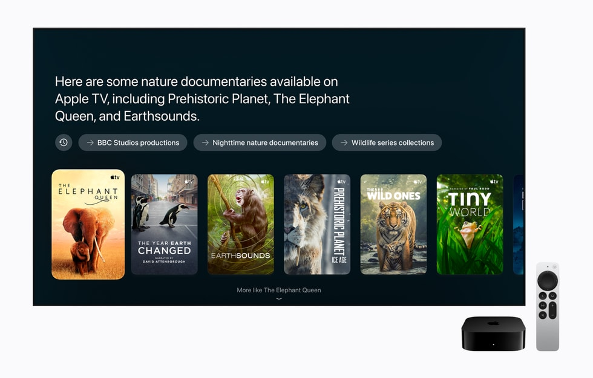
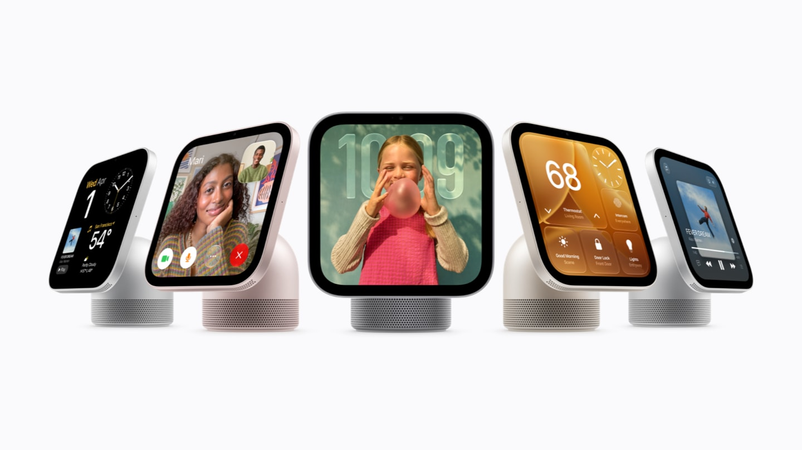

# Apple prices and dates the release of its small speaker

Apple has priced and dated the refresh of its small speaker. The HomePod mini 2 will cost €169, can be reserved today, and arrives in stores on Friday, October 30, in five colors: pink, green, blue, white, and midnight black. The name and form are continuists, but inside there is a change that didn't exist in the 2020 model: the speaker moves to the S10 chip and debuts Sound Glow.

The launch is part of the "Welcome Home" event Apple held on October 13, which also served to present a new Apple TV 4K and the HomeView, a speaker with a screen that, for now, won't be sold in Spain. Read together, the three announcements point to the same idea: cover the living room from top to bottom and turn the HomePod mini 2 into the cheapest entry point to the home audio ecosystem.

## What changes in the HomePod mini 2

Acoustically, the mini 2 maintains the original's approach: a full-range transducer and two passive radiators with force cancellation that, supported by computational audio, seek to fill the room with 360-degree sound. The new element is the S10 chip, which replaces the old S5 from 2020 and analyzes music in real time to adjust dynamic range, volume, and acoustic performance. It can be used alone, in a stereo pair, or within a multi-zone system, and also functions as a Mac speaker with Wi‑Fi 6E or later.

The most visible feature is Sound Glow: the top, previously just a simple touch surface, now lights up and pulses to the rhythm of the music, reacts to bass and treble, and takes on the color of the album cover that's playing. With a soundscape, like rain, it generates its own animations.

Where the jump is most noticeable is in home cinema. For the first time, the HomePod mini 2 can be combined with the Apple TV 4K (4th generation) to set up four-speaker surround sound: two in front and two behind, each pair formed by the same model. The Apple TV 4K recognizes the position of the speakers in the room and calibrates timing and levels automatically.

## The Apple TV 4K handles the cinema part

The second announcement is the Apple TV 4K (4th generation), which can be reserved today, arrives on November 13, and costs €349. The performance jump comes from the A19 chip: Apple cites up to 50% more CPU performance and double in GPU compared to the previous generation, plus a dedicated AV1 decoder that improves streaming efficiency.

In the living room, what stands out most is the microphone. The new Apple TV 4K incorporates three far-field microphones with echo cancellation, so you can talk to Siri without using the remote, even with audio playing in the background. The Siri Remote retains its design but adds compatibility with Find My and Precision Finding and the option to emit a sound to locate it when lost, the same idea already used by AirPods.

## HomeView: the screen speaker that stays out of Spain

The third product is the most different. The HomeView is a speaker with a 7-inch Liquid Retina touch display, mounted on a dome-shaped base and a steel hinge that allows it to be tilted for comfortable viewing. It's sold in four colors (silver, starlight white, pink, and space gray) and also in a wall version. It recognizes up to six people by face and adapts the screen to each one.

In sound, it aims higher than the mini: two full-range speakers on the screen, a downward-facing woofer, and two passive radiators in the base, all with spatial audio and computational audio.

For the Spanish reader, the problem is availability. The HomeView will be sold in the United States for $299 and arrives in countries like Canada, the UK, or Australia on November 13. Apple confirms, however, that it won't be sold in the European Union, and the reason given is that Siri AI isn't yet available on iOS in the EU. The company says it's still talking with Brussels to find a solution.

## Is it worth it?

Seen with Spanish prices, the HomePod mini 2 is the easiest piece to justify: €169 for a speaker that integrates with the rest of the ecosystem and, in a pair, performs as a desktop speaker for a Mac. Setting up the four-speaker home cinema, however, requires buying the Apple TV 4K and a full set of speakers, and there the bill grows. In its first impressions, Engadget found the four-unit setup convincing but noted that the most realistic use case for most people is the stereo pair connected to a computer.

One caveat worth keeping in mind before reserving: the big selling point of the launch, Siri AI, doesn't come standard and won't be available at launch in the EU. In iOS 27 there's already the option to [enable Siri AI or revert to Siri Classic](/noticias/siri-ai-ios-27/), but on the HomePod mini 2 the assistant will arrive, according to Apple, with a future free software update. For a user in Spain, today the reasons to buy the speaker are the S10 chip, sound illumination, and surround sound, not the assistant.
