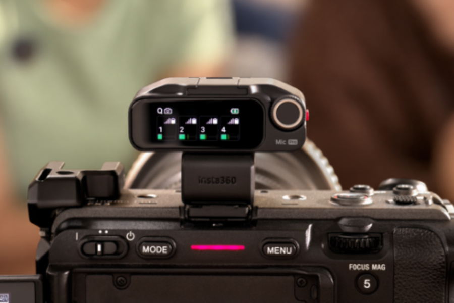

The **$79.99 price of the Insta360 Mic is for the standalone transmitter**, not for a setup with a receiver. The new wireless microphone, launched on October 22, combines a customizable e-ink display with a microSD slot that stores audio locally in 32-bit float. The kit with one transmitter and one receiver starts at $139.99, according to [Insta360's launch release](https://www.prnewswire.com/news-releases/insta360-launches-mic-to-complete-its-wireless-microphone-lineup-flagship-level-audio-for-everyday-creators-302916915.html).

The distinction matters before buying: a user with a compatible Insta360 camera can do without the receiver, whereas connecting the system to other cameras requires checking the connections. The brand places this model between the entry-level Mic Air and the Mic Pro, with one clear decision: storage on the new Mic depends on a card bought separately.

## Insta360 Mic: customizable display and microSD backup

The transmitter's display measures **1.22 inches**, uses six colors and has a resolution of 240 × 208 pixels. It allows an image to be uploaded, such as a logo or an illustration, instead of showing a fixed brand on clothing. It can also serve to identify the participants in a conversation. It is a visual difference, not proof of better sound quality.

The microSD slot has a different use: it turns the transmitter into a standalone recorder. With a card inserted it supports internal recording at 24 bits or 32-bit float, as a backup of what the phone or camera receives. Without a card it still works as a wireless microphone, but it does not have that local copy.

**32-bit float applies only to internal recording**, not to every output of the system. The format offers more headroom for adjusting levels during editing; it should not be confused with a guarantee of removing any distortion or noise from the take. The official spec sheet also states that a new file is generated automatically every 30 minutes.

## Which cameras and phones can use it

The direct Bluetooth connection supports the Insta360 X6, X5, Luna Ultra, Luna Pro, GO Ultra and Ace Pro 2, with 48 kHz audio and no receiver. For other cameras, the receiver connects to the microphone input through a 3.5 mm cable; on phones, the included USB-C adapter can be used.

Not all Bluetooth connections are equivalent. Insta360 clarifies that the transmitter's direct link to a phone works with compatible third-party apps, **not with the native camera app**, and captures audio at 16 kHz. It is worth checking this limit if the idea is to buy only the transmitter to record with the phone.

A receiver supports up to four transmitters, including mixed Mic and Mic Pro models. That does not mean always having four independent tracks in the camera: the four-channel output requires certain Sony models and the official adapter, sold separately. In stereo, with more than two transmitters, the system groups the sources in pairs.

## Claimed battery life and differences from the Mic Pro

Insta360 claims up to 13 hours per transmitter and up to 34 hours with the case. These are laboratory figures obtained **with internal recording and noise cancellation turned off**. They therefore do not necessarily describe a day of continuous recording to microSD with noise reduction enabled.

Processing includes a chip dedicated to noise cancellation, two automatic gain modes and three voice presets. The manufacturer attributes to the system a noise reduction with fewer artifacts; this is not the result of testing by this publication.

Compared with the Mic Pro, the Mic uses a single omnidirectional microphone, instead of a three-microphone array with several pickup patterns. It also replaces the Pro's built-in 32 GB with storage expandable through a card. The shared display does not, therefore, make their capture and storage capabilities equivalent.

## Pricing: transmitter alone or kit with a receiver

The company announces global availability from October 22 in its official store, Amazon and authorized distributors, with these prices in US dollars:

- **$79.99:** one transmitter, no receiver.
- **$139.99:** one transmitter and one receiver.
- **$249.99:** two transmitters and one receiver.

These prices do not confirm the final price in Spain or stock at a particular retailer. Before comparing with other creator kits, such as the [Elgato Wave Go wireless microphone](/noticias/audio/elgato-wave-go-microfono-inalambrico/), it is worth matching the contents of the package and the connections required.

The Mic's practical argument lies in keeping a local copy without giving up wireless transmission. For anyone already using a compatible camera, the standalone transmitter can cover that role; for other setups, the budget must account for the receiver, the microSD card and the adapters required. The customizable display comes after those checks, not instead of them.
