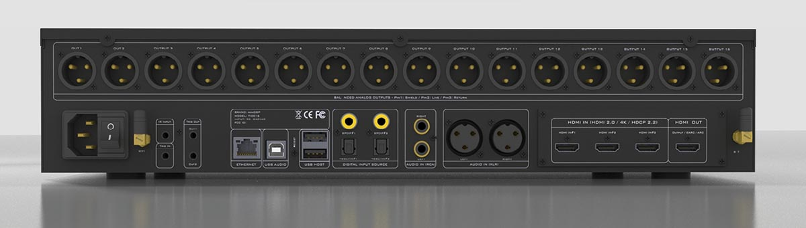
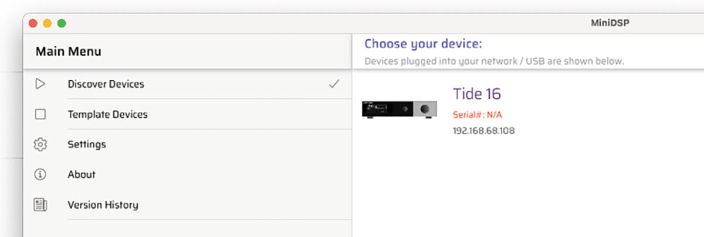
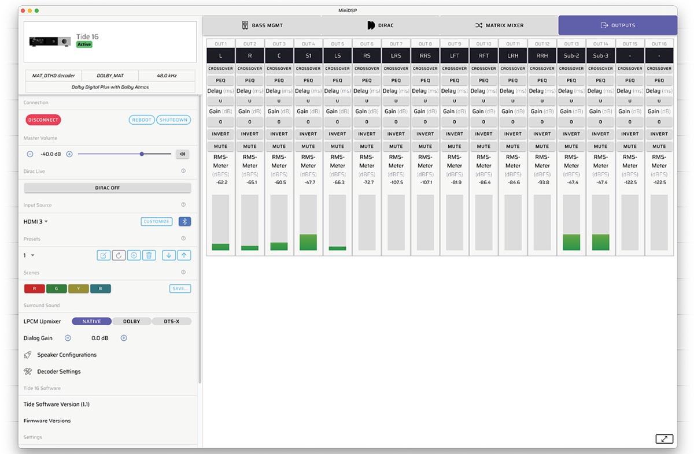
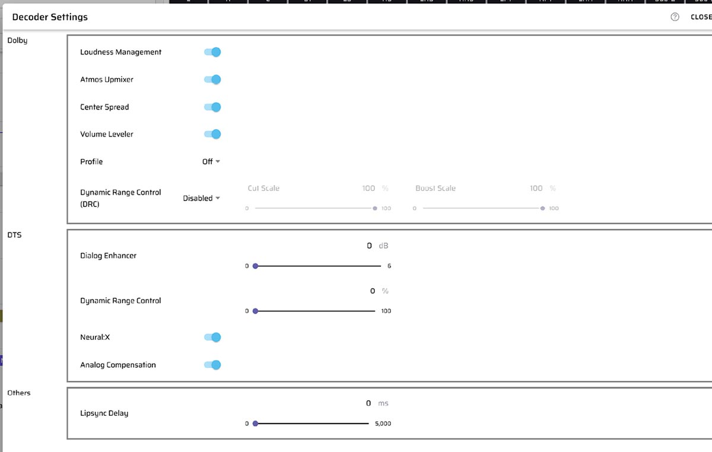
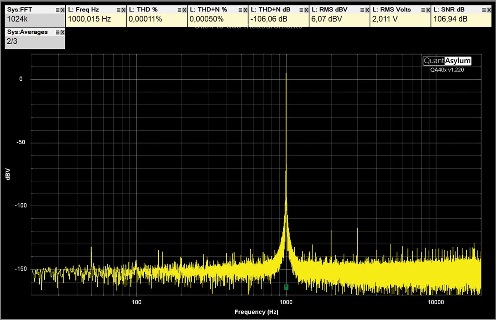
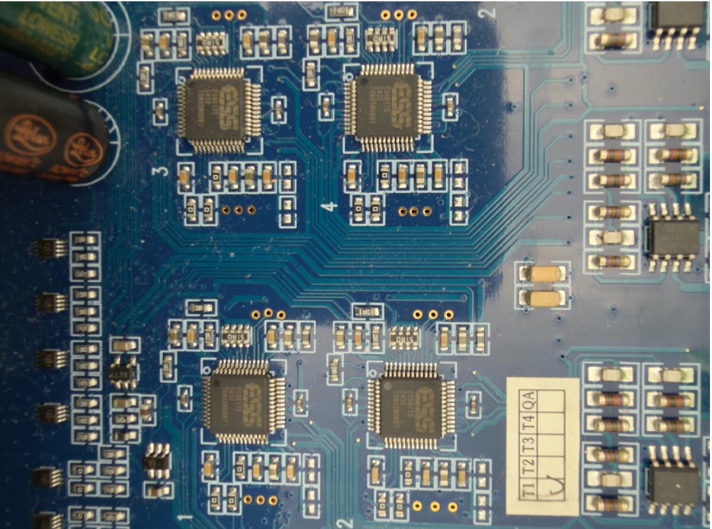
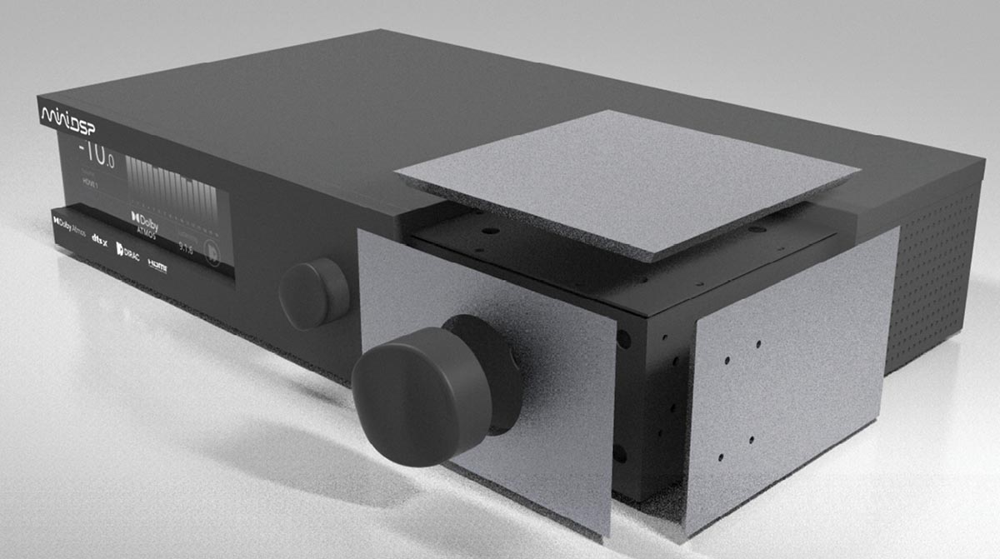
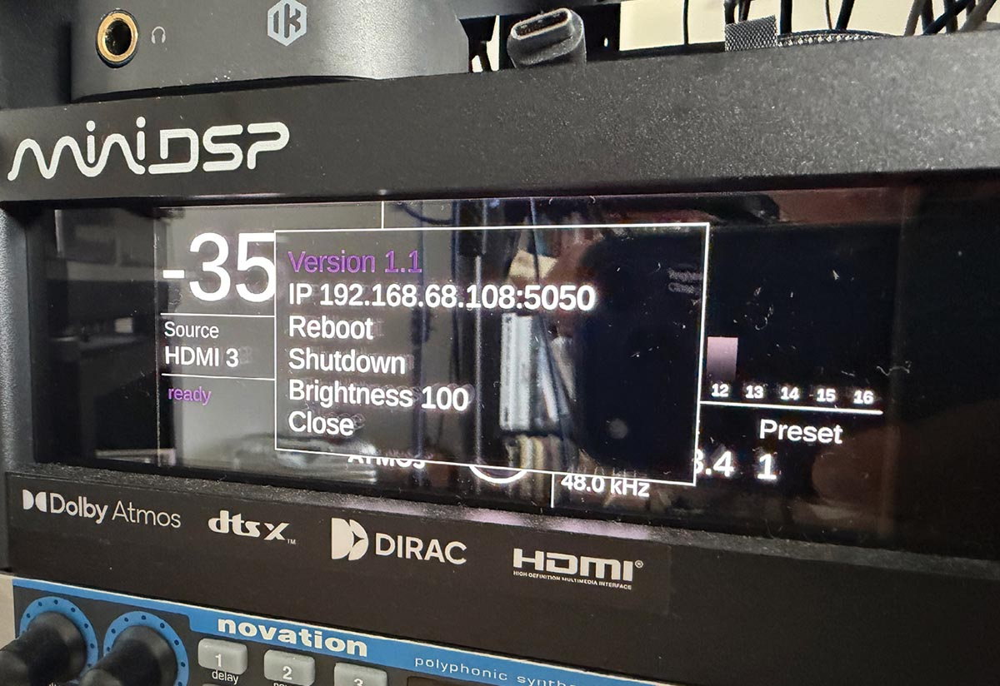

miniDSP has won over a faithful audience in the audio world with products that solve specific problems without inflating prices: their processors, streamers, and measurement microphones are found in studios and laboratories around the world. With the **Tide16** the Hong Kong company makes its move into the territory of immersive audio processors, a segment dominated by traditional AV receivers, and does so with 16 balanced XLR outputs and a price of $3500 (plus shipping and taxes).

## What the Tide16 proposes

The Tide16 decodes Dolby Atmos and DTS:X and offers up to 16 output channels, all in balanced XLR, while retaining stereo competition when used as a DAC or preamplifier. It is a different approach than soundbars that also seek immersive audio via a more compact path, such as the [Teufel CINEBAR PRO 2](/noticias/audio/teufel-barra-sonido-dolby-atmos-dts-x/).

On the back side coexist HDMI/eARC, USB, Bluetooth, four SPDIF inputs and analog inputs, with 12V triggers for chaining stages. It measures 2U high and 40cm deep, and is powered by an internal switched-mode power supply through a C13/C14 IEC connector.

The background change compared to the Flex range is the architecture: instead of resorting to the Analog Devices DSPs usual in the house, miniDSP installs a **four-core ARM SoC from NXP (i.MX family)**. The company maintains that this integration reduces consumption and heat, and opens the door to future decoding functions via software updates.

Configuration is done from the **Device Console**, a desktop application for macOS and Windows, or from the device's own web page. An assistant guides speaker assembly and prevents creating illegal configurations, and DSP parameters can be entered manually, left to the REW API, or handed over completely to **Dirac**. Here is a relevant detail compared to many AV receivers: the Dirac license comes integrated at the factory, without additional cost, and includes the technology **Active Room Treatment (ART)**, which acts actively on the acoustic behavior of the room rather than limiting itself to applying equalization to tame resonances.

## What is measured

miniDSP declares a **SINAD of 118 dB**, a figure that would correspond to about 20 bits of resolution. In the audioXpress test, the QuantAsylum analyzer does not reach confirming it — not because the data is false, but because it falls short in range to verify it — but it does certify a signal-to-noise ratio superior to 106 dB. The output of the Tide16 results clean enough to push the measurement equipment itself to its limit.

The **ESS Sabre ES9017S** converters do the work of conversion to analog with a transparent profile, without audible coloration. In daily use, the test writer describes a silent unit: no clicks or artifacts even using the available 20 filter bands, and with startup that notably reduced configuration time for an immersive system compared to a conventional AV receiver.

## What is still missing and who it is for

Not everything is closed in version 1.12. **AirPlay, Roon and the multichannel USB input are not available** at the time of the test: USB stays at two channels, so to enjoy immersive material one must use sources like an Apple TV. miniDSP has promised to activate them via software updates, which install themselves if the unit is connected to the network. The power button, moreover, is on the back, a design decision that the test qualifies as uncomfortable.

In the finishing chapter, the front panels surrounding the volume control are interchangeable and fixed with magnets, although for now only the silver aluminum variant exists. The screen is Full HD and the two rotary controls — one of them also pressable — allow changing source and accessing a minimal menu with the IP address or brightness. The new remote integrates the new **scenes**, which save source and volume in addition to the DSP parameters managed by the **presets**.

Is it worth it? For anyone setting up an immersive room or home cinema, the Tide16 promises to lower the entry barrier significantly compared to an AV receiver: fewer hours of configuration and the most advanced room correction included. The $3500 places it in a high price bracket, but competitive for what it offers. Anyone needing AirPlay or Roon today will have to wait for those updates; anyone prioritizing conversion transparency and frictionless startup will find here one of the most interesting proposals in the segment.
