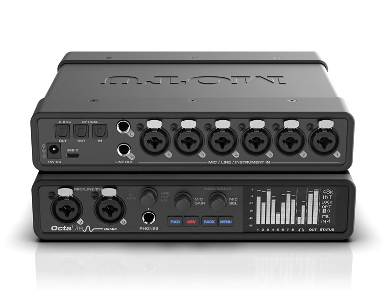

MOTU now distributes the OctaLite, a USB-C audio interface that packs eight microphone, line, and instrument preamps into a half-rack chassis. The American company sells it at a recommended price of $849.95 and targets mobile recording, home studio, and live applications.

The unit weighs 1.36 kg, features a steel chassis, and is powered by an included external 15 V DC power supply.

## The OctaLite, input by input

The connector layout aims to fit battery sessions, small ensembles, or out-of-studio shoots. Two combined XLR/TRS inputs are located on the front panel, while the remaining six move to the rear; all accept microphone, line, or high-impedance instrument signals without needing an external DI.

Each channel provides individual 48 V phantom power, a 20 dB pad, polarity inversion, and up to 74 dB of preamp gain. The 6.35 mm jack inputs declare 1 MΩ impedance, a value that MOTU highlights as useful when connecting multiple guitars directly.

## From measured specs to real-world use

The analog section combines Burr-Brown operational amplifiers from Texas Instruments with ESS Sabre32 conversion. MOTU identifies the output DAC as ES9026PRO, citing 125 dB of A-weighted dynamic range, −114 dB THD+N unweighted, and a maximum of +21 dBu on balanced line outputs. Microphone inputs stay at 115 dB of A-weighted dynamic range and −129 dBu equivalent input noise, figures intended for low-output microphones.

The front-panel headphone output drops to 1 Ω impedance, and a white OLED display shows analog input/output monitoring and equipment status.

Computer connection is via USB 2.0 through a USB-C connector, with support for USB-A devices via cable or [USB-A to USB-C adapter](/noticias/usb-to-usb-c-adapter-guide/). On macOS no drivers are needed, and class-compliant mode allows connecting compatible Macs and iPhones/iPads without installing anything. With its own drivers, MOTU announces 2 ms round-trip latency at 96 kHz with a 32-sample buffer, a relevant figure if playing virtual instruments or amp simulations.

The compatibility list covers Mac with Apple silicon and Intel processors, plus Windows PCs with Intel, AMD, or Snapdragon CPUs.

For monitoring without routing through the computer, the OctaLite includes a DSP mixer with reverb, four-band parametric equalization, compression, and gating. The CueMix 5 app controls these settings from macOS, Windows, and iOS, with independent mixes for balanced monitor outputs, headphones, and loopback channels.

Input signals can be sent to the DAW dry or with processing applied, so the performer hears effects while recording a clean take. Three virtual mix buses expand routing for streaming and podcasting, and mobile devices can handle CueMix over Wi-Fi through a USB-connected computer on the same network.

## ADAT expansion and direct rivals

The optical port adds a second function to the product. By selecting the eight analog inputs as the source for the optical output, the OctaLite operates as an eight-channel preamp and converter for another interface or console with ADAT. A second optical output carries channels five through eight via S/MUX at 88.2 or 96 kHz, and the single optical input also accepts stereo S/PDIF over TOSLink.

The announced configuration of 16 inputs and 12 outputs applies to 44.1/48 kHz; it drops to 12 inputs and 12 outputs at 88.2/96 kHz, and to eight inputs and four outputs at 176.4/192 kHz.

Within the MOTU lineup, the OctaLite sits as a natural companion to the UltraLite-mk5, sharing microphone input circuitry with it; combined they offer ten mic channels. The firm also points to models 828 and 16A as possible expansion partners. With optional rackspace supports, an OctaLite and an UltraLite-mk5—or two OctaLites—fit into a single rack space, and the second option delivers sixteen mic inputs in 1U.

The eight-preamp optical-expansion segment already has references like the Focusrite Scarlett 18i20 and the Audient EVO 16. Against them, the OctaLite’s argument isn’t connection count but packing eight mic/line/instrument inputs into a half-rack, adding onboard effects, and switching between interface, mixer, and ADAT expander roles. The trade-off lies in outputs: it offers only two balanced line outputs, sufficient for simple stereo monitoring but scarce when working with multiple monitor pairs or routing much analog hardware. That those outputs are DC-coupled does allow generating control voltages for modular synthesizers from compatible software.

The package includes Performer Lite, Ableton Live Lite, more than 100 instruments, and 6 GB of loops and sounds.
