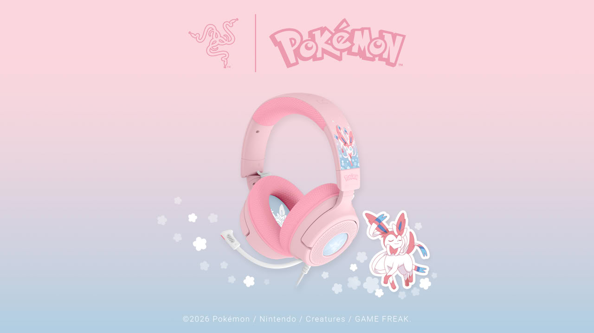
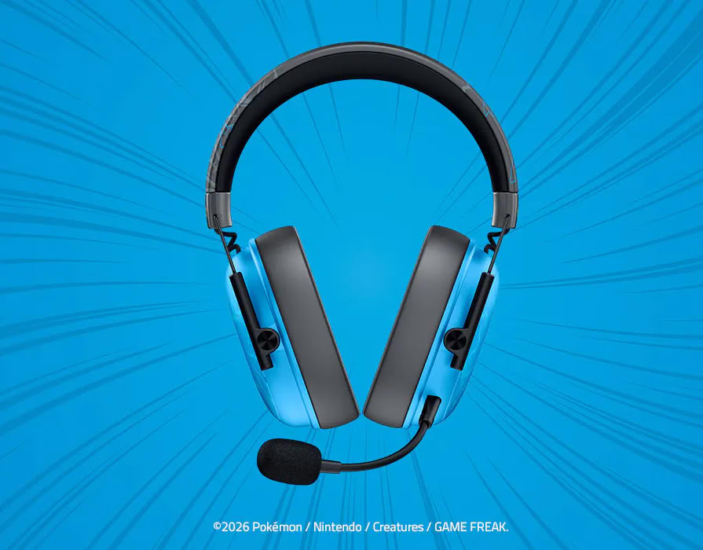
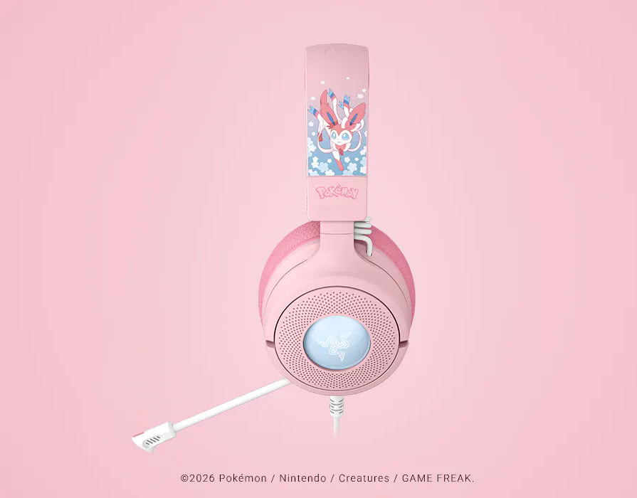

Razer has expanded its Pokémon peripheral collection with three licensed gaming headsets, developed in collaboration with The Pokémon Company International. The designs are inspired by Charizard, Lucario and Sylveon, arriving to celebrate the franchise's 30th anniversary. The press release does not detail prices or a launch date, so for now the only known data comes from each model's own platform page.

## Two wireless BlackShark V3 X HyperSpeeds and one wired Kraken V4 X

The three pieces do not share a base. The Charizard and Lucario editions are based on the **BlackShark V3 X HyperSpeed**, a wireless esports-style headset that combines **50mm TriForce Gen-2 drivers** with the brand's HyperSpeed Wireless connection. Razer presents both as low-latency solutions designed for competitive gaming, with the only difference between them being the character design.

The third model breaks this pattern: **Kraken V4 X** in Sylveon edition is a **wired** headset, finished in pink and blue, that drops to **40mm TriForce drivers** and adds a retractable HyperClear Cardioid microphone and Razer Chroma RGB lighting.

## What actually changes compared to the base model

It's worth separating what you see from what you hear. In the two BlackShark V3 X HyperSpeeds, the character edition affects the finish and packaging, not the acoustic platform: the 50mm Gen-2 drivers and the HyperSpeed Wireless module are the same as in the standard version, so frequency response and isolation should remain identical on paper.

The Kraken V4 X is a different starting point. Its 40mm driver is smaller, and since it's wired, it doesn't depend on a wireless link or its latency. That doesn't make it better or worse in itself: it marks a distinct profile, closer to home use than competitive play.

## The three Pokémon headsets, one by one

*   **Charizard Edition** on BlackShark V3 X HyperSpeed: wireless, 50mm Gen-2 TriForce driver and HyperSpeed Wireless connection.
*   **Lucario Edition** on BlackShark V3 X HyperSpeed: same base as the previous one, with a finish inspired by Lucario.
*   **Sylveon Edition** on Kraken V4 X: wired, 40mm TriForce driver, retractable HyperClear Cardioid microphone and Chroma RGB lighting.

## Is it worth it?

For anyone already looking for one of these models, the character edition doesn't alter performance: you're paying for the design, not an acoustic improvement. The real decision still lies in the format — 50mm wireless for competitive matches, wired 40mm for the desk — and how much weight the character carries against the price, which Razer has yet to publish. It's a move consistent with the rest of the collection: the brand had already brought Pokémon to other products, such as the [Beats Pill speaker with Pikachu design](/noticias/audio/beats-pokemon-altavoz-pill-pikachu/) that the brand hinted at these past days.
