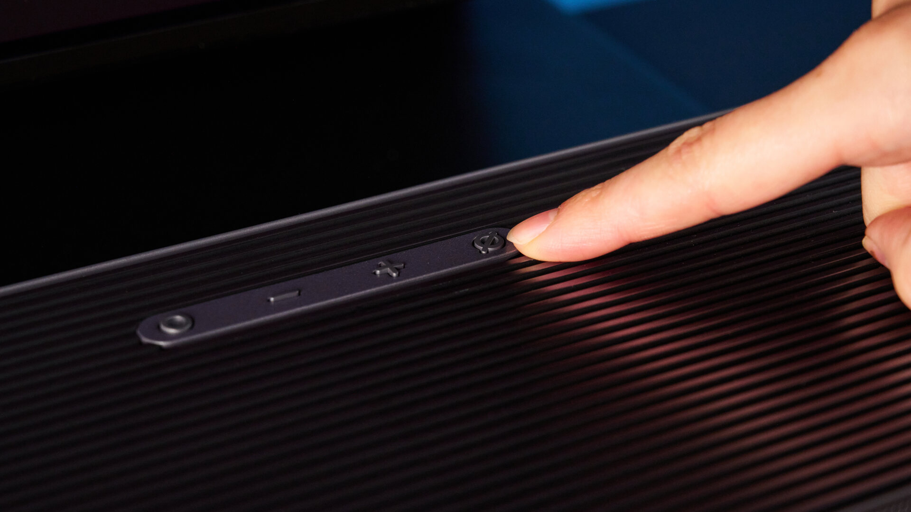

The Samsung Q990H combines **11.1.4 channels, a subwoofer and rear speakers**, but its channel count does not tell the whole story. The review by Erin Bashford published in Tom’s Guide on 23 October highlights dialogue clarity and bass punch, while finding room for improvement in Dolby Atmos’s sense of height. These are the conclusions of that outlet’s testing, not a TechSpain24 evaluation of its own.

## What the Samsung Q990H offers beyond Dolby Atmos

The [official Samsung spec sheet for the HW-Q990H/XU model](https://www.samsung.com/uk/business/audio-devices/soundbar/q990h-black-hw-q990h-xu/) confirms the 11.1.4 configuration, SpaceFit Sound Pro and 4K video passthrough at 120 Hz. That last feature lets you place the bar between a compatible source and the television without limiting the signal to 60 Hz. Compatibility across the rest of the chain is still required.

The system is not just one piece in front of the screen: it includes a subwoofer and two speakers for the rear of the room. Bashford explains that these paired automatically when switched on. **Wireless does not mean cable-free**: both the subwoofer and each rear speaker need mains power, though not an audio cable back to the bar.

It is an important distinction when planning the living room. Before choosing a set like this, it is worth thinking about where the speakers and their power sockets will go, not only how much space there is under the television.

## Voices and bass: the strengths in testing

In Tom’s Guide’s sessions, dialogue in *Top Gun: Maverick* was intelligible without engaging the voice enhancements, even with engines and music underneath. The author also highlights intelligibility in *The Batman*, a film with restrained voices and scenes that demand separation between dialogue and effects.

The result described matters especially to anyone who turns the volume up to catch a line and then has to turn it down during the action. It is not the same as a frequency-response or distortion measurement: it is a listening observation attributed to the reviewer.

Bass also gets a favourable verdict. Bashford reports a pronounced physical presence in the *The Batman* chase and music playback that kept vocals above the bass lines. Those impressions describe her room and her sessions; they do not guarantee the same weight or balance in any other home.

## Useful calibration, but a sense of height that does not fully convince

SpaceFit Sound Pro tailors the sound to the room. According to Tom’s Guide, the feature could be used with LG and TCL televisions: calibration was not restricted to a Samsung screen. The author perceived an improvement in centre-channel clarity with it enabled. That should not be confused with wireless audio connection to the television, whose compatibility needs a separate check.

The SmartThings app allows channel, subwoofer, bass and treble levels to be adjusted. However, Bashford notes that raising the rear and side channels did not make as much difference as she expected. Her main reservation is precisely that: a wide soundstage and convincing bass, but a sense of height and envelopment that does not always meet her expectations.

The reviewer finds the JBL Bar 1300X MK2 more enveloping. That preference is the outlet’s subjective comparison, not a universal ranking nor a comparison of Spanish prices. The mix of film, room and placement still matters more than a reading of the channel count in isolation.

## What to check before deciding to buy

The review’s balance favours anyone who prioritises intelligible voices, present bass and a set that includes rear speakers. For anyone above all seeking clearly elevated effects, the reservation about Dolby Atmos deserves attention before buying without listening to it.

It is also worth distinguishing it from other options, such as the [Teufel CINEBAR PRO 2 and its expandable rear-speaker configuration](/noticias/audio/teufel-barra-sonido-dolby-atmos-dts-x/): sharing Dolby Atmos does not mean including the same elements or distributing the channels the same way.

Tom’s Guide recommends considering the Q990H at a discount, but its page mixes references to list price and different retail offers. That is why those figures are not converted into euros here and no Spanish price is presented. Before comparing, check the exact regional reference, the contents of the box and the seller’s final price.

Images: Tom’s Guide; SmartThings screenshots: Samsung / Tom’s Guide.
