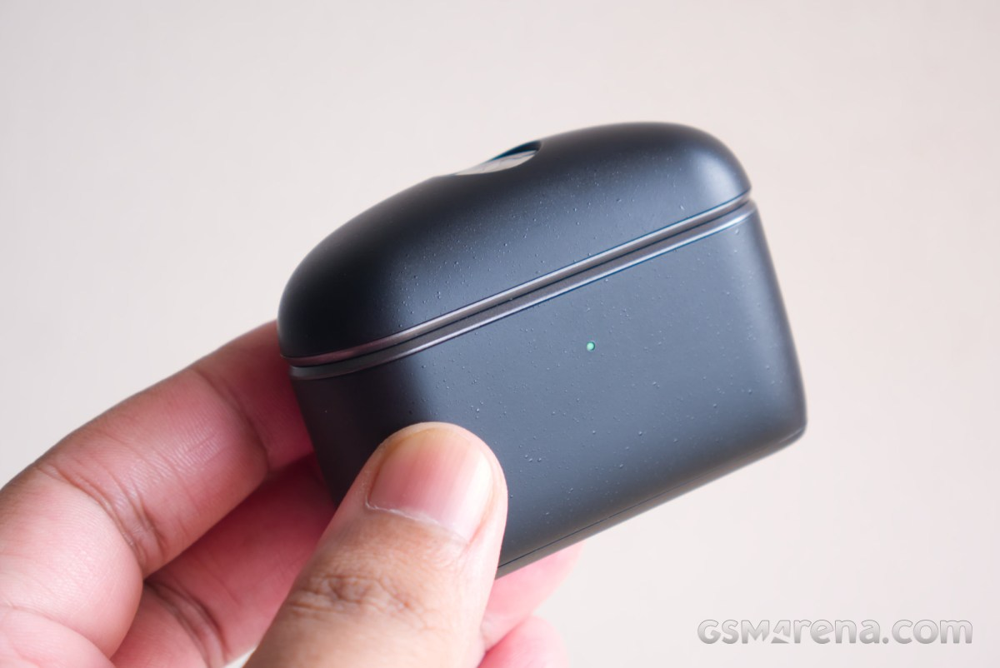
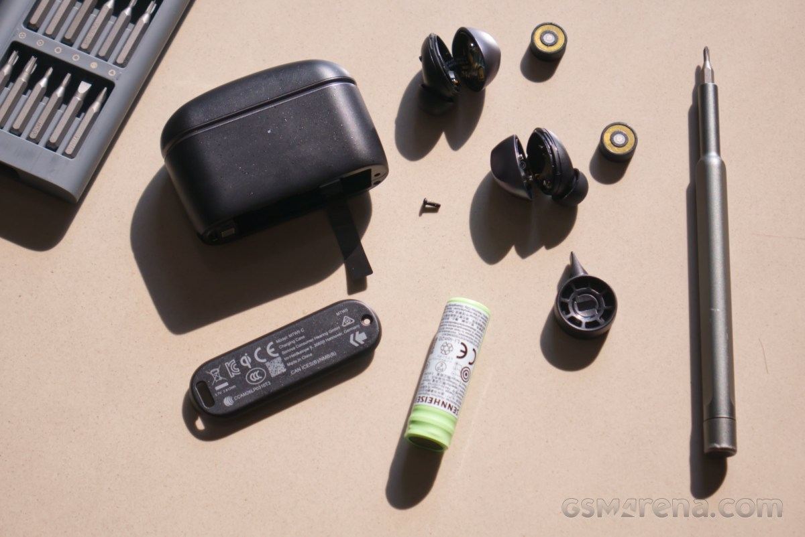
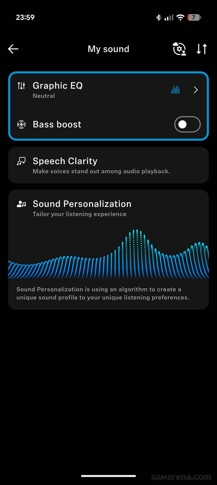
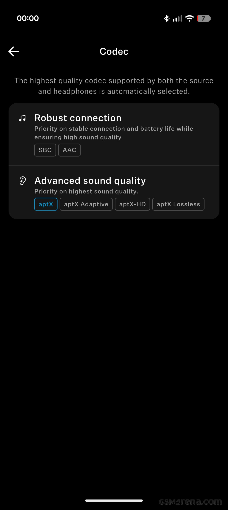

# Sennheiser Momentum True Wireless 5: $300 and a replaceable battery

The Sennheiser Momentum True Wireless 5 cost $300 and enter the same arena as the Apple AirPods Pro 3 and Sony WF-1000XM6. Their less common argument is not in the sound spec sheet: they are the first wireless earbuds from the brand with replaceable batteries, both in the earbuds and in the case. GSMArena has published its review and the conclusion is that we are facing a broad improvement over the previous generation, with two clear reservations: software and microphone performance in noisy environments.

## What changes in the Momentum True Wireless 5 compared to the previous model

The redesign is complete. The case is taller and thinner, much easier to carry in your pocket than the bulk of the previous model, and it abandons the textile coating for a matte plastic with a speckled finish. According to the review, that material stains less than fabric but attracts more fingerprints and conveys a less premium feel. The case also does not inherit the dust and water resistance of the earbuds — IP54 — and presents some creaking, especially at the hinge.

The earbuds, on the other hand, are noticeably smaller: the square design with fins disappears and a compact, rounded shape arrives without a handle. The fit is more superficial than on the Momentum True Wireless 4, which translates to comfort for long sessions, although GSMArena warns that handling them without a handle feels clumsier. They come in five colors: Graphite, Cream, Copper, Denim and Lavender.

In the acoustic department, the base is a 7 mm TrueResponse dynamic driver, the same type Sennheiser uses in much of its catalog, including several wired models.

## Isolation, transparency and microphone

Active noise cancellation works well but is not category reference. GSMArena places it below the AirPods Pro 3: it takes longer to adjust, probably due to a more modest processor, and in a test with one earbud of each model in each ear, more background noise leaked through the Sennheisers. The distance, however, is short, and the more superficial fit plays in favor of comfort.

The transparency mode is the weakest point of the system. Its level can be regulated and it activates only during calls, but the review points out that it prioritizes ambient sounds over voices: it is harder to understand who is speaking around you and yourself than with rivals. The microphone also splits into two scenarios. In a quiet room voice quality is very good, just behind the latest AirPods; with noise, the algorithm sacrifices the voice to leave the background practically silent, and the result sounds muted, with occasional cuts.

## Battery life and replaceable batteries

Sennheiser announces 12 hours of battery life, but that figure corresponds to noise cancellation deactivated. With ANC or transparency active, the promise drops to 6 hours. GSMArena measured 6 hours and 23 minutes with ANC on, in line with what was declared. Charging is via cable and wireless.

The real novelty is that those batteries are replaceable. In each earbud you must loosen two screws with a PH000 screwdriver and open the casing with the included spatula; the case only has one screw on the base. The review lists nuances of the procedure: the earbud screws are captive, but the case one is not; there is a flat cable between the two halves, so you should open just enough; the cells can be placed backwards if their orientation is not noted; and the plastic of the slots is soft, so some cosmetic marks may remain.

The limit lies in supply. The batteries are proprietary — model BA 501 for the earbuds and BA 502 for the case — and concrete availability information reduces to a vague statement about the European Union and "other selected countries." Long-term durability therefore depends on how long Sennheiser keeps those cells in catalog. Still, it is an advantage no direct rival offers today, and it changes the price calculation versus cheaper alternatives like the [Cambridge Audio Melomania A100 SE](/noticias/audio/cambridge-audio-melomania-a100-se/), which start from a much lower price.

## Tonal profile, codecs and software

The tuning leans neutral, with broad bass reinforcement that bleeds somewhat into the low mids, neutral mid-mids, a drop in the upper mids that extends through the low highs and mids, and an upper high zone of reinforced treble. The result is warm sound without being excessively deep and bright in the zone where sibilants appear, although that drop leaves some voices and instruments somewhat muted and pushes you to raise volume. According to GSMArena, it is the first thing to correct with the equalizer. Detail, imaging and stage are at a reasonable level, and Dolby Atmos mode with spatial head tracking well spatializes stereo sources, provided SBC, AAC or standard aptX are used: the switch stops working if Hi-Res settings are active.

The Smart Control Plus app (iOS and Android) is complete: 8-band equalizer with presets, Sound Personalization function, transparency level control, disableable anti-wind mode and a battery protection mode that prevents charging to 100%. It also allows setting the codec and shows which one is being used. In connectivity there are SBC, AAC, aptX up to 16 bits and 48 kHz, aptX Adaptive up to 24 bits and 96 kHz, and aptX Lossless at 16 bits and 44.1 kHz, plus multipoint.

There are two nuances worth knowing before buying. The first is that there is no real aptX HD, despite what the app screen mentions: GSMArena attributes it to a change in Qualcomm chips, which replaced HD with Adaptive. On non-Qualcomm mobile phones, like the Pixel series, the practical ceiling is aptX. The second is that the review itself downplays this codec race because in actual listening the difference is practically null.

Software, however, is indeed a problem. Noise cancellation activates and deactivates unevenly on each ear, transparency starts with very high volume before settling, automatic ANC level keeps correcting, transparency does not activate when you remove an earbud — nor does it allow doing so manually because it requires both placed — and clicking sounds appear when walking with ANC. On some occasions audio slowed down until the earbuds had to restart. There is also no pairing button on the case: you must take out the earbuds and hold their touch surface.

All in all, GSMArena's verdict is positive: they are very complete earbuds and a broad improvement over the previous model, with good sound, good isolation and comfortable fit. The $300 weighs, but the possibility of continuing to use them by changing the battery compensates part of the outlay. Whoever seeks best noise cancellation or best street microphone will find superior options; whoever values keeping the product for years has here an uncommon argument. To compare with the rest of the brand's catalog, the [Momentum 4 over-ear](/noticias/audio/sennheiser-momentum-4-oferta/) remains the option with much more battery life.
