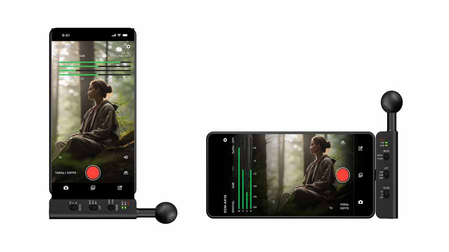

# Sony launches ECM-AX10, a spatial audio microphone that records directly to mobile via USB-C

Sony has announced pricing and availability for the ECM-AX10, a USB-C microphone designed to capture video with spatial sound directly from a smartphone. It weighs around 24 grams, requires no external recorder, and connects via Type-C: the phone itself powers it and captures audio.

In China it is already available for ¥1499, according to local outlet ITHome, while the European reference price Sony quotes is around €199, close to the ~€200 cited by its French subsidiary.

## What the ECM-AX10 captures: four capsules and three modes

It is not a lapel mic or a standard shotgun microphone: Sony positions it as a spatial capture accessory. It carries four omnidirectional capsules that collect sound from multiple directions, along with processing designed to preserve the sense of direction and space. This matters when recording performances, events, or an environment’s ambience, where a phone’s built-in microphone tends to flatten everything into a single foreground.

There are three ways to record. The Ambisonics mode captures directional information for production and can be exported via Sony’s app as Eclipsa Audio content for YouTube. Binaural aims at immersive headphone listening. Stereo is the most conventional option for everyday videos and social media posts. The device includes physical buttons to switch between spatial and stereo modes.

According to ITHome, the microphone adds a 6-axis motion sensor that detects its orientation and automatically adjusts horizontal or vertical mode accordingly. The box includes a windscreen, a cold shoe mount, an extension Type-C cable, and spacers.

## USB-C does not guarantee compatibility

Having a USB-C port on the phone is not enough for full functionality. Sony has published a list of tested phones and warns that quality may vary by device. In software terms it requires iOS 18 or later, or Android 14 or later. The dedicated app, Spatial Audio Video Tool, covers recording, clip review, basic editing, and spatial audio export; some features depend on it, so the phone’s requirements weigh as much as the microphone itself.

The ECM-AX10 can also be used with general recording and video apps, though in that case available functions fall to the software. For someone starting out, mode choice depends on how the result will be heard: stereo is direct, binaural is intended for headphones, and Eclipsa Audio needs compatible playback to deploy its spatial effect.

## Price and availability

In China the ECM-AX10 is already available for ¥1499, around €180 at current exchange rates, per ITHome. The European reference price is around €199, with Sony’s French subsidiary pointing toward ~€200. 4K recording support is expected from December onward.

Is it worth it? It depends on the type of video. For single-source narration, a handheld USB mic like the [Shure MV6 Gen 2](/noticias/shure-mv6-gen-2/) solves it with one piece and without relying on an app. The ECM-AX10 justifies itself when the goal is to capture space —a performance, an event, a soundscape—and whoever views it will use headphones or spatial audio support. Without that, the advantage over the phone’s microphone falls halfway.
