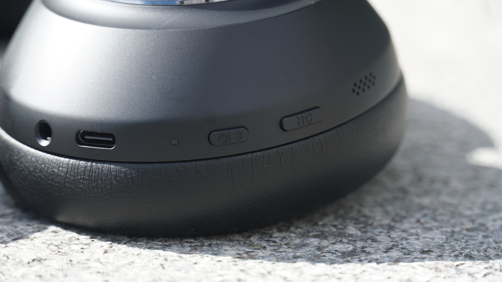

The **Anker Soundcore Space 2 Pro** cost €199.99 in the brand's official Spanish store, the same list price Trusted Reviews works with in the United Kingdom and the United States (£199.99 and $199.99). They are over-ear headphones with adaptive noise cancellation, a Thus AI chip for calls and up to 60 hours of battery life without ANC. The British outlet's review, written by Kob Monney and published on 26 October, gives them four stars out of five.

It is worth clarifying that this is not a launch from today. The Space 2 Pro reached the market in September, and what is being published now is the full review, after four weeks of real-world use. The conclusion can be summed up in one sentence: these are excellent headphones for work and for calls, and considerably less advisable if what you are after is tonal fidelity.

## Noise cancellation and calls: where the Space 2 Pro earns its place

Cancellation depends on the seal more than on other models. With the slightest gap in the earpad, noise comes in as if through a half-open window. When the fit is correct, the adaptive system works reliably and without the hum that sometimes accompanies this technology: it cuts traffic and the bustle of stations and indoor spaces without the ear noticing the processing. The review tested it on journeys through Canary Wharf and on a plane, with some wind noise outdoors and a slight vibration in the right earcup as the only issue.

Transparency mode does its job without shining. It is not the sharpest on the market, but it lets you hear what is happening around you without taking the headphones off. Against the direct competitor the outlet uses as a reference, the JBL Live 780NC, cancellation lands at a similar level: the JBL isolate a little more, the Soundcore do it more naturally.

Calls are where there is no argument. The Thus AI chip, the same one the brand uses in the Liberty 5 Pro and 5 Pro Max, governs a set of six microphones with real-time voice separation. In a test call that went through the London light railway, a supermarket and a crowded restaurant, the person on the other end heard only the journalist's voice, with no background noise. Trusted Reviews rates it as the reference standard in this price range, and that is the claim that has to be attributed to them: it is their measurement, not a test of our own.

## The problem is in the bass

The tonal profile is the debatable part. Against the Space 2, the Pro is a clear improvement: bigger, weightier bass and more detailed treble. Against the JBL Live 780NC, which already have a sound with forward bass, the Soundcore go quite a bit further. The boost is noticeable in the low-mid range, thickens the transition between bass and mids and overemphasises male voices, less so female ones. On tracks with a lot of sub-bass the punch impresses; on more delicate recordings the result turns boomy and loses nuance. The outlet cites two specific examples: “Garden Song”, by Phoebe Bridgers, flirts with saturation, while “Regulate”, by Warren G, makes the most of that energy.

Not everything is excess. The soundstage is wide, the treble is bright without being harsh and voices have a soft clarity that holds up well over long sessions. What is missing is balance: kick drum hits turn into dull thuds and subtlety in the low frequencies is lost. For anyone coming from consumer headphones with boosted bass, the jump is coherent; for anyone expecting neutrality because of the Pro surname, the sound signature falls short.

Anker released a firmware update that retunes the curve and tempers the bass somewhat, but it arrived too late to count towards the score. The review could only do a brief listen with that version, enough to appreciate the correction, not to redo the measurements. It is a relevant point for a purchase: the sound described here may not be exactly what someone who updates the product will get.

## Battery life, controls and spec sheets that do not add up

The battery delivers what the manufacturer promises, which does not always happen with recent Soundcore models. It is 60 hours without cancellation and 30 with it enabled, and the outlet verified the second figure with a three-hour discharge at 50% volume using AAC over Bluetooth. With LDAC, which is more demanding, battery life should drop. Fast charging adds eight hours from five minutes plugged in. The official Spanish spec sheet adds 20 hours of talk time, a useful figure for anyone who uses the headphones mainly for meetings.

On build, the Space 2 Pro repeats the house formula: physical buttons instead of touch controls, with power and ANC on the left earcup and playback and volume on the right. They are easy to find by touch and every press is confirmed with a click. The headband adjusts in steps, not continuously, and the mechanism makes some noise when you move it. The stated weight is 262 grams and comfort is one of the strong points: the earcups leave room, pressure on the head and ears is low and they can be worn for several hours without fatigue. They fold for travel, although the package includes a fabric pouch and not a hard case.

There are more features than are used day to day: LDAC, multipoint for two devices (not usable at the same time as LDAC), wear detection, safe hearing and an eight-band equaliser. HearID 5.0 requires creating an account, and spatial audio mode, according to the review, is better left off because it widens the stage at the cost of thinning out the sound. The app also caused problems: at one point it stopped recognising the headphones despite them being connected, and they had to be unpaired and paired again.

On top of that, the spec sheets do not match each other. The review text mentions Bluetooth 6.1, while its own specification table lists 5.1. The manufacturer's Spanish page includes “intuitive touch control” and “IP57 resistance” in a block of additional features, two lines that fit neither the physical buttons the review describes nor its table, which does not grant the model an IP rating. The colours do not match either: the review mentions black and midnight grey, and the Spanish store adds linen white. These are spec-sheet details worth double-checking before buying, not defects of the product itself.

## Verdict: who it is for and who it is not

| Profile | Verdict |
| --- | --- |
| Office and work | Yes. Cancellation covers voices and keyboards in an open-plan space, and comfort lasts the working day. Requires a good seal. |
| Calls and meetings | Yes, with caveats. It is their strongest argument, and the microphones isolate the voice even in noisy environments. |
| Travel | Yes, if travelling light. 30 hours with ANC and they fold, but there is no hard case and battery life drops if LDAC is used. |
| Critical listening and fidelity | No. The bass boost and the lack of balance weigh more than the wide soundstage. |

Against alternatives, the Space 2 Pro sits in a middle zone. They cost less than half of a pair of [Sonos Ace Ultra](/en/news/audio/sonos-ace-ultra-review/) at $449 and offer a better microphone and more battery life; in exchange, the Sonos are more neutral and their ecosystem is more closed. And anyone who prioritises battery life above all else has the [Sennheiser Momentum 4](/en/news/audio/sennheiser-momentum-4-deal/), with 60 hours with ANC and deals below $250 in the United States.

The final assessment is sober: for €199.99, the Space 2 Pro handles work and calls very well, which is exactly what their spec sheet promises. Anyone looking for headphones to listen to music with maximum fidelity should try them first or look elsewhere, because the excess bass is not a minor detail in a signature that aims at the upper mid-range.
