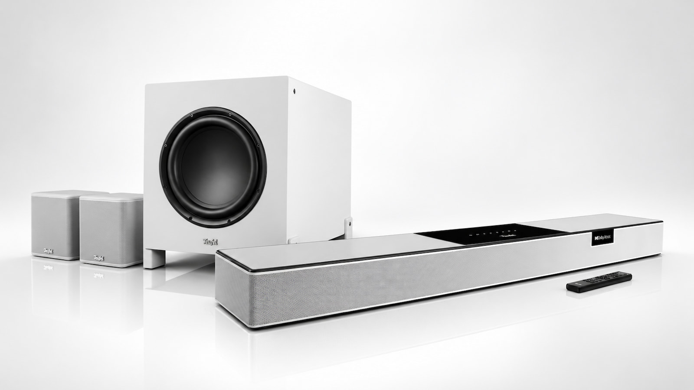

Teufel's new CINEBAR PRO 2 is its most ambitious soundbar to date and is already available in Spain from €1,199.99 in its Select configuration. The basis of the proposal is a 5.1.2 configuration with ten transducers, 232.5 W RMS of Class D amplification and a wireless subwoofer; adding two rear speakers, the system moves to 7.1.2 channels.

## The soundbar mounts ten speakers, two pointing at the ceiling

What distinguishes this soundbar from a system that simulates surround sound via processing is the physical distribution of its speakers. On the front it mounts three coaxials, each with its tweeter and its mid-woofer aligned on the same axis, designed to better fix the position of voices even if we are not sitting directly in front of the television. To them are added two side speakers and two 3.5-inch speakers oriented towards the ceiling, which bounce the sound to reproduce the height effects of Dolby Atmos and DTS:X.

Teufel also resorts to Dynamore, its processing technology, to widen the sound scene. The bar supports Dolby TrueHD, Dolby Digital Plus, DTS-HD and DTS Digital Surround, so it is not limited to the usual compressed formats of streaming.

## HDMI 2.1, eARC and network music

In connectivity, the CINEBAR PRO 2 includes two HDMI 2.1 inputs and one HDMI eARC with CEC, in addition to optical input, auxiliary and Ethernet. This allows connecting players or consoles directly to the bar and receiving the television's audio through eARC. The brand does not specify whether those HDMI 2.1 ports maintain 4K at 120 Hz or VRR, a relevant detail for anyone who wants to pass the signal of a new-generation console through here.

For music, it integrates AirPlay 2, Google Cast, Spotify Connect, TIDAL Connect and TuneIn via Teufel Home, and adds Bluetooth 5.3 with AAC. Handling is distributed between the remote, the app, the touch controls on the bar itself and a small OLED screen, with five sound modes: Movie, Music, Game, Voice+ and Night.

## 10-inch subwoofer and up to 7.1.2 channels

The T 10 Mk2 subwoofer incorporates a 250 mm (10-inch) driver with 150 W of amplification and descends to 31 Hz at -3 dB. It connects wirelessly and its speaker can be oriented forwards or towards the floor depending on how it is placed. Anyone who wants physical rear channels can add the EFFEKT 2, also wireless, with which the configuration moves from 5.1.2 to 7.1.2 and the rear surround effects stop depending solely on the bar.

The prices of the various sets are as follows:

| Configuration | Subwoofer | Price |
| --- | --- | --- |
| CINEBAR PRO 2 (5.1.2) | T 10 Mk2 | €1,299.99 |
| CINEBAR PRO 2 Select (5.1.2) | T 8 | €1,199.99 |
| 7.1.2 Set with EFFEKT 2 | T 10 Mk2 | €1,649.99 |
| 7.1.2 Select Set with EFFEKT 2 | T 8 | €1,549.99 |

All packs are available in Spain in black or white finish.

## Is it worth it?

The jump compared to a conventional soundbar is supported by two concrete data points: real height speakers instead of a processing simulation, and a subwoofer that goes down to 31 Hz. The unknown, as with almost any system that bounces sound off the ceiling, is the room acoustics: the height and material of the ceiling condition the result quite a bit. For a small living room, a compact proposal like the [Sonos Beam Ultra](/noticias/audio/sonos-beam-ultra-analisis/) covers needs without occupying space, while anyone looking for physical rear channels and real bass will find in this CINEBAR PRO 2 and the [JBL Cinema SB Mk2](/noticias/jbl-cinema-sb-mk2/) two different paths within the same price range.
