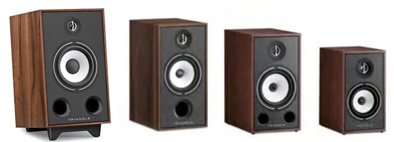

A **21 cm** midrange/bass driver is the main new feature of the **Triangle Borea BR05**, two-way passive speakers that expand the Borea family with a larger format and retro styling. The official specifications confirm a 25 mm EFS tweeter and two front bass-reflex ports. The addition, covered by [eCoustics on October 19](https://www.ecoustics.com/products/triangle-borea-br05-bookshelf-speakers/), retains an important distinction for anyone putting together a system: the speakers need external amplification.

## Borea BR05: a larger driver, not a smaller cabinet

Triangle developed a natural cellulose-pulp cone driver for this model, handling both bass and midrange frequencies. It is paired with an EFS silk-dome tweeter with a phase corrector, while the crossover divides their work at **1,700 Hz**.

A comparison with [Triangle’s own Borea BR04](https://www.trianglehifi.com/products/borea-br04) helps put the change in context: those speakers use a 16 cm driver and specify a response starting at 44 Hz; the BR05 advertise **42 Hz–22 kHz, with a ±3 dB tolerance**. That is a specification-sheet difference, not proof that the new speakers sound better in every room.

The cabinet is larger too. Each BR05 measures **300 × 490 × 345 mm**, without its base, and weighs **14.6 kg**. The BR04 measures 220 × 425 × 314 mm and weighs 8.6 kg per speaker. The bookshelf label should therefore not be mistaken for a small product that fits any piece of furniture: measuring the space and checking the stand’s load capacity is advisable.

## Two front ports and bracing to counter vibrations

The BR05 use MDF panels up to 21 mm thick, two additional internal braces and Triangle’s DVAS architecture. According to the manufacturer, this structure aims to dissipate mechanical energy and limit vibrations reaching the cabinet.

Both bass-reflex ports are at the front. Triangle explains that splitting airflow between them helps reduce turbulence and noise at high levels. That is the design objective, not a measured result in this report: we have not conducted a listening test or checked distortion. The ports’ orientation alone cannot guarantee balanced bass in every placement either.

## External amplifier and five finishes

The specifications list **90 dB** sensitivity, **8-ohm** nominal impedance and a **4.7-ohm** minimum. Triangle recommends amplifiers delivering **25 to 130 W RMS per channel into 8 ohms** and rates the cabinet’s power handling at 120 W. That last figure is not built-in output power: the BR05 do not contain an amplifier.

This is a different proposition from the [active PSB iQ2 with BluOS](/noticias/psb-iq2-altavoces/), which combine amplification and playback features in the speakers themselves. Here, the choice of amplifier and source forms part of the budget. Dual binding posts allow bi-wiring or bi-amping in compatible configurations.

The available finishes are light oak, black ash, chestnut, green and frosted white. Magnetic grilles and bases are included; as an alternative, Triangle offers optional S03 stands with an 8-degree tilt toward the listener.

## Price per pair and market-specific availability

The [manufacturer’s French store](https://www.trianglehifi.fr/products/borea-br05) shows **€749 per pair** when checked on October 20. Meanwhile, eCoustics reports suggested prices of **$999 for the United States and £729 for the United Kingdom**, also per pair, not per speaker. The outlet lists S03 stands at $299, £225 or €249 per pair as a separate purchase.

These references do not confirm stock, final pricing or a delivery date in Spain. Assessing the complete system requires adding the electronics and, if chosen, the stands. The BR05’s appeal lies in offering a larger driver within the series without moving to a floorstanding speaker; deciding whether the extra space and cost are worthwhile requires something specifications cannot settle: listening to the system under comparable conditions.
