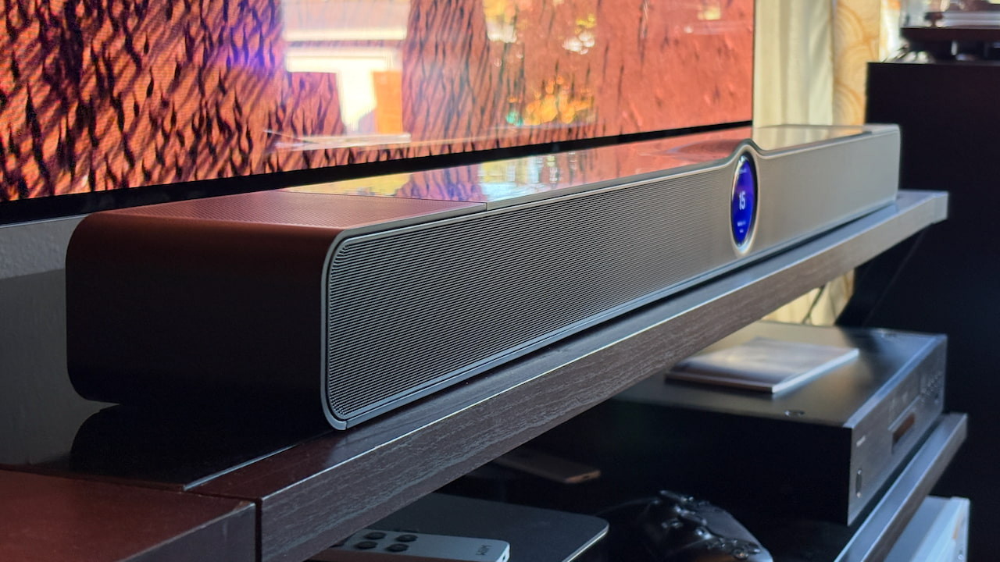
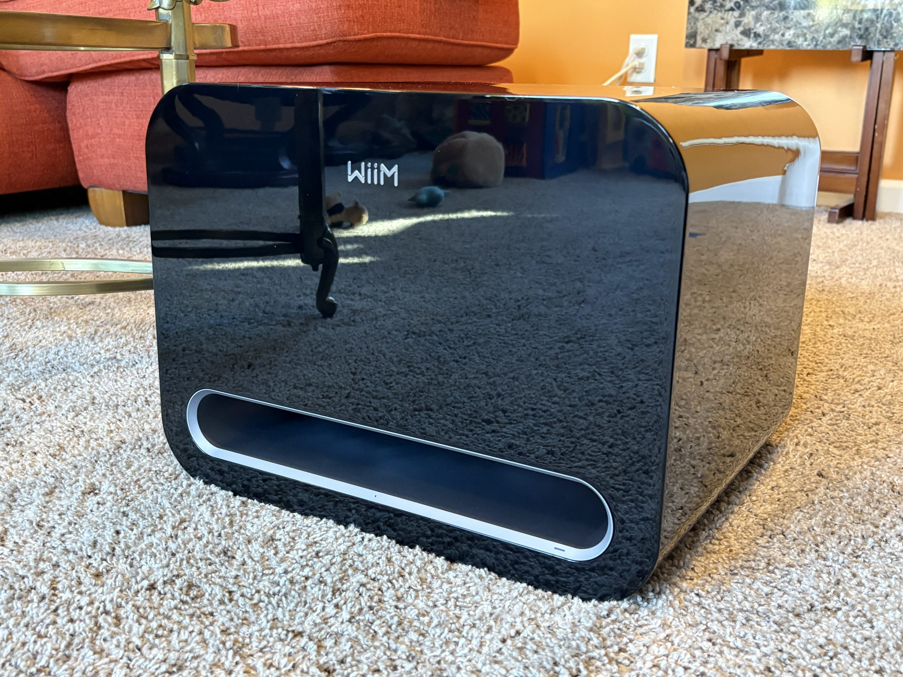
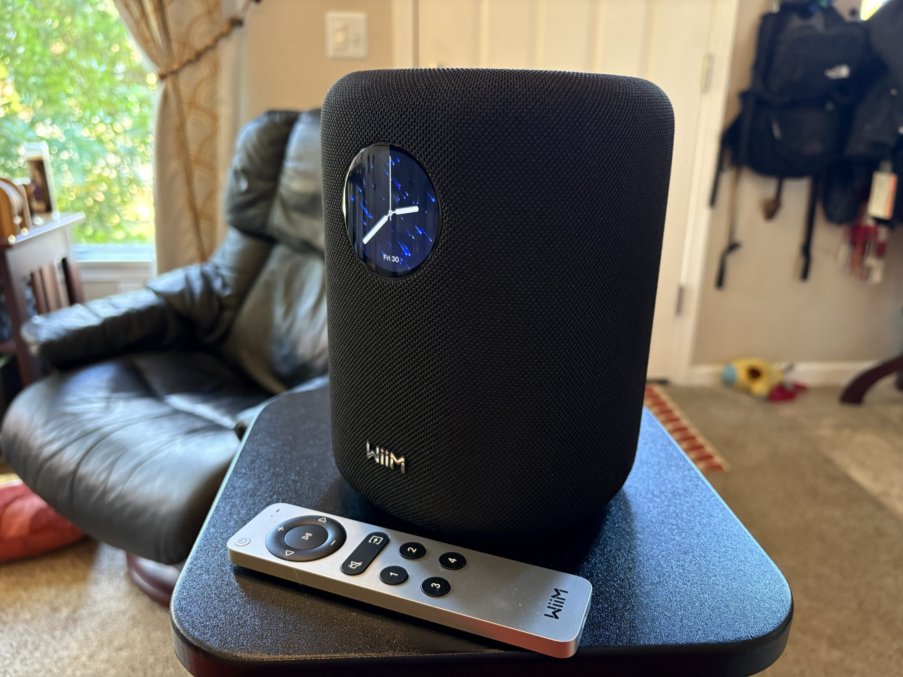

# WiiM Bar Review: $479 Dolby Atmos Soundbar That Wins on Music but Loses on Cinema

The WiiM Bar costs $479 and brings to the living room the formula that WiiM already applied in its network amplifiers and speakers: proprietary software, more-than-enough connectivity, and a price below the current rival. In this case, the rival is obvious, because the comparison with Sonos appears on the first line of the analysis that eCoustics has published about the model. The price difference versus the [Sonos Beam Ultra](/noticias/audio/sonos-beam-ultra-analisis/), which Sonos sells for $699, is $220.

The problem is that a Dolby Atmos soundbar is judged by what it does with cinema, and there the analysis is clear: the WiiM Bar delivers a wide scene and clean sound, but compresses the densest moments too much. eCoustics describes it as a system with many advantages that ends up in an uncomfortable position due to design decisions, and above all, due to an overly aggressive limiter.

## What the WiiM Bar Offers: 3.0.2, Screen and App

The hardware is that of a mid-to-high-end soundbar, not a toy: three 2.05-inch tweeters at the front, three 4.33 × 2.05-inch woofers, two 2.05-inch height speakers on the top face, and 135 W of amplification. The resulting configuration is 3.0.2, with four passive radiators that help sustain bass without a subwoofer. Dimensions are 106 cm wide, 10.4 cm deep, and 7.9 cm tall — a format that calls for a deep stand and a large TV in front.

The glossy black top finish and the 2.1-inch touchscreen are the product's hallmarks, and also its two most debated points in the analysis: both reflect light and the screen tends to visually invade the lower area of the TV. In exchange, that screen combines with the WiiM app and an included aluminum remote, so there are several ways to control the bar without relying on a phone.

The app concentrates setup and RoomFit calibration, and it is also where the brand's character shows: many options and a learning curve that lengthens as speakers are added. The bar can be expanded to a 5.1.2 system with the WiiM Sound and Sound Lite models as rear channels and the Sub Pro subwoofer.

## Dolby Atmos: Height Yes, Dynamics No

The two upward-firing speakers deliver: the analysis recognizes them for reasonable vertical extension given the size of the bar. The problem appears when the soundtrack gets complicated. With scenes that have heavy load in the height channel, the system cuts peaks and compresses dynamics, and that effect ends up reaching the center channel as well, where dialogue lives. eCoustics checked this with *Our Planet* and *Mad Max: Fury Road*, two usual references for measuring atmosphere and impact.

It is a measurable behavior, not an impression: the bar flattens the difference between a whisper and an explosion right when that difference IS the effect. WiiM acknowledged the problem to eCoustics and said it is working on it; according to their explanation, it appears mainly at high volume, although it can also occur in scenes with heavy processing. The brand admitting it is a good sign of support, but it doesn't turn today's limitation into a virtue.

In other formats the picture is more friendly. The bar supports DTS and DTS:X, as well as Dolby Atmos over TrueHD, and leaves out Dolby Atmos Music natively. In bass it gets a just-passing grade: the cut in the mid-bass area comes early and doesn't match the punch of the Beam Ultra. The tonal profile, however, is colder than Sonos's and never reaches being strident, something that is appreciated during long listening sessions.

## Connectivity and Streaming, the Strongest Argument

Here the WiiM Bar has little to envy anyone. The input section includes HDMI eARC, optical, USB, Ethernet, and even analog RCA for older equipment — a combination uncommon in this price range. In wireless there is Bluetooth 5.3 and Wi-Fi, with Spotify, Tidal Connect, Amazon Music, YouTube Music, Deezer, and TuneIn among compatible services, plus Google Cast, Amazon Music Cast, and UPnP.

The absence that stands out most is AirPlay, and with it Apple Music: whoever has the Apple ecosystem set up at home will have to resort to Bluetooth or another input. It is the only relevant gap in a section that eCoustics rates 4.5 out of 5, the highest score in the analysis.

## Is It Worth It Versus Sonos?

eCoustics' notes draw the product profile well: performance 3 out of 5, build quality 3.5, features 4.5, and value for money 3. The analysis conclusion is nuanced. For series, sports, news, and music, the WiiM Bar sounds very good and its ecosystem of speakers and subwoofer adds value for what it costs. For cinema with Dolby Atmos or DTS:X as a priority, it doesn't reach the level expected from a bar that boasts spatial audio.

The alternative proposed by the analysis is double. Whoever stays in the Sonos universe has the Beam Ultra; whoever has decided to leave it and doesn't need networking features can look at the Klipsch Flexus Core 200 and 300. In the Spanish market there are also other options with Atmos and DTS:X, such as the [Teufel CINEBAR PRO 2](/noticias/audio/teufel-barra-sonido-dolby-atmos-dts-x/), although in a different price league.

On the expenditure, eCoustics only publishes the US price: $479 at Amazon, Best Buy, and Crutchfield. The analysis does not indicate a euro price or availability in Spain, so any euro figure circulating should be checked before accepting it as correct.

The final reading is simple: if the TV is used mainly for daily content and music weighs on the decision, the WiiM Bar is a reasonable and very complete purchase in connectivity. If the goal is to squeeze Dolby Atmos, today it's better to wait for WiiM to solve the compression or look toward another bar.
