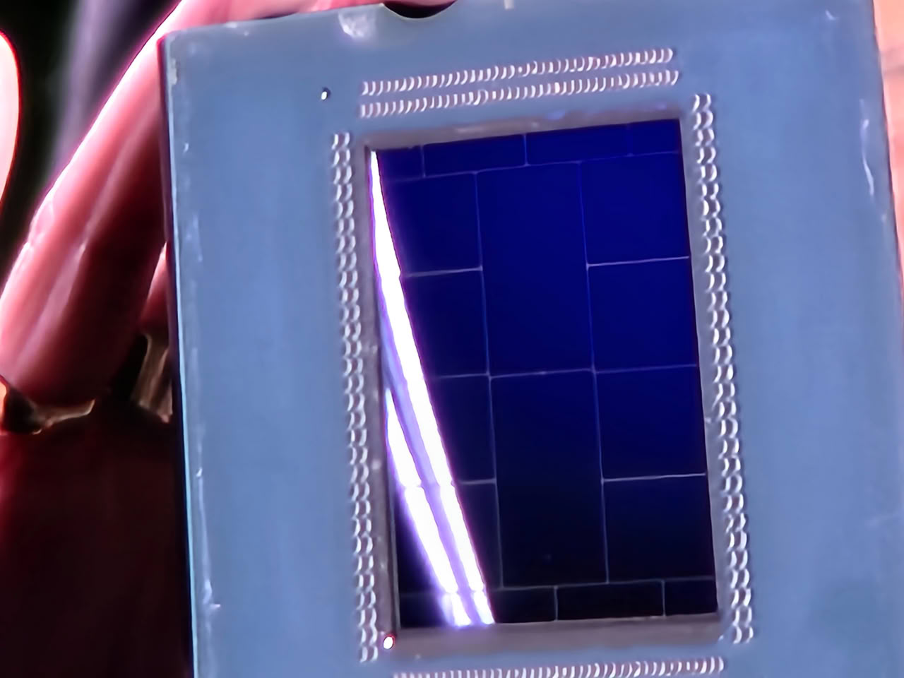

The deciding figure is double: it's the first EPYC to support LPDDR5X memory via SOCAMM2 modules, and its core count jumps from the initial 72 to a maximum of 192. For those building systems, the news isn't just about how many cores fit in, but that the platform changes: Verano relies on the new SP8 socket, not the SP7 used by "Venice" EPYCs.

## The EPYC Veranos: 192 cores and LPDDR5X via SOCAMM2

"Verano" lives within the EPYC 9006 "LP" family and is manufactured on TSMC's same 2 nm process as the already-launched "Venice" EPYCs. The difference in focus is what matters: while "Venice" is the first EPYC on Zen 6 architecture, "Verano" is tuned for AI loads in agent AI racks, with a low system power idea and CPU-to-GPU bandwidth as the main argument. AMD pairs it with its own Instinct MI500 GPUs via xGMI links of up to 112 Gbps.

Memory is the other leap. By adopting LPDDR5X on replaceable SOCAMM2 modules, AMD follows the path already opened by NVIDIA's Vera CPU. In the projected slide, the company summarizes the chip with three promises—lower system power consumption, the highest CPU-GPU bandwidth in its catalog, and up to 192 cores—and a date: availability expected for 2027, with the first half of that year marked on the presentation itself.

## Eight CCDs and four memory controllers

The 192 cores leave a workshop question open: one large chip or two of 96? The analysis circulated by System360Cheese on X points to the piece shown carrying eight Zen 6 CCDs alongside two large I/O dies and four LPDDR5X memory controllers. The interesting detail is that those CCDs appear smaller than the Venice Zen 6C ones, suggesting standard 12-core Zen 6 dies rather than the compact 32-core variants. Fitting more cores into the same socket without bulking up the package is precisely the thermal challenge for this class of chips.

The announcement comes after AMD revealed its Helion rack, a system designed on Open Compute Project specification where Verano integration is expected.

## What it implies for building

For the builder, the lesson is always the same in servers: the socket rules. A jump to SP8 drags along motherboard, mounting bracket, and heatsink, and none of those parts inherit compatibility from SP7 or the SP8 of "Venice," just as the possible SB1 that had been pointed out for Verano cannot be taken for granted. SOCAMM2 memory is good maintenance news because it replaces without soldering, but conditions the motherboard and chassis airflow: in a rack, it's not enough for the processor to fit; the whole assembly must be validated.

The declared destination is AI racks, not the desktop tower, so today you read it as a roadmap and not as a purchase piece. If you are looking at an EPYC platform for a server, stick with what's already sold—like the [ASRock Rack for EPYC 8005 Sorano](/noticias/asrock-rack-sorano-epyc-8005/)—and follow closely [the trail of Verano's socket](/noticias/componentes/amd-epyc-verano-sb1/) before reserving budget for 2027.
