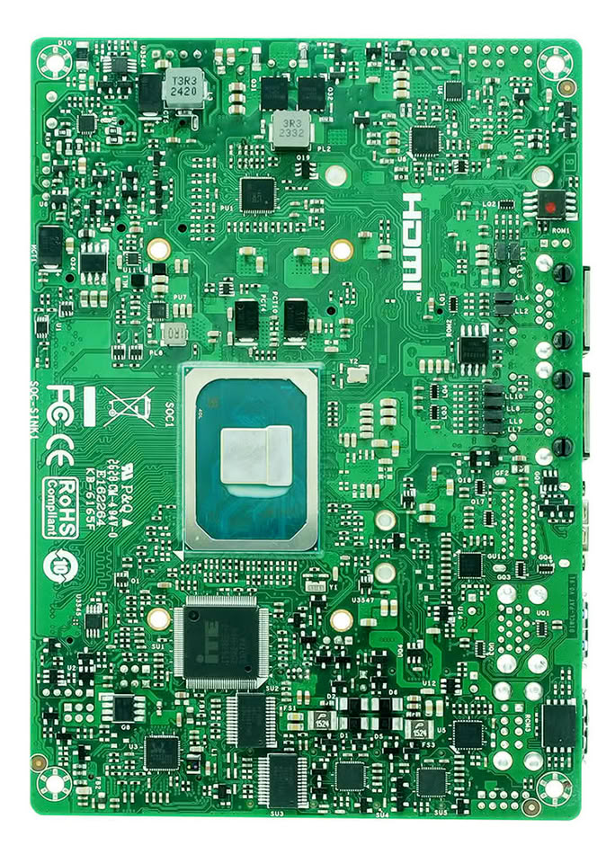

Biostar has presented the BIWCL-PAT, a compact industrial motherboard (148 × 102 mm) designed to integrate into equipment with limited space. TechPowerUp reports the news based on a press release from Biostar itself, and it is advisable to read it with the mindset of someone who will assemble the system rather than just comparing specs: in this segment, what decides is not aesthetics, but size, connector layout, and thermal headroom.

## The BIWCL-PAT, an industrial board for integration

The BIWCL-PAT starts from Intel Core Series 3 processors, codename Wildcat Lake, with options ranging from the Core 3 to the Core 7. Memory is handled by a single DDR5-6400 SO-DIMM slot up to 64 GB, the same standard already used by modules designed for the embedded market, [such as the 64 GB CUDIMM and CSODIMMs presented by Transcend](/noticias/transcend-ddr5-6400-industrial/). That single slot is a real limitation worth keeping in mind: there is no dual-channel, so performance will depend on how much bandwidth the workload requires.

Power supply accepts a range of 9 to 24 V DC, which allows reusing industrial power supplies without adding conversion stages, and the declared operating temperature ranges from 0 °C to 60 °C. These are two data points that weigh more than they seem when the board ends up inside an electrical cabinet or an unventilated box.

## Triple screen and three M.2 slots

The platform can drive three independent displays via LVDS, HDMI, and DisplayPort. HDMI 2.1 and DisplayPort 1.4 reach 4K at 60 Hz each, while LVDS is intended for embedded panels up to 1920 × 1200. This is a common combination in control terminals, where it is interesting to separate the operator interface from status data.

For storage and connectivity there are three dedicated M.2 slots: one Key-M for NVMe SSDs 2242/2280 over PCIe 4.0 x2, one Key-B for 4G/5G modules 3042/3052 over PCIe 4.0 x1 and USB 3.2 —with space for an integrated SIM— and one Key-E 2230 for Wi-Fi and Bluetooth modules.

In networking, it incorporates two Intel 2.5GbE ports with I226-LM and I226-V controllers. Having two separate interfaces allows isolating the local network of the machine from the upstream network, a detail that in isolated installations usually decides whether a switch needs to be added.

## Industrial ports and operating system

Alongside more modern connectors, the BIWCL-PAT maintains those truly used on the factory floor: two USB 3.2 Gen 2, four USB 2.0, two RS232/422/485, two RS232, and an 8-bit digital I/O header. With that, peripherals such as barcode readers or industrial controllers can be connected without resorting to adapters.

The board also integrates TPM 2.0 via hardware and declares compatibility with Windows 11 IoT Enterprise 24H2 or later and Ubuntu 24.04.

## What to check before assembling it

Before deciding, three things should be checked: that the chosen panel or monitors fit the output intended to be used (LVDS and HDMI/DisplayPort are not interchangeable), that the case leaves physical room for the three M.2 slots, and that the power supply delivers within the 9 to 24 V range.

And a workshop warning: with a single SO-DIMM slot there is no dual-channel, so in bandwidth-sensitive loads —several containers or local data processing for AIoT— sizing the 64 GB of memory matters more than on a desktop board.

