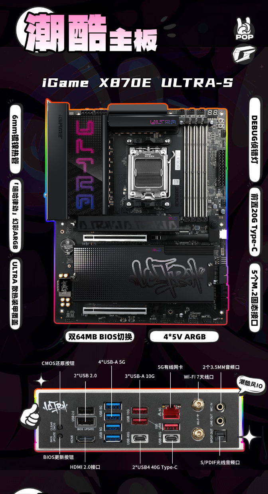
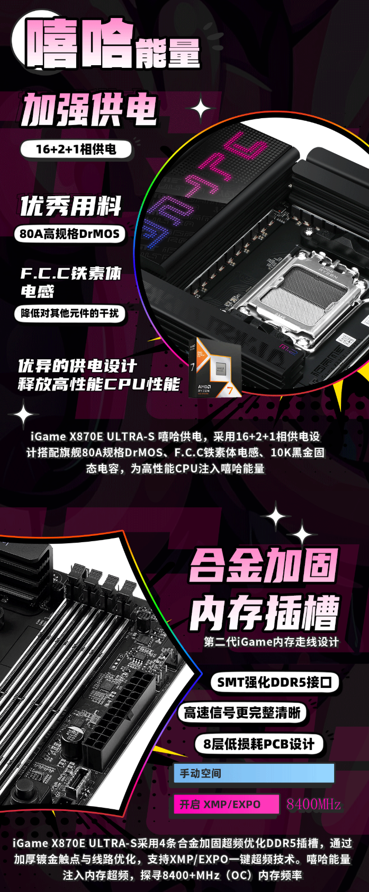
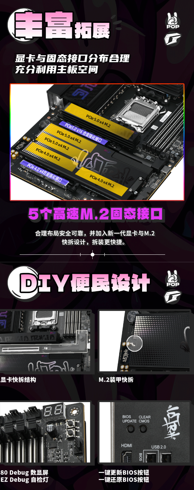
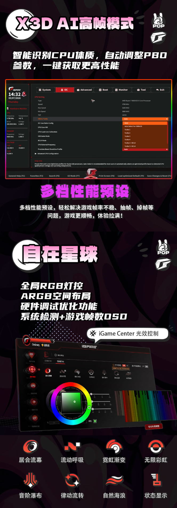
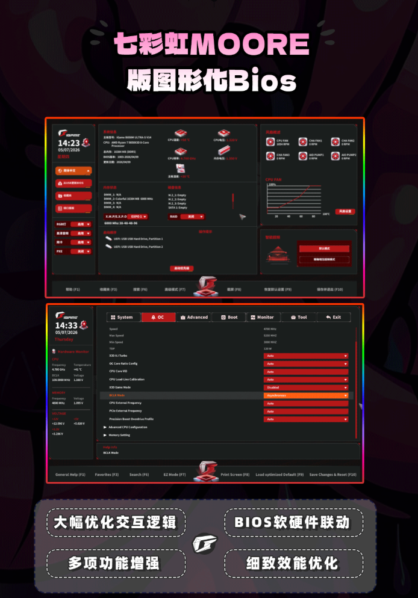

The **Colorful iGame X870E Ultra-S V14 DDR5** combines five M.2 connectors and **16+2+1-phase** power delivery for building a system on AMD’s AM5 platform. The latest development is commercial: [IT Home reported on October 19](https://www.ithome.com/1/015/020.htm) that it had appeared on JD in China for **1,899 yuan**. That is a sales reference in that market, not an announced price for Spain.

## What the iGame X870E Ultra-S V14 offers for a build

According to the information reported by IT Home, the VRM uses **80 A DrMOS stages**, ferrite inductors and solid capacitors. The board includes four reinforced DDR5 slots and supports **XMP and EXPO** memory profiles, as well as asynchronous overclocking. These are features of the advertised configuration: phase counts and the stages’ rated current do not replace temperature or stability testing under load.

The product material reproduced by the outlet shows heatsinks over the power delivery and storage, together with a rear cover. For someone building a PC, the relevant issue is not the lighting but access to components and maintaining adequate airflow around the socket and SSDs.

## Five M.2 connectors, quick release and diagnostics

The **five M.2 connectors** are one of its main selling points for systems with several storage drives. That number does not mean they all use the same interface or that all five are PCIe 5.0. Before planning a fully populated configuration, it is advisable to consult the manual and lane allocation between storage and expansion rather than deducing it solely from the X870E chipset.

IT Home also describes a graphics-card quick-release mechanism, a numeric diagnostic display and **EZ Debug** lights. The illustrations also show rear buttons for updating the BIOS and clearing CMOS settings. These are useful tools for locating boot issues or working on a build without relying exclusively on what appears on screen.

The product joins other AM5 boards prioritizing power delivery and storage, such as the [Gigabyte B850 AORUS ELITE X3D with four M.2 slots](/noticias/gigabyte-b850-aorus-elite-x3d/). When comparing options, operating conditions matter as much as connector counts.

The reproduced documentation also includes an **X3D AI** mode that, according to IT Home, automatically adjusts PBO parameters. No independent measurements are provided here that would turn that claim into a guaranteed improvement in frames per second.

## Chinese pricing and the limits of available information

[TechPowerUp also covered the launch on October 19](https://www.techpowerup.com/353899/colorful-igame-x870e-ultra-s-v14-gaming-and-oc-motherboard-launches-for-usd-284), citing IT Home and the same JD link. It provides a comparison of the coverage, but not independent confirmation of the price: both texts point to the same retail reference.

During this check, a complete official Colorful listing for this model could not be consulted, and the JD link did not expose a readable purchase page. The **1,899 yuan** price and described specifications are therefore attributed to IT Home’s report and the product images it reproduces, not to direct verification of the manufacturer’s catalog. All images in this article come from that report.

The sources consulted do not confirm availability in Spain or an international distribution date. For a local purchase, the sales channel, warranty and final price remain unknown; for planning a build, it is also advisable to wait for the manual and check dimensions, memory compatibility and connection allocation before choosing the remaining components.
