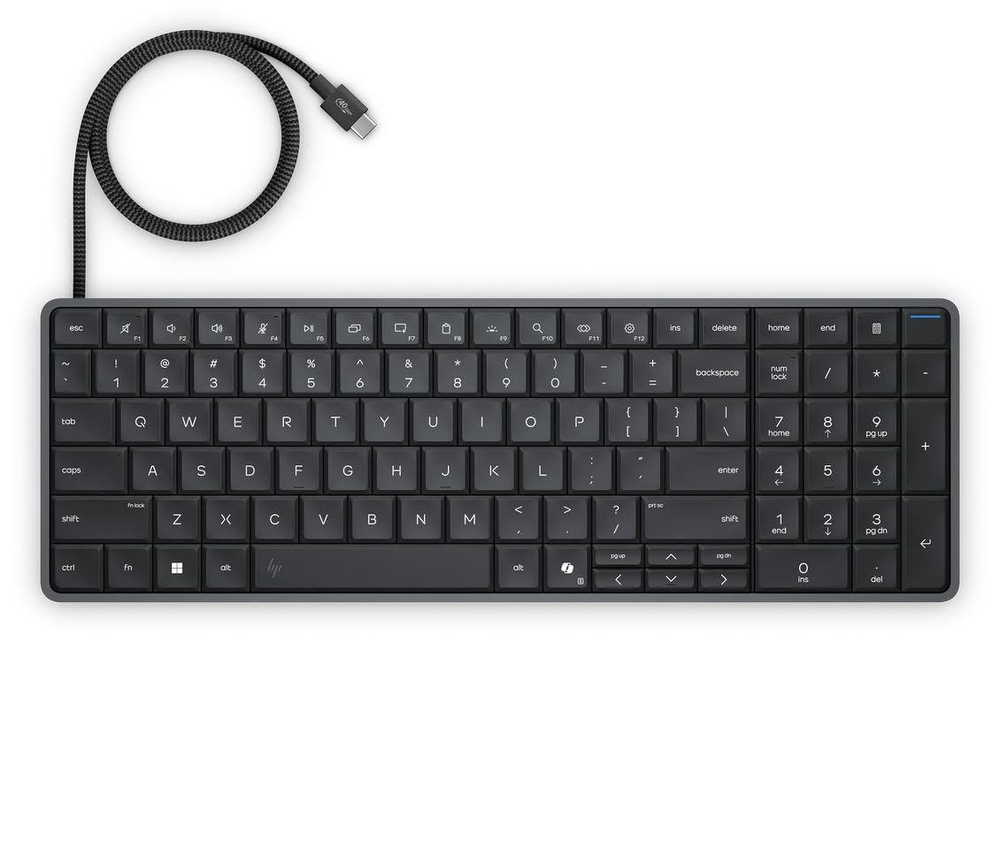
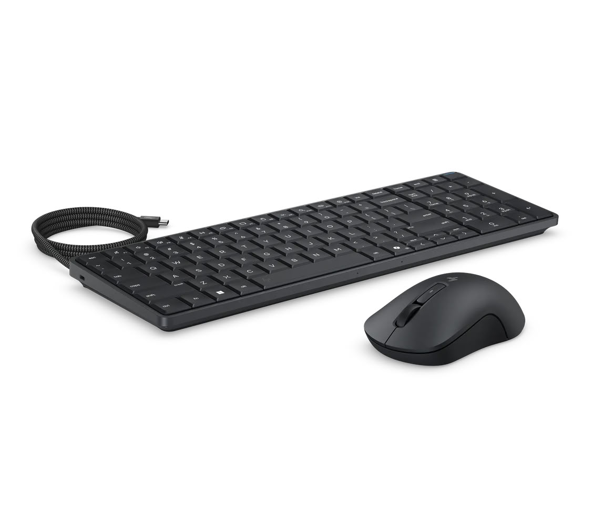

# HP launches EliteBoard G2a, a full PC inside a keyboard starting at $3,028

HP showcased the EliteBoard G2a at CES 2026 with the promise of "next-generation local AI power in a keyboard-sized form factor." Ten months later, the company has put the machine on sale and, along the way, revealed the price and much of the specification that had previously been kept under lock.

## A complete PC beneath the EliteBoard G2a keys

The EliteBoard G2a is not a keyboard with extras: it is an entire mini PC mounted inside the keyboard chassis. The part that drives the whole thing is the AMD APU, and here there are two versions. The top model carries the Ryzen AI 7 Pro 450 and the entry-level one the Ryzen AI 5 Pro 435. Both integrate an NPU that, according to HP, delivers 50 TOPS. The real difference between the two lies in the CPU and, above all, the graphics: the Ryzen AI 7 Pro 450 goes up to eight cores and mounts a Radeon 860M with eight compute units, while the Ryzen AI 5 Pro 435 stays at the Radeon 840M with four.

In pricing, the entry-level model —Ryzen AI 5 Pro, 16 GB of DDR5-5600 and a PCIe Gen 5 SSD of 512 GB— starts at $3,028. The version with Ryzen AI 7 Pro 450, 32 GB of memory and the same 512 GB SSD goes up to $4,167.

## Few ports and a surprise when opening it

Physically, the machine is powered by USB Power Delivery and consumes up to 65 W through that port. Connectivity is minimal for a desktop PC: a single USB4 and one USB Type-C at 10 Gbps. It comes with two built-in speakers and is sold with the HP 675M wireless mouse in the box.

The keyboard itself is membrane, not mechanical, with a layout that seems to follow the 1800 format and white backlighting. For anyone who plans to open it, there is good news: the memory is SODIMM, so you can upgrade without going through HP's box.

## "PC inside a keyboard," an expensive niche

Putting the motherboard inside the keyboard is nothing new: home machines from the eighties already followed that scheme, and the Raspberry Pi 400 revived it a few years ago. The appeal is always the same: fewer gadgets on the desk and just one cable. But it remains a niche format.

The problem is price. At $3,028 and $4,167, the EliteBoard G2a positions itself above many laptops and mini PCs with comparable performance, even though it gives up the screen. The manufacturer frames it as an enterprise-grade "Copilot+ PC" device, not as a mass-consumer product. It is not the only compact format with high-end pricing: the [Framework Desktop with Ryzen AI Max+ Pro 495](/noticias/componentes/framework-desktop-ryzen-ai-max-pro-495/) also sold out its first batch starting at $6,799.

## What to look at before buying

Given the price, this is not a machine for someone building with an eye on lowest cost per watt. If the format still interests you, the point in favor lies in SODIMM memory: buying the basic configuration and upgrading RAM yourself usually comes out cheaper than paying HP's jump to 32 GB. The downside is connectivity: a single USB4 and one 10 Gbps USB-C force you to use a hub to connect screen, peripherals and external storage, so it makes sense to budget for that accessory before making the leap.

