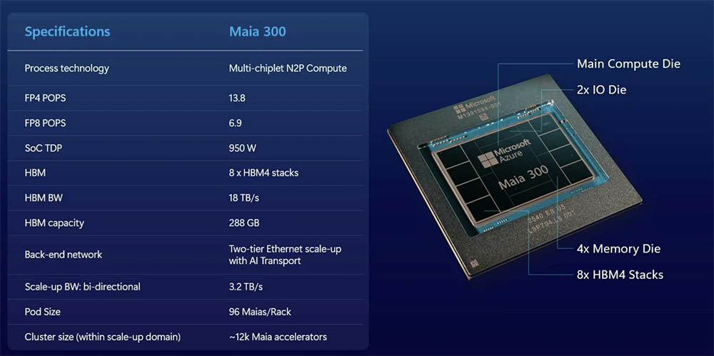

# Microsoft announces the Azure Maia 300: 2 nm chiplets, 288 GB of HBM4 and 950 W for the cloud

Microsoft has unveiled the **Azure Maia 300**, its third AI chip in two years and the first in the family to feature a multi-chiplet design. Satya Nadella, CEO of the company, announced it with the intention of scaling proprietary silicon up to multi-gigawatt deployments and making it the primary inference system for the company's products and services. The chip will replace the Maia 200 in that role, targeting deployment around 2027.

## The Azure Maia 300 replaces the monolithic design with chiplets

The Maia 200 was a monolith; the 300 is split into pieces. There is a main compute die manufactured by TSMC on the N2P node, at 2 nm. Around it are placed two input/output (I/O) chiplets on an older node — sufficient and cheaper for moving data — four DDR RDIMM memory tiles that serve as the system's main memory, and eight HBM4 stacks for the accelerator. This is the same division we've been seeing at the desktop level for years: expensive silicon where performance matters, and cheap silicon where it just needs to connect.

HBM4 adds 288 GB, compared to the Maia 200's 216 GB of HBM3E, and operates at 9 GT/s for a bandwidth of 18 TB/s: 2.5 times that of the previous generation. In compute, the Maia 300 delivers 13.8 PFLOPS in FP4 and 6.9 PFLOPS in FP8, while the Maia 200 stayed at 10.1 PFLOPS in FP4 and 5.1 PFLOPS in FP8. The rack goes up to 96 chips — double the 48 of the 200 — and the inter-chip link reaches 3.2 TB/s.

## 950 W: the price of fitting more into the same space

The figure anyone following hardware closely should watch most is power consumption: TDP rises to **950 W**, 200 W more than the Maia 200's 750 W, and that with a theoretically more efficient node. There is no contradiction here. More stacked memory, more bandwidth, and more power phases fit into the same package, but all the energy that goes in eventually comes out as heat. A full rack of 96 units runs at around 91 kW peak — a figure that in a data center stops being a detail and becomes a cooling and electrical distribution problem. It's the same physical limit chasing consumer PCs: thermal density grows faster than node efficiency.

## What changes with the Azure Maia 300

Microsoft's goal is twofold: reduce operating costs for services like GitHub Copilot and reduce dependence on NVIDIA and AMD hardware. The company claims the Maia 300 delivers 40% more tokens per watt than GPU-based solutions, and a full rack multiplies token generation by seven compared to a Maia 200 rack. Today the Maia 200 already runs OpenAI models, Microsoft's MAI models, and open models in regions across the United States, Europe, and Australia.

For those who don't administer Azure, the effect is indirect but real: if proprietary silicon reduces inference costs, that pressure eventually translates to lower final cloud pricing. It's the same race followed by [Intel Crescent Island, GPU D-Series with 1.3 PFLOPS in FP8](/noticias/tarjetas-graficas/intel-gpu-d-series-crescent-island/) or [the Chinese alternative to NVIDIA with the Ascend 950](/noticias/componentes/huawei-ascend-950-nvidia-china/): more compute concentrated in less space. When buying or building hardware, the signal to follow isn't the chip itself, but what it brings — HBM4, 2D packaging, and thermal management at 950 W — because that direction eventually pulls down the rest of the ecosystem.
