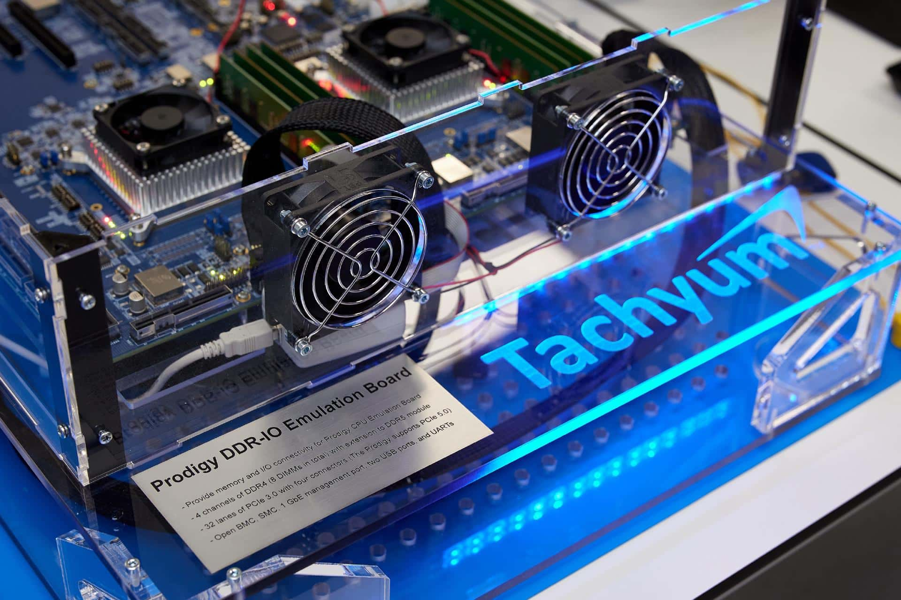

Prodigy never reached a socket. That is the fact that orders the entire story: Tachyum, the Slovakian company that since 2018 promised a "universal" processor for data centers, filed its own bankruptcy on October 22, 2026 with the Bratislava III Municipal Court. The resolution opening the procedure was published by Forbes Slovakia on October 29, and Tom's Hardware subsequently added the corporate detail that weighs most heavily on the technology's future: Prodigy's intellectual property is not in the bankrupt subsidiary.

## What the bankruptcy filing contains

The judicial resolution is brief and leaves no room for interpretation. The court records that the debtor itself filed the bankruptcy application on its assets on October 22, and that the request meets the requirements of the Bankruptcy and Restructuring Law. It adds a relevant legal principle: when the debtor requests the bankruptcy, their insolvency is presumed. There was therefore no creditor pushing the process; it was the company that placed itself in the hands of the court.

From there comes into play the usual Slovak procedure: an administrator appointed by the court manages the company's assets, which are then sold to pay creditors. That is what appears in the documents. What does not appear, neither in the resolution nor in any communication from the company, is a continuity plan for Prodigy.

## The corporate structure that decides Prodigy's future

Here lies the nuance that separates "bankrupt company" from "dead technology." According to Tom's Hardware update, the ultimate parent and owner of all Tachyum intellectual property is Tachyum Ltd., based in the Cayman Islands. This controls US-based Tachyum Inc., which in turn controls Slovakian Tachyum s.r.o., responsible for most of Prodigy development.

That chain theoretically allows the Slovak subsidiary to be declared insolvent and liquidated while Tachyum Ltd. continues operating, creates new companies, and continues development. The problem is that Tachyum Ltd. itself is subject to a liquidation procedure, according to the US media citing OffshoreAlert. If that company ends up being liquidated, control of Prodigy patents could pass to judicial administrators, who could sell them to pay creditors. Current management might try to repurchase them, but would have to compete with other interested parties and meet sale conditions.

## What Prodigy promised

The project was presented in 2018 with an ambitious promise: a processor offering very high performance in data centers while simultaneously consuming less electricity. The launch was planned for 2019 and never happened. Over the years, the design changed: it started as a 64-core CPU and ended up being proposed as a chiplet architecture of up to 1,024 cores, according to Profesional Review. Tom's Hardware summarizes the history in one phrase: repeatedly unfulfilled development and production milestones.

The board illustrating this article says everything without saying it: it is a "Prodigy DDR-IO Emulation Board," an emulation system for validating memory and I/O, not a Prodigy processor in production. In the image you can read the fine print of the prototype: four DDR4 channels with eight DIMM modules total, 32 PCIe 3.0 lanes with four connectors, and BMC management. It is laboratory material, not a product anyone could buy.

## Why it matters — and why not — for the CPU market

For someone building a system, the short answer is that nothing changes. Prodigy never had a commercial socket, nor motherboards, nor BIOS support, nor a price. No one could plan a build around it, so its disappearance leaves no orphaned systems or forces a platform change.

For the server market, the case is more interesting as a lesson than as a catalog. A new processor needs more than a spec sheet with many cores: compilers, operating system, firmware, boards, and clients willing to validate it. That ecosystem is what sustains x86 and what Arm is building in the data center segment, as seen in the lab work of [Arm with its AGI CPU for servers](/noticias/arm-agi-cpu-lab/). A "universal" architecture that does not reach silicon does not compete with anything.

There remains the path of intellectual property. That patents survive bankruptcy is possible; that this translates into a chip, no. Buying a design and converting it into a product requires equipment, funding, and years of validation, and no one has announced such an operation.

## What is still unknown

There is no company statement, no announced buyer, and no date for a Prodigy. The idea that the parent company buys the intellectual property of the Slovak subsidiary to avoid insolvency circulates as speculation, and so it must be read: it does not appear in the file. Nor is there confirmation that development will continue, beyond the theoretical possibility left open by the corporate structure.

If the plan was to wait for Prodigy to build a server, that plan no longer exists. The practical decision remains where it always has been: choose between x86 and Arm with platforms sold today, with boards, BIOS, and verifiable software support. And for the workshop, a rule this case reminds us of: before getting excited about a new architecture, check that the board on which it will be mounted exists.
