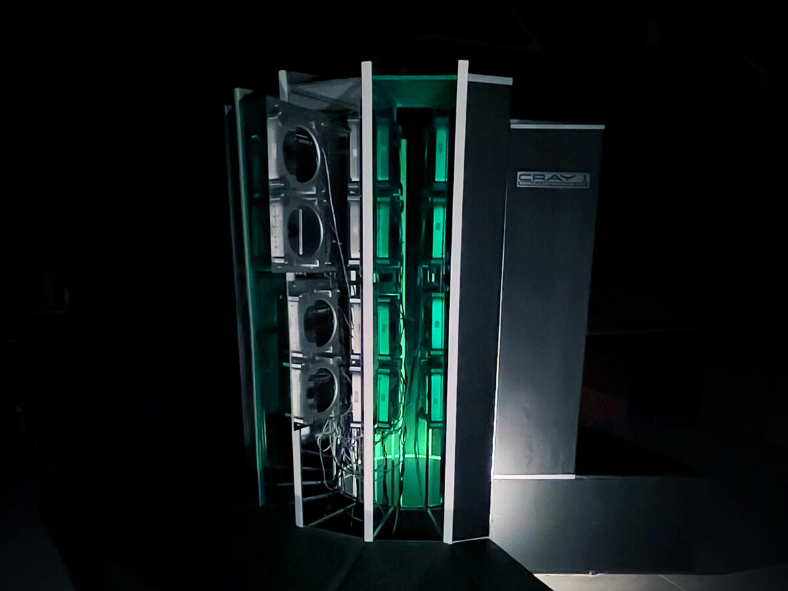
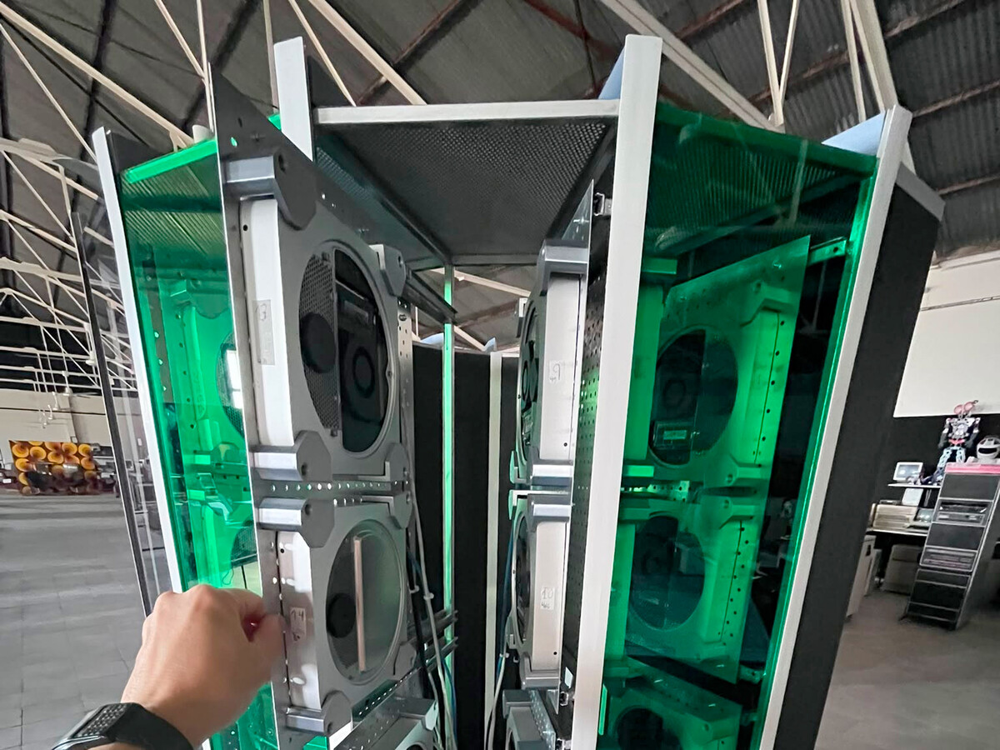

The Computer History Museum, in Majadas de Tiétar (Cáceres), has presented a full-scale replica of the Cray-1, the supercomputer that was unveiled in 1976 and which was the fastest computer of its time. What is interesting is not its curved silhouette, but what makes it work: 30 Apple Mac Minis connected in a network that, together, calculate faster than the original machine. It is not a restoration of a historical unit, but a new system with the appearance of a classic, and it has required more than a year and a half of work.

## A Cray-1 on the outside, 30 Mac Minis on the inside

The replica reproduces the external appearance of the Cray-1 and gives it computing capacity with much more recent hardware. The system uses 28 Mac minis from 2012 and two others from 2014. Of the total, 25 are equipped with dual-core Intel Core i5 processors, while the remaining five use quad-core Core i7. The key to them functioning as a single machine is that they are connected via a network to distribute operations among themselves: this is what is known as a cluster, several computers collaborating on a single task by making use of each processor's calculation.

The museum attributes around 1.5 teraflops to the system, that is, one and a half billion floating-point operations per second. The 1976 Cray-1 had a theoretical maximum of around 160 megaflops. The difference serves to show how far computing has advanced, although it is advisable not to read this as an exact equivalence: they are different architectures and the figures are obtained with different methods, so the comparison is indicative.

## From assembly to silence: how the cluster is cooled

Here is where the project stops being a model and becomes a workshop problem. Keeping 30 computers running without turning the exhibition into a noisy room forces one to think about airflow before power. The solution lies in placing **the Mac Minis vertically**, on aluminum trays inside a steel structure, so that hot air rises and exits from the top. No additional fans are needed: natural convection does the work and the assembly remains silent.

The installation is managed from a terminal inspired by the seventies, which houses one of the Apple machines. Visitors can see how performance changes when several processors work at once, which is exactly what a cluster wants to demonstrate.

## Under the console: emulators, Raspberry Pi and two real Crays

The control station manages much more than the 30 Mac Minis. According to the project's official documentation, these machines run on macOS Mojave, but the installation incorporates other systems. From its three-screen console, one can control a Raspberry Pi that runs emulators of classic computing environments, as well as another cluster formed by Raspberry Pi boards. The ensemble also includes two authentic Cray CX1 supercomputers running CentOS, a Linux distribution.

## What this assembly teaches

The project does not reproduce the internal functioning of the original Cray-1, and precisely there lies its value: it preserves the appearance of a machine that marked an era and uses it to explain how the approach to large calculations has changed. The curved casing of the original Cray was not an aesthetic whim—it shortened internal connections so signals took less time to travel them—and that same practical spirit reappears here in convective cooling.

For those who reuse veteran hardware, the lesson is always the same: before adding power, solve the physics. An excellent piece on paper is useless if it doesn't fit in the box or if air cannot be evacuated. Placing the equipment vertically and letting heat rise is cheaper and quieter than adding fans, and that idea fits just as well in a museum as in a home server built with an [old laptop instead of a new Raspberry Pi](/noticias/old-laptop-home-server/).
