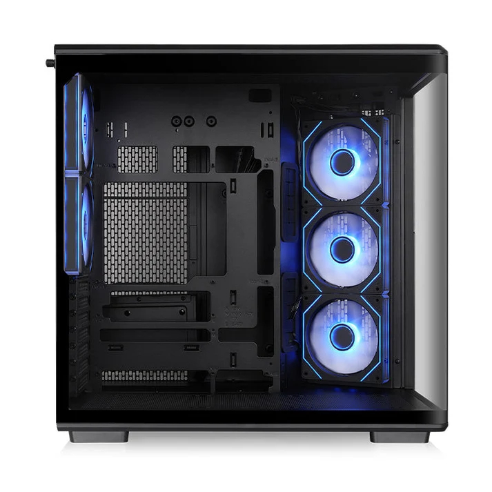
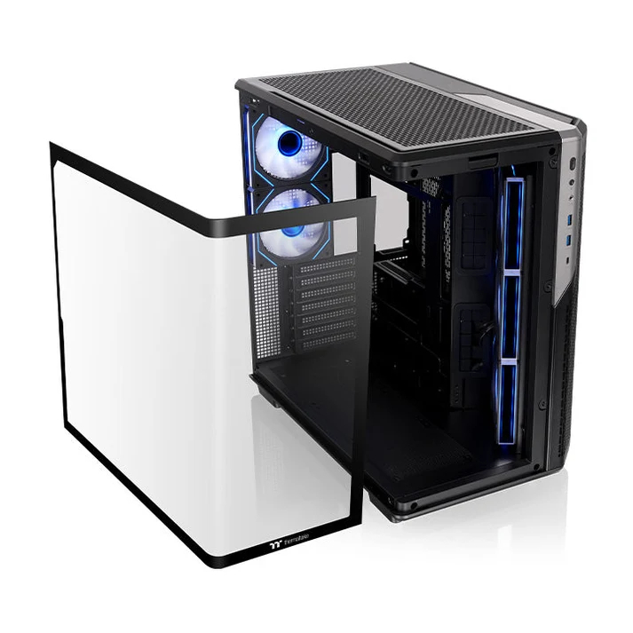
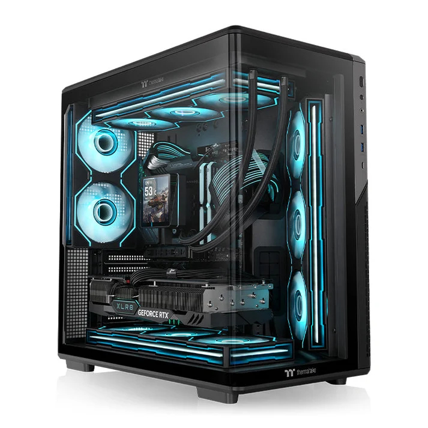
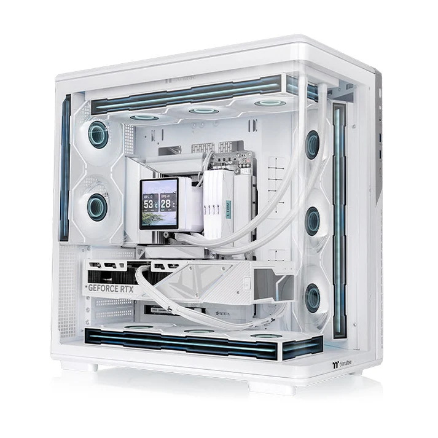

The **Thermaltake View 590 TG ARGB** supports graphics cards up to 435 mm long, but that figure drops to **350 mm if a liquid-cooling AIO is mounted on the motherboard side**. That is the detail worth checking before building in this dual-chamber mid-tower, which pairs a curved glass panel with five included fans and support for motherboards with rear connectors.

Thermaltake has detailed the chassis on its [official View 590 page](https://thermaltake.com/products/view-590-tg-argb-mid-tower-chassis), also picked up by [KitGuru](https://www.kitguru.net/components/cases/joao-silva/thermaltake-launches-view-590-tg-argb-chassis-with-curved-glass-panel/). The case is available in black and white finishes, although the sources consulted do not confirm a price or a release date in Spain.

## View 590: clearances that depend on the build

External dimensions are 473 × 290 × 477 mm. The spec sheet lists compatibility with Mini-ITX, micro-ATX, ATX and SSI-CEB motherboards; for boards with hidden connectors it specifies micro-ATX and ATX formats and names the ASUS BTF, MSI Project Zero and Gigabyte Project Stealth families. Choosing a board by its commercial name is therefore not enough: its form factor has to be checked as well.

The CPU cooler can be up to 165 mm tall. The power supply has an advertised limit of 270 mm, but the clearance table reduces that to 180 mm with a hard drive installed. As with the side radiator and the GPU, not every maximum capacity should be read as if all of them applied at the same time.

The case includes a graphics card bracket. It is a useful addition for supporting heavy cards, but it does not replace checking their length or the space the chosen cooling will take up.

## Five fans included, up to eleven in total

The factory configuration is three 120 mm Infinity ARGB Reverse PWM fans on the motherboard side, set up as intake, plus two more 120 mm Infinity ARGB PWM fans at the rear, set up as exhaust. The layout matters more than the lighting: it lets a build start with both functions covered, without buying a full set of fans first.

The chassis accepts up to eleven 120 mm fans split between the roof, side, base and rear. For liquid cooling, Thermaltake specifies radiators up to 360 mm both on top and beside the motherboard; the roof also takes 280 mm. Choosing the top position avoids the GPU length reduction the spec sheet attributes to a side AIO, although the dimensions of the whole assembly still need checking.

Lighting can be synced with ASUS, ASRock, Gigabyte and MSI software. These are features declared by the manufacturer, not the results of a thermal or acoustic test: the five included fans on their own do not settle how a complete system will behave under load.

## Removable glass and accessible ports

The 4 mm tempered glass panel wraps around the front and the left side. It has a tab for removal during installation or maintenance, so access does not depend on working through a narrow opening.

Splitting the case into two chambers keeps the cabling away from the main area. It is a design line shared with other cases built to show off the system, such as the [AZZA ABYSS with rear-connector support](/noticias/componentes/azza-abyss/), but the choice should follow each model's clearances, not just its glazed surface.

Ports include one USB-C 3.2 Gen 2, two USB-A 3.0 and HD audio. Thermaltake also lists dust filters, something worth keeping clean so the air intakes are not obstructed.

## Price and availability in Spain still to be confirmed

The [official US store](https://thermaltakeusa.com/products/view-590-tg-argb-mid-tower-chassis-ca-12c-00m1wn-01) lists the View 590 TG ARGB at 159.99 dollars. That reference is not a Spanish price and does not confirm stock at national retailers; nor should it be converted straight into euros as if it carried the same sales conditions.

For anyone planning a system with a rear-connector motherboard, the View 590 deserves a compatibility check. Before buying, the three decisive measurements are the graphics card's real length with the chosen AIO, the 165 mm cooler clearance and the power supply space when hard drives are used. The glass is the most visible part; those constraints are what decide whether the build fits.
