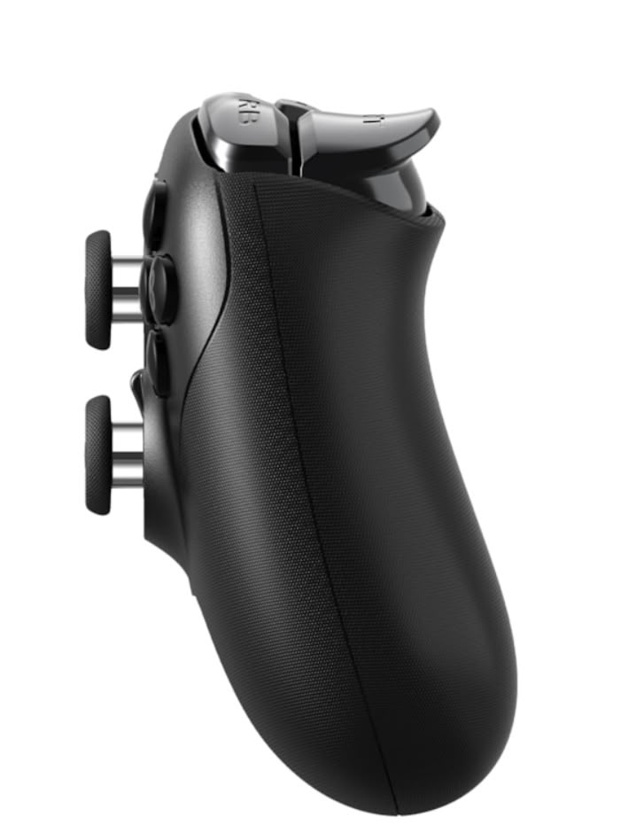
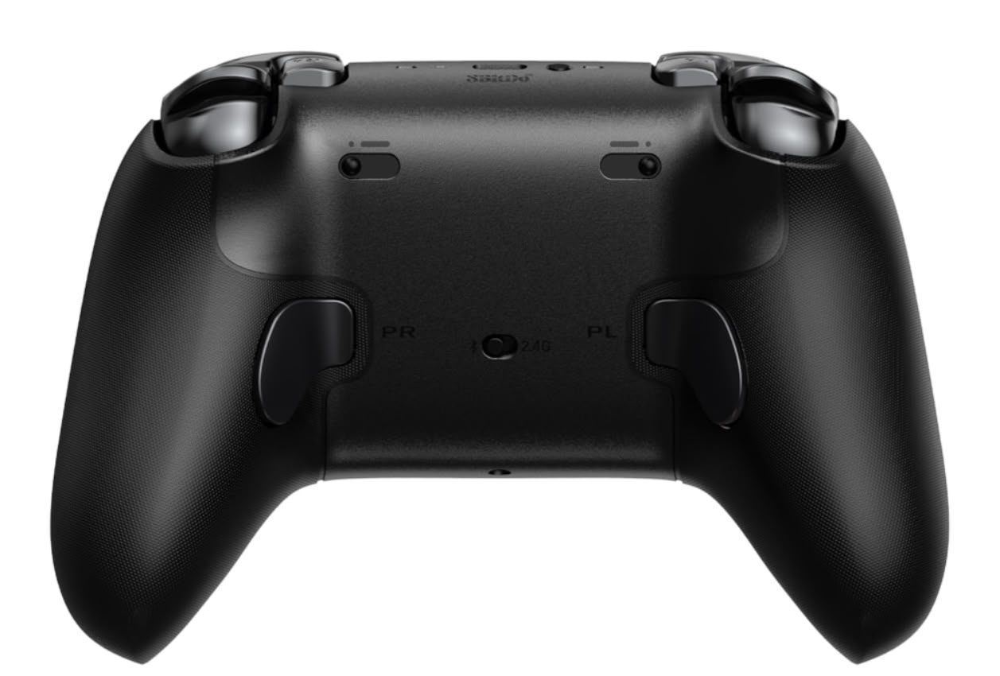
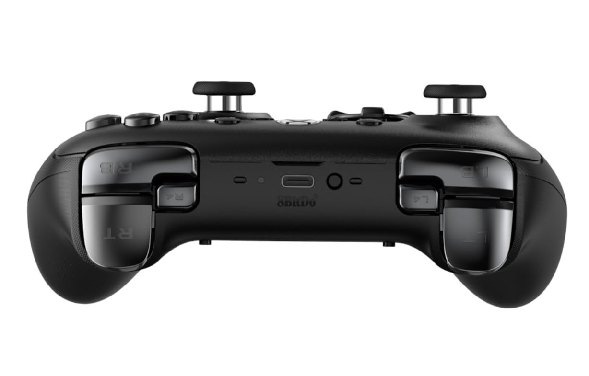

The **8BitDo Ultimate 3E** arrives in the European market with a recommended price of **€139.99** and a proposition built around adapting the controller to the player: swappable face buttons, different D-pads and several stick options. Game Outlet Europe announces that shipping begins in Europe and the United Kingdom on 23 October. It is an accessory officially licensed for Xbox that also works on PC, although it does not offer the same features on both platforms.

The announcement comes from the [distributor's release published by Overload PR](https://www.overloadpr.com/post/8bitdo-ushers-in-the-next-generation-of-ultimate-launching-the-8bitdo-ultimate-3e-controller-for-x), which TechPowerUp reproduces as a press release. The communication lists Amazon Spain among the points of sale, but the recommended price does not guarantee stock or the same final amount in every store.

## Ultimate 3E: changing the feel, not just the buttons

Physical customisation is the Ultimate 3E's main argument. The ABXY module can be swapped to choose between a silicone membrane and microswitches: two different responses for the four action buttons. It also lets you alternate between a conventional D-pad and a circular one, instead of imposing a single surface for every game.

The two standard joysticks come installed. The package adds two tall sticks, one with a thicker neck and one with a domed top. The front shell is magnetic and the grips carry a silicone texture. These are adjustment options; the announcement does not replace a comfort test with different hand sizes.

The [official 8BitDo product page](https://www.8bitdo.com/ultimate-3e-controller-xbox/) confirms TMR sensors in the joysticks and a 12-bit ADC converter. The triggers use the Hall effect and have two levels of travel stop. Two back buttons and the additional L4 and R4 shoulder buttons complete the controls, allowing actions to be remapped without relying solely on the face buttons.

## Xbox and PC share a connection, but not the 1,000 Hz

On Xbox Series X|S, Xbox One and Windows, the controller supports a 2.4 GHz wireless connection through its adapter or a wired USB connection. Bluetooth is reserved for Apple and Android devices; it is not the connection mode announced for playing on Xbox. The product page specifies Windows 10 from version 1903 and Android 13 or later.

There are two especially important limits before buying it. The polling rate of **up to 1,000 Hz**, both wired and wirelessly, is exclusive to PC. In addition, 8BitDo identifies that figure as a laboratory result under ideal conditions: it is not equivalent to an independent measurement of full latency during a game.

Six-axis motion control is also exclusive to PC and requires the 2.4 GHz mode. It is not available on Xbox consoles. Ultimate Software X allows that feature to be adjusted, buttons to be remapped and sensitivity, trigger travel and vibration intensity to be modified. The controller offers three custom profiles and a 3.5 mm headphone jack for Xbox or Windows.

## Dock, accessories and battery life: what the price includes

The announced €139.99 includes the charging dock, the wireless adapter, a USB cable, the carrying case and the pack of interchangeable parts. It is not, therefore, the price of a basic controller to which those accessories have to be added separately.

According to the manufacturer, the 1,400 mAh rechargeable battery allows up to 18 hours of play and needs between four and five hours to charge. These are declared figures, not the results of our own test. The dock uses magnetic alignment and wireless charging without contact points.

For those who play mainly on Xbox, the decision revolves around the interchangeable modules, the additional controls and the accessory bundle, not the 1,000 Hz or the gyroscope. Those who alternate between console and computer can make use of those additional features on PC. The [Razer Wolverine V4 controllers for Xbox and PC](/noticias/consolas/razer-wolverine-v4/) already sit in the same segment: comparing the features available on each platform matters more than choosing solely on the highest polling figure.
