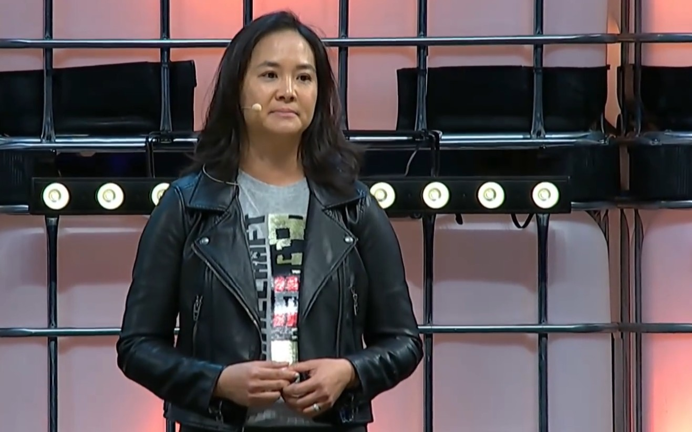

Helen Chiang, until a few weeks ago Xbox operations director, published on November 2nd a LinkedIn message rejecting allegations that circulated after her departure and maintaining that her firing was not managed according to the criteria she expects from the company. The text, titled "Clarity is Kindness," does not explain why she left the position but makes it clear that the decision was not hers.

The executive does not dispute that she was fired. What she disputes is the narrative constructed around her departure.

## What Chiang said

In the message, Chiang lists and denies one by one the versions that had been circulated: that she leaked confidential information to the press, that she left for a competitor, that she had committed discrimination, harassment, insider trading abuse, embezzlement or other fraudulent practices, and that she had left because they denied her a more responsible position.

> I don't want my departure reduced to an inaccurate story about incompetence, ambition for the next big job, or a textbook scandal.

On her career path, she adds: "You don't spend two decades in one place without developing deep loyalty to the people, teams, and businesses you helped build." And on closing the chapter: "It's not like that I ever imagined my story here would end. And it's not the whole story."

The most relevant paragraph is dedicated to equity and accountability. Chiang affirms she believes in both things but warns that "they only mean something when applied consistently," adding that she has "serious doubts" about how they were applied in her case, doubts that, in her judgment, "deserve to be taken seriously."

## A departure no one has explained

The chronology helps explain why the case has attracted so much attention inside and outside Microsoft. Chiang had been with the company for more than two decades, almost all of them in the video game business, and she came from directing the Minecraft franchise as corporate vice president. In July 2026 she was promoted to a newly created position, that of Xbox operations director, within the reorganization with which Microsoft reordered its gaming division, with responsibility over content, hardware, platform, and services.

Three months later she was out. The internal announcement was brief: Xbox CEO Asha Sharma communicated that Chiang was leaving Microsoft that same day and thanked her "for her years of service." A few days later, Eurogamer published that she had been "fired for policy violations," an accusation PC Gamer describes as anonymous. That is the version Chiang qualifies as inaccurate.

Microsoft did not respond to comment requests from The Verge or PC Gamer. It is also not confirmed whether Chiang plans to pursue legal action: the outlet asked about it and received no response. There remain, therefore, two open unknowns: the real reason for the firing and the scope of those "serious doubts" that the executive hints at without detailing them.

It is worth separating what is confirmed from what is speculated. Confirmed are the July promotion, the October departure, the internal announcement, and the existence of the LinkedIn message. No reason is confirmed, neither by the company nor by the executive, and none of the accusations she denies has been publicly backed up with evidence.

## Why it matters to the gamer

The episode does not change the console catalog or prices, but it says something about how Xbox is being managed in this generation. Chiang's departure occurred during the restructuring of the division, a process that has left firings — such as those of [Ninja Theory ahead of the closure of the Hellblade studio](/noticias/consolas/ninja-theory-cierre-hellblade/)— and sales of teams, which we already analyzed when talking about how [the new structure reinforces the weight of Activision and Bethesda](/noticias/reestructuracion-xbox-refuerza-activision-bethesda/). Movements in the upper echelons are the visible part of that adjustment; what the player perceives is the pace of releases, the state of subscriptions, and service support throughout the generation.

With the operations directorship vacant and without an official explanation, the reasonable question is whether the reorganization maintains the course Sharma has defended in recent months or if there will be more changes before the division stabilizes. For now there is only one certainty: the person who held that position during the last quarter is no longer there, and the official version remains a three-line announcement.
