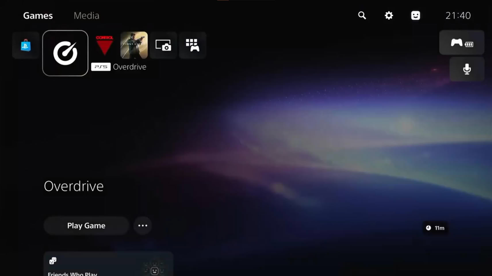

A whole catalog without paying at the register. That is what **Overdrive** promises, an app that has been circulating on X recently and which, when installed on a **jailbroken PS5**, behaves like a parallel store to Sony's: games and DLC without price, with download size and a review note occupying exactly the space where the price normally sits. The hook is obvious for anyone looking at their wishlist, but it is also the kind of promise that deserves a closer look before touching it.

## A storefront without prices

Insider Gaming collects a clip published on **October 11** by user **Edigax on X**. In that video, Overdrive presents itself with an interface very recognizable to anyone who uses a PlayStation: rows of covers, categories by genre, and navigation that mimics the official store. The difference is that instead of price, download weight appears, along with a score, and in the catalog titles such as **Battlefield 6** and **Forza Horizon 5** are visible.

Regarding its origin, the truth is that very little is known. There is no identified author, it is not clear where the files come from, nor whether the app works as well as the video suggests. The first testimonies are mixed: one of the comments collected in the PS5 homebrew subreddit describes the app as «very poorly made», so the real experience still needs to be confirmed.

## It doesn't come alone: Orbit Store and Relapse's push

Overdrive is not the only proposal of this type. **Orbit Store**, an open-source beta by developer **saawant12**, proposes a similar storefront with **147 games** linked from Archive.org, although its own author clarifies that it does not host any file itself. Both tools land shortly after **Relapse**, the **public jailbreak** for PS5 and PS5 Pro that opened models with firmware **7.00 up to 13.60**, and which has reactivated the entire scene.

That push is noticeable in the rest of the ecosystem: in recent days it has been seen **loading PS2 discs** via the PS5SX2 emulator and even **Halo 2 at 30 FPS** thanks to an Xbox emulator. It is the same pattern that the PS3 scene lived through at its time, and it explains why a store like Overdrive finds such an audience so quickly: access comes first, then tools, and finally those promising the full catalog without opening your wallet.

## What it really costs you

The problem with these apps is not just legal. A **jailbreak voids the console's warranty**, exposes the **PSN account to a ban**, and opens the door to unsigned software of unknown origin, which is the most comfortable way to slip in malware or render the console unusable. And downloading paid games via this route is, without nuances, **piracy**.

To this is added Sony's reaction, which for now **has not commented anything** on Overdrive. The company already published firmware **14.00**, out of reach of Relapse, and the **October 1 (14.10)** update added more security patches. Since there is no official path to downgrade versions, **updating today equals losing the jailbreak**, so whoever has followed this path finds themselves with each new patch closing more doors.

## What it means for the player

Seen from a purchasing decision perspective, Overdrive does not change the board: it remains an unaccountable promise, with an experience to verify and a hidden cost paid in the form of warranty, account, and malware risk. The PS5 homebrew scene, however, is indeed living its best moment in many years, and there are projects with names and surnames —emulators, preservation, open-source tools— that sustain their value throughout the generation without putting the console at risk. The difference between both is always the same: one gives you games today in exchange for everything else, while the others build something that lasts.
