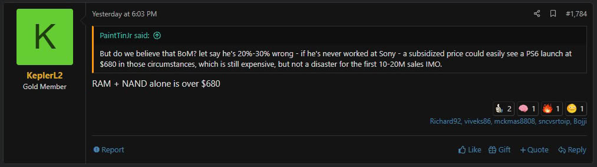

# PS6 RAM and Storage Alone Would Cost Over $680

Sony has not made any official statement about the price of PlayStation 6, but estimates on its manufacturing cost continue to rise. Leaker KeplerL2, who has been posting figures about the console's development in NeoGAF forums for months, now claims that **the PS6's RAM and NAND flash storage alone would cost over $680**. The figure is not a selling price, but an estimate of component costs, and it arrives as a response to a post suggesting precisely $680 as a possible launch price with subsidy: if just two components already consume that budget, that scenario falls apart on its own.

## A Breakdown That Adds to Previous Estimates

KeplerL2 had previously placed the total material cost of the PS6 —the so-called BOM (Bill of Materials)— at around $760 in March, a figure that by July would have risen to approximately $960. The new data does not replace those totals: it specifies them. The over $680 corresponds only to RAM and storage, before accounting for the APU, cooling, power supply, and the rest of the hardware.

## Memory and SSD: The PS6's Hurdle

According to recent leaks, the PS6 would use GDDR7 memory on a 160-bit bus, with support for up to 40 GB, although the most likely configuration would be 30 GB. It has also been reported that Sony considered reducing memory capacity to contain costs. The source of the pressure is the same as in the rest of the industry: AI data centers are absorbing DRAM and NAND supply, driving up component prices for all manufacturers, consoles included.

## What This Means for the Launch Price

Sony has not officially set the console's price, so these figures should be read with the usual caution toward leaks. That said, if memory prices hold steady, a PS6 significantly more expensive than the PS5 Pro seems likely, and a $1,000 price tag can no longer be ruled out.

Back in September we already learned that [rumors pointed to a Christmas 2027 campaign and a price between $799 and $999](/noticias/ps6-release-date-price-rumor/). If KeplerL2's estimates come close to reality, that $999 ceiling starts to look tight. For anyone looking to jump from PS5 to PS6, the purchase decision will no longer depend solely on the game catalog and services: it will depend mostly on how much one is willing to pay for a generation that starts with memory and SSD costs through the roof.
