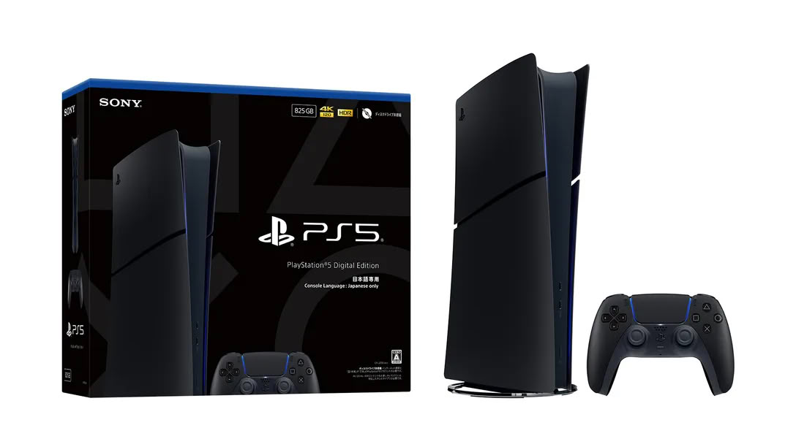

Sony has announced a version in color "Midnight Black" of its PS5 Digital Edition exclusive to Japan. The console will go on sale on November 19 for 55,000 yen — about $350 — including tax, with reservations opening on October 20 at PlayStation stores and the website in the country. The date coincides with the launch of GTA 6, a detail Sony takes advantage of to feature the game alongside the console in its ad.

## A Midnight Black PS5 Digital Edition, No Hardware Changes

There are no surprises under the hood. The new model, reference CFI-2200B02S, is a standard PS5 Digital Edition with an 825 GB SSD, just in black. It does, however, carry the same limitations as the white version Sony sold in Japan last year: the system language is fixed to Japanese and the console only works with PlayStation accounts registered in the country. That rules it out for any player who doesn't live there, even if they manage to import it.

Alongside the console comes a matching disc drive, also in Midnight Black and also on November 19, for 11,980 yen (about $76).

## The Price, the Most Interesting Part

The key to this edition is the price tag. When Sony raised PS5 prices worldwide in April, the Japan-exclusive model stayed at 55,000 yen (about $350), while the standard Digital Edition in Japan jumped to 89,980 yen (about $570). In the United States, that same digital version is already selling for $599.99, in a market where [the average console price has hit record highs](/noticias/consolas/mercado-consolas-caida-xbox-ps5/). With such a difference, the regional lock doesn't seem like a whim: it's what prevents these cheaper units from leaving the country and competing with the international price.

## What Changes for the Player

For those playing in Spain or Latin America, nothing changes for now: Sony hasn't said a word about a launch outside Japan. The company did take advantage of the announcement to repeat that new PlayStation games will be digital only starting January 2028, a message that clashes with releasing a new disc drive on the same day. It's a contradiction that has already received criticism from within the industry itself: former executive Shawn Layden [described the goodbye to discs as "a major blow for the brand"](/noticias/consolas/shawn-layden-discos-playstation/).

The purchase decision therefore remains in Japan and with a very specific audience: anyone who wants a black PS5 cheaper than the rest of the world's model and can accept that their catalog and account will be tied to the Japanese market throughout the generation.
