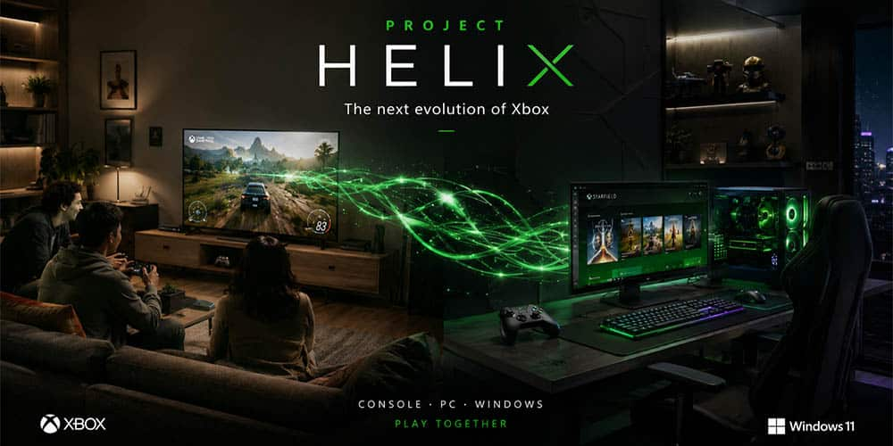

If you still store your games on a shelf, Microsoft has just sent you a message: the company has posted a job offer for an **"Xbox Games Supply Strategist,"** a position within the Xbox Supply Chain team whose mission is to coordinate the launch of **physical games** across all platforms. The vacancy is visible on LinkedIn and is the real source of the news; Windows Central turned it into news on October 18, and from there it spread in Spain via El Chapuzas Informático.

The offer arrives when the console physical format is living its worst moment: PlayStation announced that it will stop accepting discs, and Game Pass and the digital catalog are already Xbox's natural terrain. Hiring someone to plan inventory and sales channels for physical games fits poorly with that story. Or it fits exactly the opposite way.

## What Microsoft asks in the physical games job offer

The position has very specific responsibilities, according to the text of the offer itself: coordinate the launch of Xbox physical games on all platforms, lead and oversee the global supply positioning strategy across all phases of the product lifecycle, ensure that inventory meets working capital, cost, and service objectives, and supervise sales execution and distribution channels. Whoever occupies the position will work with Product Marketing, Finance, and various groups within the supply chain, as well as Sales, Manufacturing, Engineering, and the New Product Introduction team.

In other words: it is not a decorative public relations vacancy, but a planning role with budget and real supply chains behind it. That said, an important nuance to avoid going off track: **the offer does not mention Blu-ray discs at any point**. It speaks of "physical games" in business terms, without specifying the concrete support medium on which they will materialize.

That silence is not new. Xbox CEO Asha Sharma had already acknowledged that players like the physical format without confirming plans for the next generation, according to Windows Central.

## The worst moment to defend the physical format

Why this signal matters: it arrives at the worst possible time for those defending discs. Sony announced the end of the physical format for PlayStation, and that decision has pushed optical drive manufacturers to reconvert their production lines toward adjacent products such as lenses and lasers, moving away from mechanical readers. Windows Central summarizes without beating around the bush: if PlayStation leaves, the Blu-ray supply chain is no longer viable on its own, and Microsoft cannot stop the tide on its own.

Against that current, the company has made moves pointing in the opposite direction. Its **disc-to-digital** program allows obtaining a digital license simply by inserting the disc into a compatible Xbox One or Xbox Series X, a transition path to not lose the library when hardware changes — we already covered [the story of that program](/noticias/xbox-disc-to-digital-history/), which had been in the drawer for fifteen years — and publishers such as Ubisoft have joined [the compatibility list](/noticias/ubisoft-xbox-disc-to-digital/). Nintendo, on its part, [already said it has no plans to abandon the physical format](/noticias/consolas/nintendo-mantiene-formato-fisico/).

## What changes for the player if Project Helix keeps the physical format

The name that appears in the analysis is **Project Helix**, the codename of the next generation of Xbox, whose chips would have already reached the tape-out phase alongside those of PS6,
[according to Kepler_L2 leaks that we already covered](/noticias/ps6-xbox-helix-chips-taped-out/).
The problem is that, with optical drives disappearing from laptops, players, and consoles, the offer does not guarantee that Helix comes with a disc drive. Windows Central points out that it is most likely that it will not have a traditional one and speculates with alternatives: cartridges in the style of Nintendo Switch, perhaps more sense for the future Xbox Portable, or even a cheaper proprietary format. These are hypotheses, not plans confirmed by Microsoft.

What does change, meanwhile, is the buying conversation. Players who collect, who resell, who lend a disc, or who simply want to know that the game will still be there in ten years have a reason in this vacancy to keep looking at Xbox, because a sustained bet on physical launches throughout the generation is a buying argument against PlayStation, and an argument of longer-term support than any spec sheet entry.

That said, a job offer is not a hardware announcement. Microsoft has not confirmed the format of Project Helix nor its release date, and the assignment of the position could also cover current physical launches. It is worth waiting for the company to speak before deciding on the purchase.
