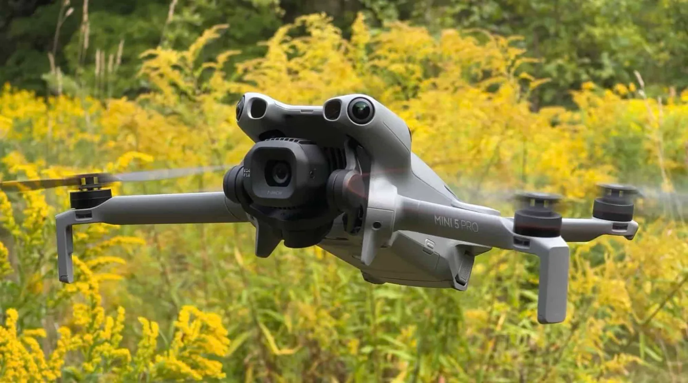
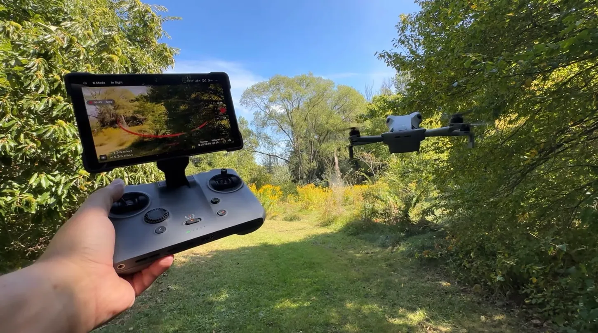

# DJI Mini 5 Pro Drops to $679, Its Lowest Price Ever on Amazon

The DJI Mini 5 Pro is selling for $679 on Amazon, $80 below its catalog price of $759 and the lowest price the drone has ever reached on its own. The discount arrived on October 6 with Prime Big Deal Days, and although the event closed on Wednesday, October 7, the price was still active when DroneXL checked the listing at 22:25 (Eastern time) on Monday, October 12.

For $679, the box includes the drone, the DJI RC-N3 controller, a battery, and spare propellers. The listing has accumulated more than 500 units sold in the last month, but Keepa’s price tracker does not record any $679 sales directly from Amazon: its graph shows the store’s own stock ending at the end of September at $759. In other words, the price is there, but it’s worth checking who is selling before paying.

## A Low That Had Never Been Seen Before

The Mini 5 Pro was the first drone in the “mini” range with a one-inch CMOS sensor. It shoots at 50 megapixels for photos, 4K HDR video at 60 fps, and slow-motion 4K at 120 fps behind an f/1.8 lens. The gimbal rotates 225 degrees, so vertical video uses the full sensor instead of cropping it.

Until now, the standalone package never dropped below $683. Keepa’s history shows it at that figure from mid-July to August 1, again during the last week of August and a third time from September 1–9, always returning to $759 afterward. From September 9 onward it stayed at catalog price until Prime Big Deal Days kicked off. The current $679 is therefore one step below the floor that had been marked up to today.

## What the Combos Add and at What Price

On October 12, the listing showed four configurations. The standalone kit was at $679; the Fly More Combo with the RC-N3, at $849; the version with the integrated-screen RC 2, at $979; and the Fly More Combo Plus with the RC 2, at $1,029, versus the crossed-out prices of $959, $1,099, and $1,159.

The Fly More kits add two batteries, for three in total, and a charging hub that fills all three in about 115 minutes. DJI promises 36 minutes of flight with the standard battery, although long-term reviews put them at 20 to 25 minutes depending on weather. The Plus combo switches to the Intelligent Flight Battery Plus, which DJI rates at 52 minutes, for $50 more than the standard combo with the RC 2. O4+ transmission is certified up to 20 km and the 42 GB of internal storage covers a microSD card forgetfulness. A detail for Android users: DJI Fly is no longer on Google Play and must be downloaded from the manufacturer’s website.

## The Real Weight and Regulatory Shadow

There is one figure that does not appear in the brochure. DJI advertises 249.9 grams and Amazon’s listing allows a margin of ±4 grams, but a DroneXL-sourced industry source weighed production units at 252 to 253 grams. The FAA grants no tolerance on the 250-gram threshold, so the drone falls under **Remote ID** and registration rules even for recreational flight. In Europe the manufacturer has manufacturing leeway, while in the United States any weight equal to or above 250 grams is counted as-is. Registration costs $5 at FAADroneZone.

This is compounded by the front-facing LiDAR, which places the Mini 5 Pro within the FCC’s proposal to cut off imports and sales of foreign drones with this sensor already authorized, whose comments closed on September 2. The proposal affects importation and commercialization, not flying a drone you already have at home.

## Is It Worth It?

At $679, the Mini 5 Pro is the most sensible purchase if what you’re looking for is the best one-inch camera in a body that fits in a backpack. DroneXL’s own deal tracker recommends buying at $683 or less, and this price has already held for five days after the promotion that brought it ended. Black Friday could drop it further, but every previous dip returned to $759 instead of continuing downward, so waiting is a bet on this specific announcement.

For most people, the $849 RC-N3 combo makes more sense: one battery gives about 20 minutes in the air and the kit adds two more. If you click the link and the price shows up at $759, it’s better to skip it and wait for the next drop rather than paying $80 more for the same box.
