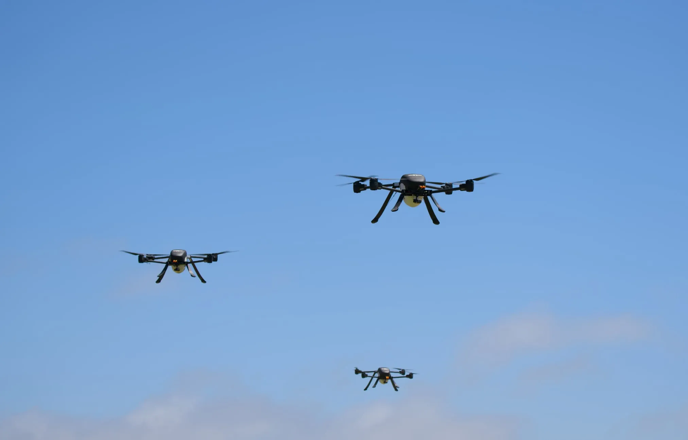

The San Bernardino County Fire Protection District (SBCoFD) has signed with Seneca to deploy a team of five autonomous firefighting drones, a towable mobile aerial operations base, and the company's autonomy software. It will be the first fire department in California to train and operate the system, according to the press release the company published on October 28. Each run discharges more than 500 gallons of finished foam, and, always according to the manufacturer, reaches a new fire in at most 5 or 10 minutes.

The county is the largest in continental United States: slightly more than 2 million residents spread across some 52,000 square kilometers, with dense neighborhoods, canyons, high desert and mountain within the same district. Many of those fires start on terrain that a crew does not reach in time and at hours when manned aircraft do not fly.

## Five Drones and One Pilot

The piece that changes the operation is not the drone, but who flies it. The five aircraft navigate and coordinate with on-board artificial intelligence, so a single district pilot supervises the entire team instead of handling each apparatus with the controls. Seneca describes the system as electric copters that are launched from a tablet, transported in a utility vehicle, or remain stationed at a high-risk point, without a helipad, mechanics, or refueling station.

This is added to a mobile operations base that is towed to the area, and several layers of traffic separation — autonomous obstacle avoidance, ADS-B alerts, and Remote ID — so as not to cross paths with other aircraft in the fire airspace. Nighttime operation is supported by on-board sensors, which is exactly the strip where much of manned firefighting aviation stays on the ground.

## What They Really Carry in the Tank

The 500 gallons of the headline measure finished foam, not bulk liquid. Class A foam is generated aerated at very high pressure, so it occupies much more volume than the water from which it comes: the 500 gallons do not equate to the almost 1,900 kilos that would weigh that same volume of water. In the product sheet, Seneca figures the complete set —systems of four to six drones— at 500 to 1,000 pounds of extinguishing agent per trip, that is, between 227 and 454 kilos. It is the figure that can be compared with the load of a conventional manned aircraft, and explains the model: many small repeated discharges instead of a single large launch.

From there come the three uses that the press release puts forward. The first is the initial attack on an incipient fire in inaccessible terrain. The second is laying foam or retardant perimeters around structures and vegetation when resources are distributed across several fronts. The third is the finish: cooling hot spots in the suppression phase without exposing crews to toxic materials.

The sensor is the other half of the problem, and there the sector has been moving for months. In October we counted how [firefighting drones gain 3D vision with LiDAR to fly through smoke](/noticias/drones/drones-incendios-lidar-ouster/), a capacity that this type of operation needs not to depend on operator visibility.

## The Numbers the Announcement Doesn't Give

The press release does not publish takeoff weight, flight endurance, wind limit, number of refills per hour, or contract price. It also does not specify the foam formulation nor whether it is free of fluorinated compounds, a recurring question among firefighters and in European regulations on foaming agents. These are the data that separate a demonstration from a guard tool: without declared endurance it is not known how many trips fit in an hour, and without a wind limit it is not known which days of the season the fleet stays on the ground.

The deadlines are there: personnel training will begin before delivery, scheduled for the first and second quarter of 2027, and the system must be integrated into operations before the peak of the 2027 season. That is to say, none of this is flying today. The goal that district chief Dan Munsey puts on the table is to stop 90% of fires before they pass 10 square feet, less than one square meter, and the district has been working with Seneca for more than a year in design.

## The Bottleneck Is the Certificate

The United States limits small civil drone operation to 55 pounds —about 25 kilos— under Part 107. An aircraft that discharges hundreds of liters of foaming agent is very far from that threshold and moves in the terrain of aerial application certification and authorizations to fly beyond the pilot's line of sight. The press release does not detail what procedure the San Bernardino system goes through nor which exemptions it has been granted.

The European framework is not softer. The EASA regulation requires the aircraft to be certified above 25 kilos and to obtain an operational authorization for this type of mission, including risk analysis. For a Spanish emergency service, the barrier is not the price of the drone: it is the file. And there the comparison with the American market, where the district already operates its own robotics and unmanned aerial systems division, remains the distance that separates an announcement from a fleet in service.

Is it worth it? As initial attack capacity, the argument holds up: arriving in minutes at a one-square-meter fire costs less than fighting a ten-hectare fire. What is missing to see is the fine print —endurance, wind, cost per run and certificates—, and that letter is not in the announcement.
