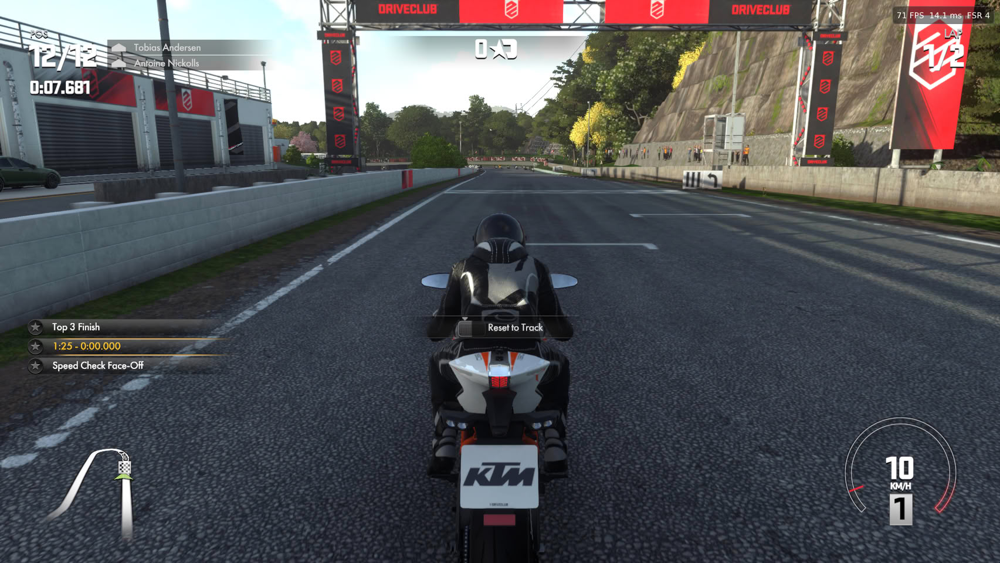
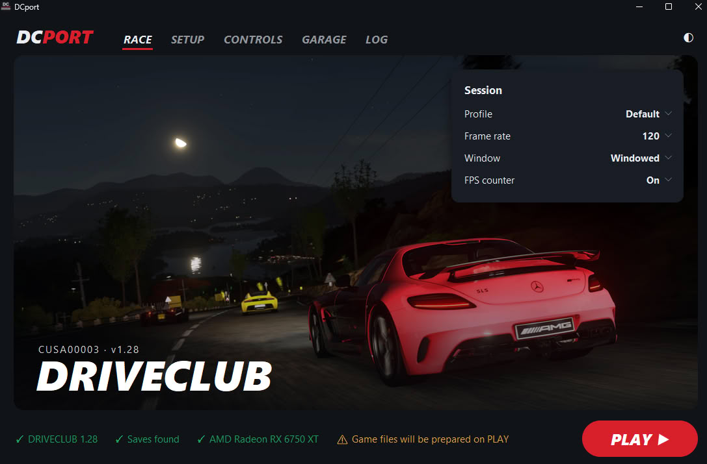

**Driveclub**, the racing game that Evolution Studios published in 2014 as a PS4 exclusive, now launches on Windows without needing a console emulator. The **DriveClub Recomp** project, published by OverkillLabs3 on GitHub, runs the game's code natively on PC and has reached version v0.2.3, which marks the starting point for the performance figures its author has measured.

## How Driveclub recomp works on PC

There is no CPU emulation in the classical sense: the game's own x86-64 code runs directly on the PC processor. The work instead concentrates on the two pieces that were previously provided by the console. On one hand, the PS4 system libraries that the game expects to find at startup are reimplemented; on the other, graphics commands are translated to Vulkan so the PC's GPU understands what the engine requests.

The comparison with other recompilations we have already covered, such as the [static recompilation of The Wind Waker](/noticias/emuladores/wind-waker-recompilacion-estatica-pc/), comes with one caveat: PS4 already speaks x86-64, so here the work is not in translating CPU instructions but in reconstructing the environment surrounding the game and translating its graphics language.

## What it allows you to adjust and how it performs at 4K

The port supports resolutions from 720p to 8K, ultrawide displays, and an unlocked framerate that does not accelerate the game. It also replaces the original antialiasing with DLAA on NVIDIA RTX cards or FSR 3.1 on any GPU, both at native resolution; anyone with an RTX can toggle between the two within the game using the `F10` key.

As for the figures, the developer assures that the game stays around 60 FPS at 4K in the most demanding scenes when combined with an RTX 5070 Ti and a Ryzen 7 5800X3D. Update v0.2.3 raised a test race from about 62 to about 71 FPS.

## DCport, the second path to reach the same place

It is not the only project along these lines. **DCport**, by qnfn, follows a similar path and adds support for FSR 3.1 and FSR 4. Both also share the requirement that weighs most on the user: it requires the game's own dump from version 1.28, which neither of them distributes.

## Current state: what works and what doesn't

The project still has the rough edges typical of a first stage. Some reflections appear too bright, shaders compile during the first minutes of gameplay, slower CPUs drop frames in loaded scenes, and online multiplayer functions do not work. To this is added a verification limitation: so far it has only been tested with NVIDIA hardware.

It helps to place it in context. A few months ago a shadPS4 patch allowed Driveclub to reach 8K, and the leap is notable for a game that launched at 1080p and 30 FPS. It is also the same terrain where the unofficial Gran Turismo Sport port operates.

What can be played today is real: Evolution Studios' Driveclub runs on Windows at native resolution, with free framerate and two modern antialiasing options. What remains pending is equally clear: reflections, initial shader compilation, performance on modest CPUs, online play, and a verification that has not yet left NVIDIA cards.
