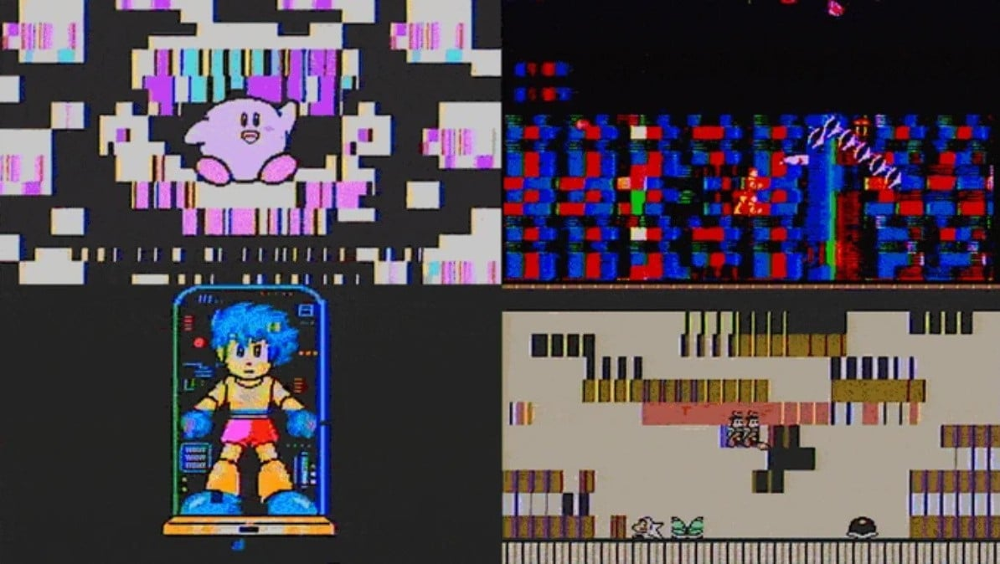

Glitch Boy uses NES and Game Boy emulation for something other than reproducing games with maximum fidelity: it alters their operation and converts their images and sounds into audiovisual material. Melted Electronics offers this instrument for **€189**, available both as a standalone unit and as an Eurorack module. Recent coverage by [Time Extension](https://www.timeextension.com/news/2026/11/glitch-boy-new-emulator-and-chiptune-synth-allows-users-to-corrupt-nes-games-in-real-time), published on November 1, brings the device back into focus; it does not credit a launch happening today.

## What Glitch Boy Does With Emulators

According to the [manufacturer's page](https://meltedelectronics.com/products/glitch-boy/), the unit starts with deliberately modified NES and Game Boy emulators designed to cause failures. The controls allow intervention during execution, while audio and MIDI inputs serve to synchronize alterations with music. Melted Electronics proposes a destination of live visuals, music videos, and video art, rather than a competition to run more systems without errors.

Time Extension explains the operation on NES: the Glitch A controller affects the emulated CPU and can change both image and sound; Glitch B intervenes on the graphics processor. The important distinction is that, according to that description, the distortions come from modifying the emulation itself, not simply by placing a filter over a finished video. We have not tested the device nor measured the stability of those interventions.

*Images: Melted Electronics; distortion montage distributed by Time Extension.*

## NES, Game Boy and Music via MIDI

The official page identifies NES and Game Boy in its description and explicitly adds **Game Boy Color compatibility**. That expands what the news report centered on NES covers, but it does not equate to a guarantee of operation for all games in those catalogs. The consulted sheet does not provide an exhaustive list of verified titles, so it does not allow promising complete compatibility.

Games load from microSD cards. Specifications indicate cards up to 32 GB, not included, and composite video output PAL or NTSC toward an external screen. No cartridge reader is documented; it should not be confused with projects like the [FPGA SP that runs original Game Boy Advance cartridges](/noticias/emuladores/taki-udon-fpga-sp-gba/), whose approach is different.

The other function is musical. MIDI allows playing sounds from the emulated console and using the device as a chiptune instrument. The manufacturer also details a mono line input, an A-type MIDI TRS connection, and two CV inputs ranging from 0 to 5 V. These are connections relevant for integrating it with other equipment, not proof that any musical configuration will work without adaptation. The sheet additionally offers firmware updates via the browser using USB.

## Two Formats at the Same Price and a Shipping Timeline

The standalone variant operates on USB power and does not need a modular chassis. The Eurorack edition is intended to be mounted in a system of that format. Both are listed at €189 in the official store; anyone who only wants to experiment without having a modular system must keep that difference in mind before choosing.

Melted Electronics announces that the order **ships approximately two weeks after being placed**. This is an indicative timeline for preparation and shipping, not a guarantee of receipt in Spain within fourteen days. Nor should that sheet price be interpreted as confirmation of the final transport cost to any destination.

The interest lies in using emulation as a creative tool, accepting alterations where a conventional emulator would try to avoid them. To work with games, it is advisable to limit oneself to own files or content whose license permits use; buying the device does not grant rights over commercial catalogs nor over the distribution of their images and music. What is confirmed is its audiovisual proposal and the systems announced by the manufacturer, not a portable console with cartridges nor universal compatibility.
