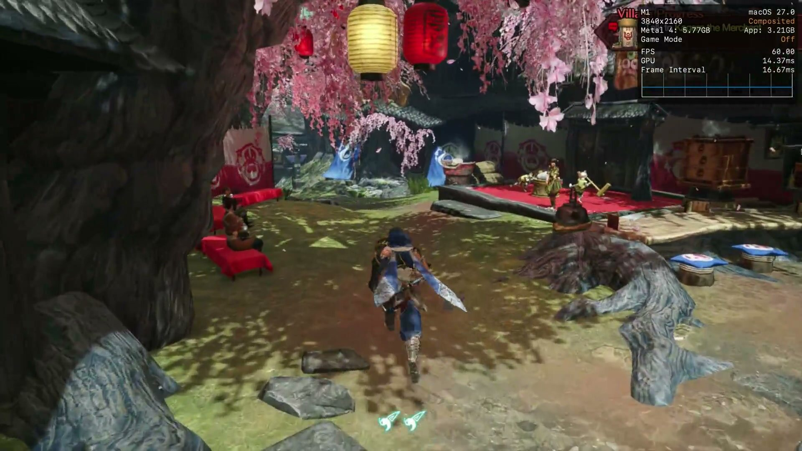

nxnative can now run Switch games as native macOS applications. YouTuber Andrew Tsai has
published a demonstration in which Monster Hunter Rise runs on an 8 GB M1 MacBook Air, and
the Metal overlay enabled by the project itself reports 60.00 FPS with 14.37 ms of GPU
time. Behind it is [`seedds/nxnative`](https://github.com/seedds/nxnative), an MIT-licensed
project with roughly 5,500 stars on GitHub that started as a copy of the generic parts of
`d2r-mobile`, the same author's earlier work on the same approach for Diablo II:
Resurrected.



The video's headline promises that "any Switch game" can work this way. The repository is
considerably more cautious: it keeps a list of tested titles and, for everything else, the
script does what it can. That gap between the claim and the current state is the
interesting part of the story.

## What nxnative does instead of emulating

The technical difference is real and it explains the performance. A Switch emulator
interprets or recompiles the console's instructions and reproduces its GPU in real time;
here, that does not happen. nxnative rewrites the game's code modules and lets the original
ARM64 code run directly on Apple's chip. What does remain is a host that stands in for the
Horizon kernel and the system services: threads and synchronisation, memory, a file system
with transactional saves, input, audio, the on-screen keyboard and the application
lifecycle. It is a substantial compatibility layer, it just does not emulate the CPU.

Graphics take the same route. Switch's NVN API is rebuilt on top of Metal, and shaders are
extracted from Nintendo's containers and from Unity objects so they can be translated
before execution: Ryujinx's shader translator converts Maxwell code into SPIR-V and then
SPIRV-Cross turns it into Metal Shading Language, which is compiled ahead of time. Games
that draw with Vulkan or OpenGL have their own intermediate layers.

The practical result is that no frame is lost translating CPU instructions, which is
precisely the bottleneck of emulation on a laptop. That is why a base M1 can hold 60 FPS in
titles that run at 30 on the console.


## What you need to try it

The hardware requirement is not negotiable: **a Mac with Apple Silicon**. The macOS host
executes the game's arm64 code, so an Intel Mac is out. On iPhone the requirement is even
more specific: iOS 26 and an A17 Pro or later.

From there, the path is the usual one for this kind of project: Xcode and Homebrew
installed, the build dependencies (`xcodegen`, `zstd`, `spirv-cross`, `glslang`, the .NET
SDK and a handful of Python packages) and, above all, **your own material**. You need a
folder with the game's NSPs — the base game, plus the update and the DLC if you have them —
and the `prod.keys` file from the console itself. The repository does not include a single
game file, and its author warns as much.

With that in place, a single command generates the application:

```
python3 scripts/build_ipa_from_nsp.py ~/Games/MarioWonder -k ~/keys/prod.keys --platform mac-app
```

The script extracts, rewrites, translates the shaders and packages a `.app` that opens from
the Finder without depending on the build folder. The first build takes between 30 and 60
minutes; subsequent ones take around 10. It is worth setting aside roughly twice the size
of the NSPs plus 10 GB of free space. Saves go to
`~/Library/Application Support/nxnative/<title ID>/` and logs to
`~/Library/Logs/nxnative/`.

Two details the demonstration does not show. The first is that the app is signed ad hoc and
**is not notarised**: if it arrives as a download, Gatekeeper blocks it until it is
authorised from System Settings › Privacy & Security. The second is that the first few
times a new scene appears there are short stutters, because Metal compiles its pipelines at
that moment and the project only remembers them for the next session.

## What you should not expect

**Not every game works.** The project's gallery gathers more than seventy titles with notes
per game, and each one has its own profile with the recognised builds and their patches. A
game without a profile gets an automatic analysis and a "best effort" packaging attempt
that, in the repository's own words, may fail to boot.

**The 60 FPS figure is the author's demonstration, not an independent test.** Tsai shows
them on his machine and with his save; nobody has replicated those numbers systematically
yet. They also depend on the version: the project's table records 60 FPS in Monster Hunter
Rise with update 16.0.2, and warns that the settings made for one specific version do not
carry over to a different one.

**There is no online play and no amiibo.** The project lists the lack of amiibo support and
of online features among its known limitations; Super Smash Bros. Ultimate appears simply
as "offline". Local multiplayer is there, though: on macOS each connected controller takes
its own player, up to eight, with the keyboard as player one. The gallery should not be
taken as all-Mac either: it mixes tests done on Mac and on iPhone, and each entry states
which platform it was tested on.

There are also acknowledged rendering gaps: conditional rendering is always drawn, geometry
shaders are not translated and, on Mac, Mario's menus and dialogue boxes come out blank (on
iPhone they do not). This is the current state of a very fast-moving project, and it is
best read for what it is: serious progress with a still-short compatibility list, not a way
to play anything you happen to have on the shelf. Anyone who wants to follow it game by game
will find it in the [emulators](/en/news/emuladores/) vertical.
