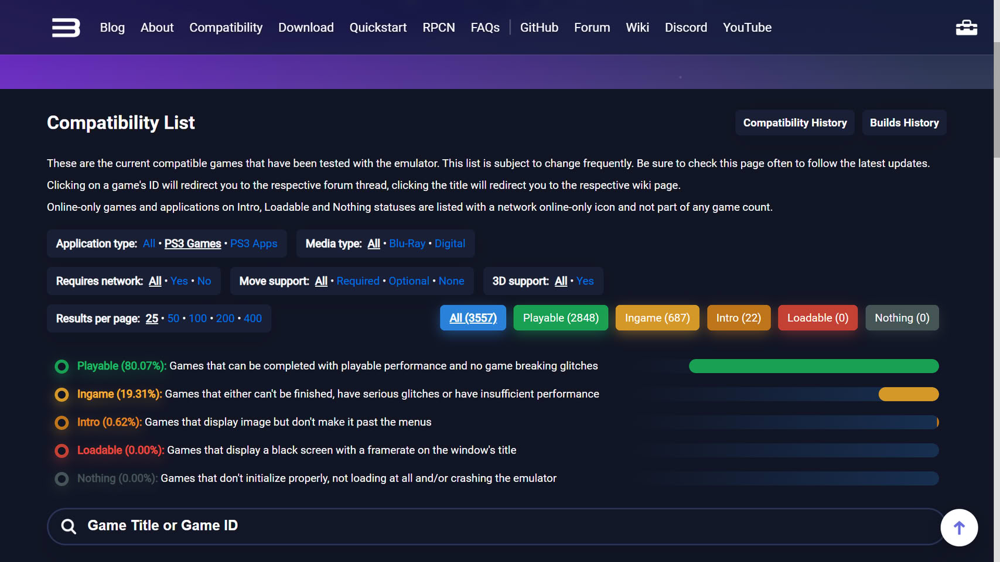
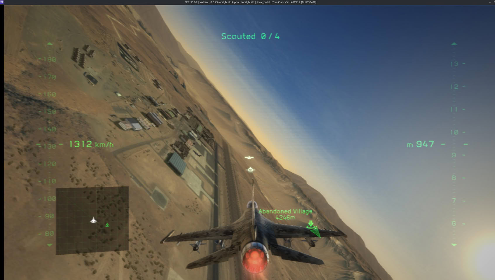

RPCS3 no longer has any games stuck in the **Loadable** category. The PlayStation 3 emulator team announced it on X, and the compatibility list reflects it: the last title remaining in that bracket, **Tom Clancy's H.A.W.X. 2**, has moved to **Ingame** thanks to an SPU precision fix signed off by contributor Yahfz. Of the 3557 games counted, 2848 appear as Playable, 687 as Ingame, 22 as Intro, and none in Loadable or Nothing.

## What the 'Loadable' category measures in RPCS3

The RPCS3 list classifies each game by how far it gets when executed, and "Loadable" was the lowest step before total failure: titles that load and then only show a **black screen with the frame counter in the title bar**. In other words, the emulator starts the game, but the image never renders.

| Category | Requirement |
| --- | --- |
| Playable | Can be completed with playable performance and no crashes breaking the game |
| Ingame | Starts and is playable, but cannot be finished, has serious bugs, or lacks sufficient performance |
| Intro | Shows image, but doesn't pass beyond menus |
| Loadable | Black screen with frame counter in title bar |
| Nothing | Does not initialize: does not load or closes the emulator directly |

Emptying "Loadable" means **no game is left at the step before showing an image**, and nothing more than that. Ingame is not guaranteed playability: the project itself defines the category as games that cannot be finished, drag serious bugs, or don't reach sufficient performance. H.A.W.X. 2 has come out of the black screen, not from a to-do list.

The nuance lies in the fine print of the list itself: the count excludes online-only games that fall into Intro, Loadable, or Nothing, which the website marks separately and does not add to the total. A handful of them — *Final Fantasy XIV: A Realm Reborn*, *Dragon's Dogma Online*, or *Angel Love Online*, among others — still appear in Loadable, but their status is not included in the figure the team has set to zero.

## The fix was in the SPU thread loader

The fix is one of those explained with a debugger in front. RPCS3 now reproduces **the SPU thread loader and the arguments that PS3's LV2 core leaves in the Local Store** at the start of each SPU group, before the code image loads. With that state reconstructed as the console left it, the loader stops corrupting itself and the game advances to gameplay.

The detail matters because PS3 architecture is not emulated "by approximation": Cell's SPUs work with a small local memory and a very specific load protocol, and a difference in initial arguments is enough for the program to read garbage where it expected code. That is why compatibility advances come as precision fixes rather than performance patches.

## 22 titles remain in Intro and 19% are in Ingame

The big block is no longer the black-screen one, but **Ingame**: 687 games, 19.31% of the total, that start and can be played with reservations. The short list is **Intro**, with 22 titles that don't pass beyond menus; according to the count, most are multiplayer games or titles requiring a PlayStation Move controller, with exceptions like *Need for Speed: The Run*.

It's also not the first time the category has hit zero: the team already announced it around the turn of 2023 and the list filled up again afterward. A regression in any subsystem can send titles back to the black screen, so the milestone should be read as **a snapshot of the current state**, not a closed goal. The other data point that helps situate the progress is the progression: in July, 0.06% of the library was still in Loadable and Playable hovered around 75%, according to the count TechPowerUp published at the time, versus 80.07% now.

## What changes for who emulates PS3 today

For the player, the practical headline is another: **fewer games remain that don't even show up**. Before downloading a copy, it's worth checking the specific entry in the compatibility list, because the emulator's global label says nothing about the title you're interested in, and "Ingame" can mean anything from a stable playthrough to a menu that crashes on loading the first level. RPCS3 publishes builds for Windows, Linux, and macOS; on Android the path goes through [ports like ARMSX3](/noticias/ps3-android-movil-emulador/), which start from this same work. And if performance falls short on a GeForce, it's not a bad idea to review the [workaround for the NVIDIA driver bug](/noticias/rpcs3-nvidia-driver-performance/) that the team documented in September.

Work remains, and plenty: 687 games in Ingame and 22 that don't pass beyond menus. What changes today is that the list no longer has a drawer of titles that load blindly.
