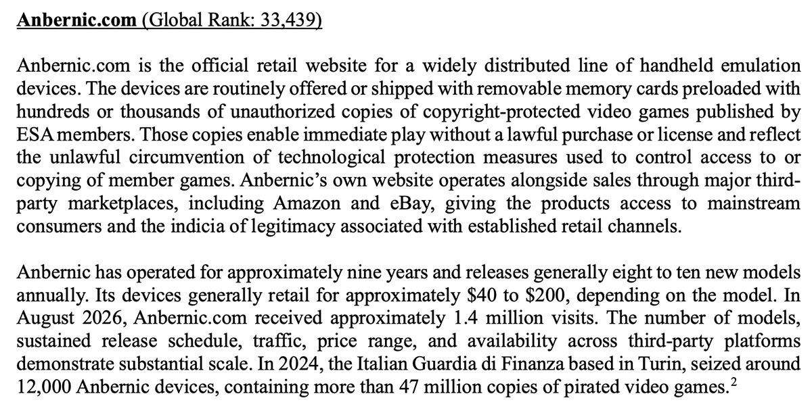

Anbernic has carved out a niche for itself in retro gaming with a very wide catalog of portable consoles, but its sales model has put the company in the crosshairs of the industry. The Entertainment Software Association (ESA), the trade association representing major US video game publishers, has formally requested that the United States Trade Representative Office (USTR) include Anbernic in its list of "notorious markets" and classified it as a "superfake", a label reserved for high-quality counterfeit products.

## What the ESA Requested

The ESA has submitted its suggestions for the USTR's "notorious markets" list, according to Android Authority based on a leak from Retrohandhelds. Alongside websites and distributors offering pirated game downloads, the association has pointed to Anbernic as one of the biggest threats to the industry.

The central argument of the document is specific: according to the ESA, Anbernic sells its portable consoles accompanied by memory cards preloaded with unauthorized copies of video games published by members of the association itself. Since this allows users to play titles they haven't legally purchased from their original publishers, the ESA considers it a case of "superfake" and not just an isolated infringement.

## What the Notorious Markets List Is

The USTR's "notorious markets" list gathers websites and companies that rights holders consider among the biggest threats to their activity. Historically it has included torrent platforms, crack markets, and other sources of illegal game downloads, so including a hardware manufacturer is an unusual move for the industry.

It is worth clarifying the scope of the document: the ESA's recommendation does not make Anbernic a "superfake" nor automatically place it on the final list. The USTR decides which entities are officially included, so for now this is a proposal and not a resolution.

## What Would Change for an Anbernic Buyer

If the USTR accepts the ESA's description and adds Anbernic to the official list, the company could be barred from selling its consoles in the United States, or it might be forced to stop packaging them with preloaded memory cards. It is an as-yet-unconfirmed scenario, but it is enough for anyone considering buying one of its models, such as the recently announced RG DDS, to evaluate the timing of their purchase.

Beyond the specific case, the move sets a precedent: the industry is starting to point not only at download sites but also at hardware sold with a preloaded catalog. We will have to see if the USTR shares that criterion or if Anbernic ends up off the list when the final resolution is published.
