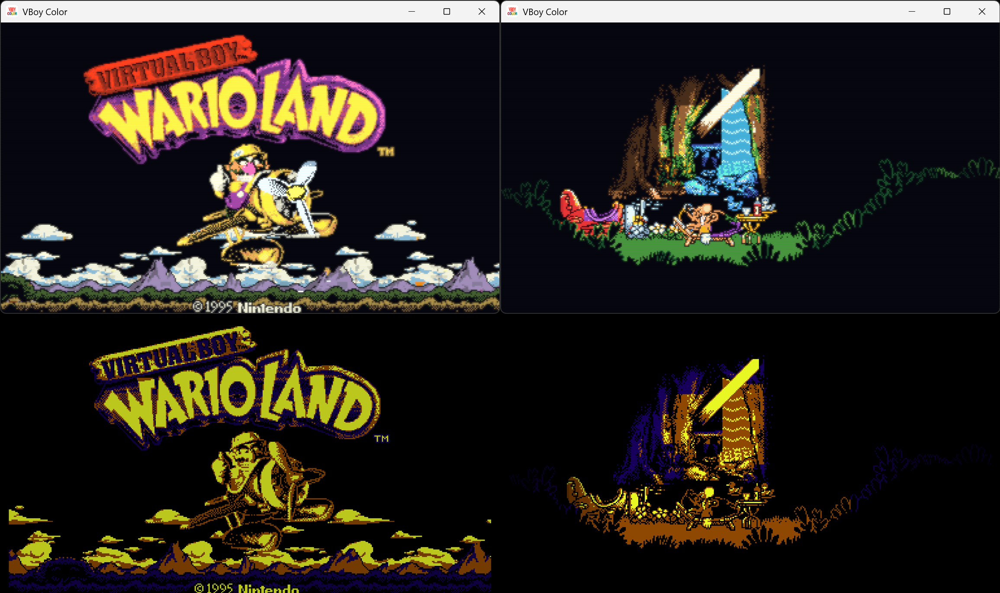

VBoy Color has just arrived as a free and open-source Virtual Boy emulator, and it does so with two promises that the Nintendo console never fully fulfilled: color and real stereoscopic 3D. The proposal allows playing games in three dimensions through Meta Quest glasses, but also on Windows, Linux, macOS, and Android, both in 2D and 3D. The project is downloaded from its public repository on GitHub.

The emulator starts from VirtualBoGo and compiles without touching the core emulation **Beetle VB**, the libretro fork of Mednafen's Virtual Boy emulation. It is distributed under the GPL-3.0 license and, as is usual in this type of project, does not include any games: one must provide their own cartridge dumps.

## How it achieves color

Color is not a flat filter. The **Auto** mode, which comes by default, colors each pixel according to what drew it: background layers by their depth, from far to near, and characters by their palette, with steps from dark to lighter. What a game draws without tiles — the wireframe world of *Red Alarm* or the pit of *3-D Tetris* — is colored according to the distance between the images of both eyes, from indigo to gold. Alongside it lives the **Multicolor** mode, which gives its own color to each of the four tones of Virtual Boy starting from a series of palettes; the **Gradient** mode, which maps the game's brightness over a gradient; and the **Tint** mode, the classic look in red or whatever color is mixed.

In addition to automatic modes there are *packs* of hand-painted colors game by game, tile by tile. They come integrated for titles such as *Galactic Pinball*, *Mario Clash*, *Mario's Tennis*, *Jack Bros.*, *Teleroboxer*, *Vertical Force*, *Wario Land*, *Bound High*, *Dragon Hopper*, *Innsmouth no Yakata*, *Panic Bomber*, *Space Invaders Virtual Collection* and *V-Tetris*, among others, which only save colors: no image of the games travels with the application. A `.vbcp` file alongside the ROM replaces the integrated pack, and on PC it is possible to paint your own.

## 3D and the rest of features

The project's strong point is the 3D. On a Meta Quest each eye receives its own image, as in the original hardware, and the screen refreshes at the highest rate the headset admits so that movement does not break. On PC and phones there is also 3D without special glasses: the **side by side** mode for a 3D TV, **top and bottom**, or the classic **color glasses** (*red/cyan*, *green/magenta* and *amber/blue*), mixed with the Dubois method to keep the game's color as much as possible.

The list of features is extensive: save states with thumbnails in color, RetroAchievements support in *softcore* mode, controller on PC, VR and Android with per-game button remapping, and three screen styles —**Sharp**, **Smooth** with the rounded edges of OmniScale, and **LED** with rows of light and the soft brightness of Virtual Boy itself—. On Quest, the image can float in the real room via *passthrough*; on PC the window size is adjusted, and *hotkeys* cover captures (F12), save and load state (F2 and F4), restart (Ctrl+R) and exit (Ctrl+Q). Video recording can record the original red image and the colored one side by side, frame by frame, and the emulator even accepts *runs* of TASVideos (`.bk2`) that it reproduces on its own.

## Actual state and what's missing

VBoy Color works on Windows (.zip x64), Linux (binary that needs a Vulkan driver), macOS via RetroArch, and Android on phones, tablets, portable devices and compatible TVs. The requirement on Android is Android 10 or higher, 64-bit ARM and Vulkan, which leaves out Fire TV Sticks with 32-bit Android. As a RetroArch core it can be installed on Windows, Linux, macOS and Android, and on PC there exists a VR version (`VBoyColorVR.exe`) for Quest Link, Virtual Desktop or SteamVR.

RetroRGB itself leaves an honest caveat: anyone who already has a MiSTer can add color from the start with the **Color Mode\Multicolor** setting or by loading a Game Boy Color palette, and see it in 3D on any screen, although the anaglyph mode is not up to the height of the real 3D of a headset. Nevertheless, the advantage of software emulation lies in things that the original hardware cannot offer, and this emulator is a weighty reason for Virtual Boy fans to give it a chance.
