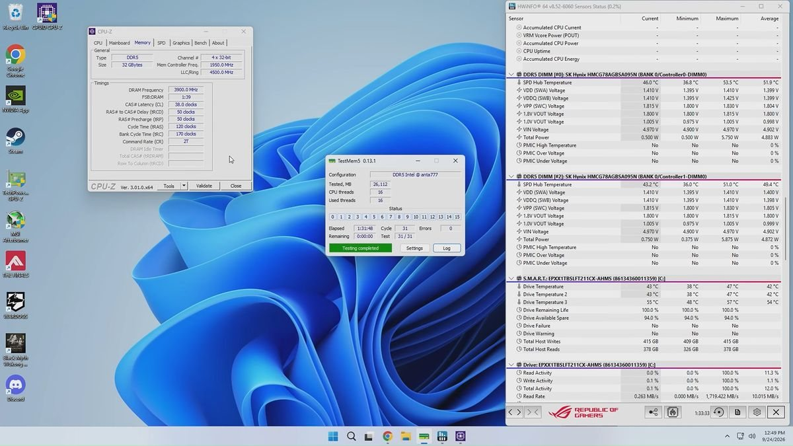
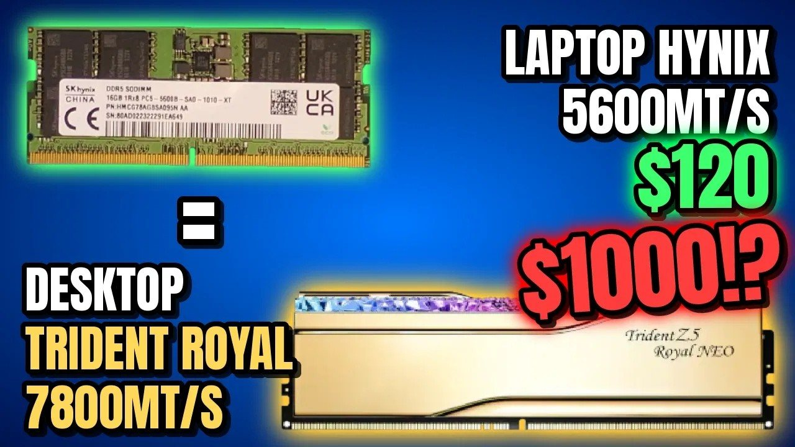

**Blighted Agent has converted laptop memory chips into a desktop kit that, according to Tom’s Hardware, reached DDR5-7800 CL38.** Mark Tyson’s report describes transferring components from two 16 GB SK hynix DDR5-5600 SO-DIMMs onto new desktop memory boards. This is specialized electronics rework, not inserting an adapter between formats.

## From SO-DIMM to desktop DDR5 through BGA work

The source consulted for this news is [the Tom’s Hardware report](https://www.tomshardware.com/pc-components/ddr5/electronics-hobbyist-converts-usd120-ddr5-sodimm-kit-into-usd1000-desktop-kit-to-fight-ram-crisis-ics-from-sk-hynix-ddr5-5600-16gb-modules-used-to-create-ddr5-7800-desktop-sticks), which points to [Blighted Agent’s original video](https://www.youtube.com/watch?v=bpT5CdOBNDU). We have not inspected the full video or independently checked the build.

According to that account, the project requires removing integrated circuits, preparing their BGA connections again and soldering them onto other boards. The operation needs tools, heat control and experience: a soldering fault or damaged chip can prevent the setup from booting. This report is not a guide to reproducing it.

## DDR5-7800 CL38 on one specific platform

Tom’s Hardware reports a setting of **DDR5-7800 CL38 at 1.40 V on an ASUS ROG Maximus Z790 Apex Encore** and a 90-minute stress test reported by the creator. These are results attributed to the project, not our own stability validation.

Neither that frequency nor that test duration guarantees operation on every motherboard or with every memory controller. Compatibility still depends on the platform and settings. Identifying the chips as possible A-die also appears as the creator’s assessment relayed by the outlet, not an identification confirmed here.

## Material cost is not total cost

The report puts the two used donor modules at $120 and the project’s materials at around $175 after adding boards and heatsinks. **The calculation excludes specialist equipment and labor.** Comparing it with a supposed $1,000 kit does not demonstrate reproducible savings or a verified market value.

The interest lies in reusing chips through a physical change of carrier and then tuning their operation. This differs from [Transcend’s industrial DDR5-6400 modules](/noticias/transcend-ddr5-6400-industrial/): an individual modification does not offer the same validation and support conditions as a commercial product specified for a platform.

*Images: Blighted Agent, through Tom’s Hardware and the public thumbnail of the video. They do not imply independent inspection of the process.*
