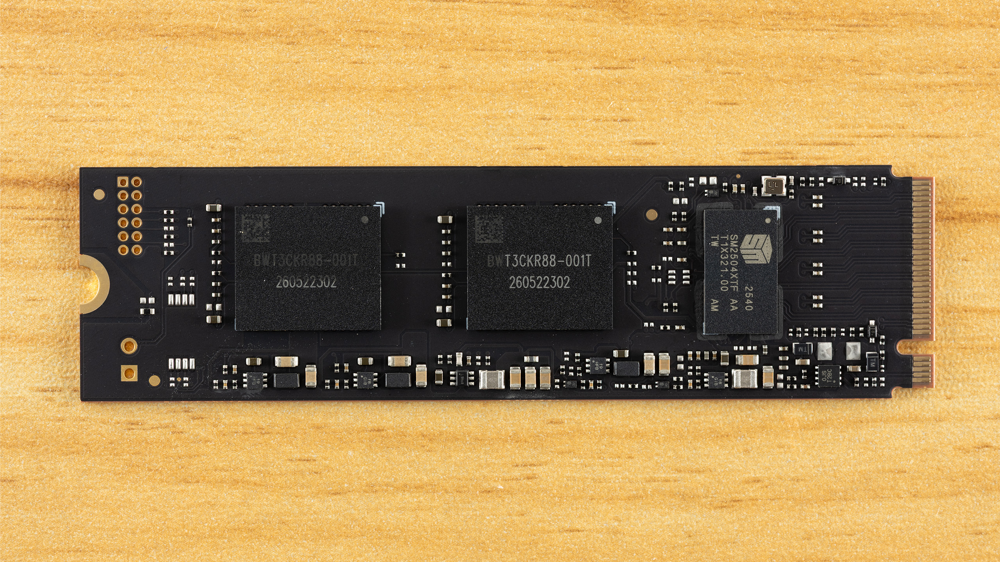
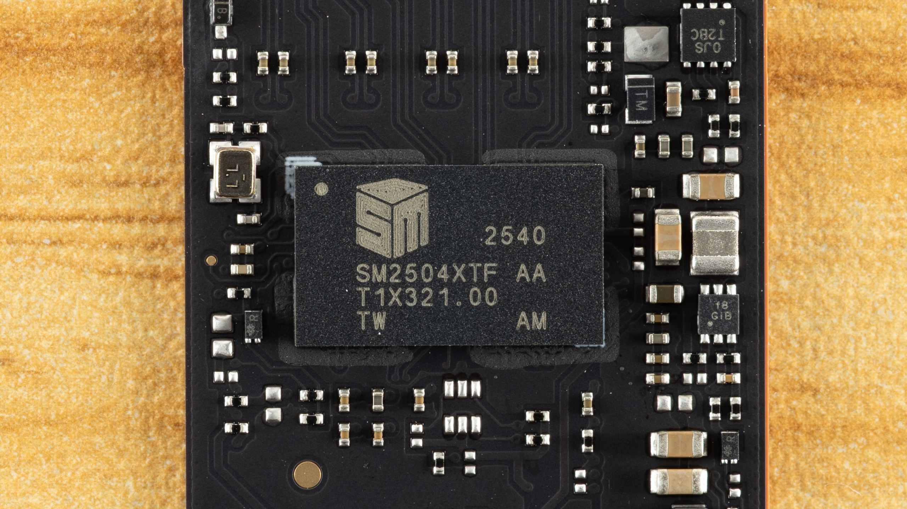

**The Biwin M560 2 TB** receives an especially favorable rating for its response and efficiency in the [analysis published by Tom’s Hardware on November 1](https://www.tomshardware.com/pc-components/ssds/biwin-m560-2tb-ssd-review). The important nuance appears when writing large amounts of data: the drive shows a notable drop when the cache is exhausted. This is a relevant difference for someone seeking a primary drive for applications and games versus someone needing long, continuous transfers. **This information compiles Tom’s Hardware tests; it is not an analysis performed in TechSpain24's laboratory.**

## Biwin M560: PCIe 5.0 without Dedicated DRAM

The technical specifications gathered by Tom’s Hardware describe a **single-sided M.2 2280 SSD**, with PCIe 5.0 x4 interface and NVMe 2.0 protocol. The drive combines the Silicon Motion SM2504XT controller with Kioxia BiCS8 TLC memory of 218 layers. It does not incorporate dedicated DRAM and relies on HMB, a mechanism that uses part of the host system's memory.

For the 2 TB version, the drive lists specifications up to **11,000 MB/s read and 10,000 MB/s sequential write**, plus a declared endurance of 1,500 TBW and five years warranty. These are spec sheet values, not guaranteed speeds for any file or system. The range examined by the publication is limited to 1 and 2 TB; the absence of a 4 TB option figures among its reservations.

*Disassembly photograph published by Tom’s Hardware.*

## Response in applications weighs more than maximum sequential speed

In the [Tom's Hardware performance results](https://www.tomshardware.com/pc-components/ssds/biwin-m560-2tb-ssd-review/2), the M560 finishes first among the compared units in PCMark 10 Storage and second in 3DMark Storage, behind the SM2504XT engineering sample. The publication also highlights its 4 KB random read latency at queue depth one: it leads that section within the compared group. This does not mean it is the fastest SSD on the entire market nor that it will accelerate all games equally.

The context of those measurements matters. Tom’s Hardware declares a platform with **Core i9-12900K, Asus ROG Maximus Z790 Hero motherboard, 32 GB DDR5-5600 CL28 RAM, and Windows 11 Pro**. Its general methodology uses each SSD as a secondary drive, with 50 % occupied and several background tasks disabled to reduce variations. It also specifies active cooling unless otherwise indicated. This does not equate to measuring it as a boot drive inside any laptop.

The comparison is also not favorable in all sections. In DiskBench, where the medium uses a set of 50 GB with 31,227 files, its rating is less enthusiastic: models with Phison E31T controller and BiCS8 memory come out better placed. This is a warning against reducing purchase to a single synthetic result.

*Detail of the controller photographed by Tom’s Hardware.*

## The cache changes the result of long writes

Tom's Hardware's sustained test uses Iometer for 15 minutes and distinguishes **three write states**, not a single constant speed. With the drive empty, the publication measures something over 10.3 GB/s during more than 59 seconds, with an approximately 611 GB pSLC cache. That reserve is dynamic: it reduces as the SSD fills up. This initial empty scenario should not be confused with the occupancy state of its general methodology.

Next comes direct write to TLC, over 4.1 GB/s according to the analysis. However, Tom’s Hardware warns that this figure alone does not describe a prolonged transfer either: when the SSD needs to move data from cache to TLC to free space, speed drops to something over **1.6 GB/s**. That reorganization competes with new writes.

Therefore, the publication's verdict favors its use as a versatile primary drive, but does not consider it ideal for sustained write loads. A large cache allows absorbing extensive bursts; it does not eliminate subsequent penalty nor guarantee the same behavior with the drive nearly full.

## Efficiency and compatibility: what to check before buying

Tom’s Hardware rates its efficiency as excellent, though slightly lower than E31T models with BiCS8 in that indicator. In its thermal test, described without a heatsink, both sensors reach **61 and 76 °C**, with an ambient temperature near 22 °C. The publication places the hotter sensor approximately ten degrees below the thermal throttling threshold, but warns that sensors are not always accurate. Those temperatures are no promise for any chassis or climate.

To install it, it is advisable to check M.2 2280 NVMe support, the slot lanes, and available space. On a PCIe 4.0 platform, PCIe 5.0 bandwidth will not be utilized. Connector distribution also matters on desktop, as illustrated by our coverage of the [Gigabyte B850 AORUS ELITE X3D M.2 slots](/noticias/gigabyte-b850-aorus-elite-x3d/).

Tom’s Hardware's conclusion is favorable for someone prioritizing response and efficiency in a 2 TB primary drive, not for someone seeking maximum capacity or continuous writes without pace changes. **There is no verified price or stock in Spain for this piece**: the American commercial references of the analysis do not allow establishing how much it will cost here nor whether it is available in a Spanish store.
