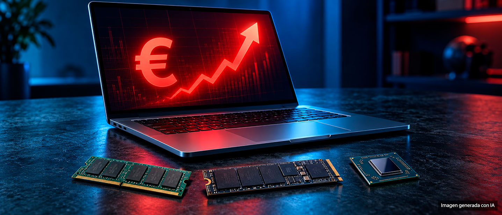

During the third quarter of 2026, the processor, RAM memory and SSD accounted for approximately 68% of the component cost of a conventional laptop with a recommended price of 900 euros or dollars. The figure should be read precisely, because it changes everything that follows: that percentage corresponds to the material cost of the equipment, not its selling price. In other words, almost seven out of every ten euros spent on manufacturing the machine go towards three parts.

## Back-to-back increases in silicon

The percentage does not come from a sudden spike, but from a sum of increments that have accumulated over months. AMD and Intel processors have already applied at least two price hikes so far this year, and all signs point to the trend continuing into 2027. Qualcomm, although it has not officially announced it, would also have increased prices for its computer and mobile chips. The origin of these increases lies with TSMC, which has raised the price it charges these companies for manufacturing their processors and graphics cards.

To that bill must be added the cost of DRAM memory and NAND storage. In `memory`, one should note this point: both are the components moving up most strongly, doing so quarter by quarter. Forecasts point to them continuing to rise throughout 2027 and much of 2028, so the problem is not with a single generation of laptops, but with the next two or three generations.

## Three exits and none comfortable

With that scenario, the manufacturer has only three paths. The first is raising the final price, with the immediate effect of reducing sales volume. The second is already being seen in stores: cutting specifications. It has become common to find equipment with 8, 16 or 24 GB of RAM and SSD configurations of 256 or 512 GB. The third, the rarest, is for the brand to assume the extra cost by reducing its profit margin.

None are attractive and all three share the same destination: either raise the product price, make it less competitive, or earn less from it. Market analyst TrendForce considers it unlikely that brands can maintain price, performance and profitability simultaneously during 2027. According to that same estimate, global laptop production outside China would fall from 24% in 2025 to 21% in 2026, and could drop below 20% in 2027, as the industry returns to prioritizing its infrastructure in China to contain costs.

## AI continues to squeeze DRAM and NAND

RAM memory is under pressure that does not depend on the PC market. Artificial intelligence servers absorb practically all advanced manufacturing capacity, so supply of memory for personal computers could grow only limitedly. On the NAND Flash side, which SSDs use, restrictions could ease during the second half of 2027 thanks to new production capacity.

It is worth keeping in mind that the phenomenon does not limit itself to laptops: it affects desktops, convertibles and Mini-PCs equally. And it has already reached other components such as printed circuit boards (PCB), capacitors and energy management chips.

## What changes for the buyer

The practical reading is that affordable equipment has months left, and the moment of buying ceases to be a matter of opportunity and becomes one of calendar. For anyone who does not want to pay now, extending the life of the current laptop is a reasonable option: a reformatting accompanied by a thermal compound change and cleaning returns the machine behavior very close to the original, and options like Windows 11 LTSC or jumping to Linux reduce performance impact without touching the hardware.

When it comes time to renew, the criterion should be compatibility ahead of the showroom number. In a new machine, the real decision lies in the platform that supports memory and storage —which DDR generation the motherboard admits, how many channels, whether the SSD is PCIe of which version— rather than the percentage on the brochure. With prices currently drifting, getting this base right avoids having to change machines prematurely.
