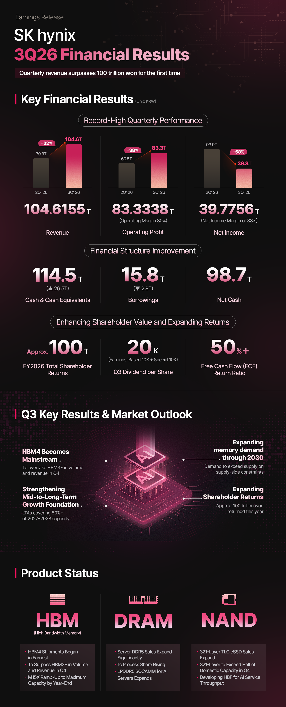

The memory shortage won't be resolved next year. That is, at least, the reading left by SK Hynix in its third-quarter 2026 results presentation published on October 28: the company expects the structure where demand outstrips supply to persist **until 2030**. Two things are worth underlining before continuing. The first is that this is a forecast, not a price commitment or a closed date. The second is that whoever makes it is one of the three major DRAM and NAND manufacturers in the world — that is, a party interested in the market staying tight.

## What SK Hynix said about memory shortage

The document doesn't talk about prices but about supply-demand balance. The company maintains that supply isn't keeping pace with the market for two concrete reasons: the technical difficulty of more advanced manufacturing processes and the long lead time required to build a new factory. Hence its conclusion: demand will stay ahead of supply until 2030.

The demand calendar is also described. In the short term, pressure comes from enterprise AI and personal AI; in the medium and long term, from so-called physical AI, with autonomous driving and robotics as vectors. It's not a market the company expects to cool down soon.

The quarter's numbers explain why no one is rushing to correct course. SK Hynix recorded revenues of 104.6 trillion won — the first time it has surpassed 100 trillion in a quarter — with an operating profit of 83.3 trillion and an operating margin of 80%. HBM4 sales have kicked off, and the company expects that product to surpass HBM3E in volume and revenue during the fourth quarter.

## Why supply doesn't react as quickly

The part that most affects hardware buyers is in capacity detail. SK Hynix has signed long-term agreements with 14 major customers, including the big cloud service providers, and already has committed **more than 50% of its production capacity for 2027 and 2028**. These are contracts typically signed at five years and include a pricing mechanism within an agreed range.

That figure, read in consumption terms, means that much of the wafers for the next two years already have a destination before the free market even asks for a single memory. And the destination is server: DDR5 server, HBM4, LPDDR5 SOCAMM modules for AI servers, and 321-layer eSSDs, which in the fourth quarter will represent more than half of the company's domestic NAND capacity. High-end production tilts toward where the margin lies.

This is added to investment. The company foresees a significant increase in spending next year, with the first phase of Yongin entering full-scale operation, but keeps the door open to adjust the calendar according to demand and profitability. In other words: more capacity, yes, but not necessarily at the pace the consumer market would desire.

## The counterpoint: Acer and storage timelines

SK Hynix's forecast clashes head-on with that given in September by Acer CEO Jason Chen, who called it "impossible" for the shortage to last until 2030 and placed the start of price drops in mid-2027, when additional capacity comes into play. That analysis came qualified: it stemmed from a translation and could refer mainly to the Chinese market. You can reread the [analysis of Jason Chen's statements](/noticias/acer-ceo-ram-crisis/) to compare both calendars.

Between these two extremes, Engadget's storage analysis adds a useful nuance: HDDs and SSDs have ended up somewhat more protected than RAM, but they're not immune either. The forecast that medium handles places 2027 as a first wave of relief, with subtle declines that many buyers won't notice, and delays a truly noticeable drop to 2029 or 2030. It adds that previous pre-pandemic lows probably won't return.

Putting the three versions in order, there's one point where they agree: none promises a return to prices of two years ago, and all push relevant correction toward the end of the decade. The real discrepancy isn't whether drops will occur, but how noticeable they'll be and when they'll start to be noticed.

## What changes if you're buying RAM, an SSD or a PC

For whoever needs to expand memory, the practical consequence is that waiting a few months won't improve the moment to buy. If the system is short now, DDR5 kit must be bought with the market as it stands, and with two precautions that save headaches: verify that the module's EXPO or XMP profile is validated for the specific motherboard and processor, and don't mix different kits to squeeze out capacity, because that's the fastest route to a system that won't boot with the profile activated.

In storage, the margin is somewhat greater. If the failing SSD is the system drive, there's no debate: replace it now. If it's a secondary unit for a game library or archive, the range described by Engadget leaves 2027 as a reasonable window to wait, without betting on a crash.

And for whoever values a complete PC, memory is only part of the bill, but it's the one that has moved most: brand machine prices and custom builds absorb that cost with delay, so the increase reaches stores after appearing in the loose component. Comparing equivalent configurations remains more profitable than waiting for a cycle change that, according to the dominant manufacturer itself, isn't scheduled before 2030.
