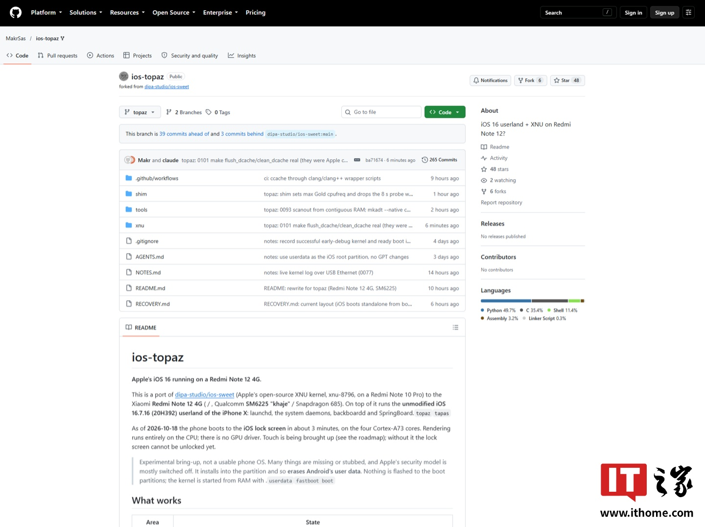

# A fan makes iOS 16 run on a Redmi Note 12 and publishes the port code

A fan who goes by Makr has managed to get a **Xiaomi Redmi Note 12 4G**
to boot **iOS 16** for real and has published the port code on GitHub, named
`ios-topaz`. It is not a theme, nor a launcher, nor an emulator: underneath runs Apple's XNU
kernel, the hybrid that powers Darwin, and on top sits unmodified iPhone X software. The story was picked up by ITHome on October 19 from the author's own demonstration.

In the recording, the "About phone" section reports iOS version 16.7.16 and a model of "iPhone X." The repository is already open, with build instructions and an honest table dividing what works and what still doesn't.

## What ios-topaz does exactly on the Redmi Note 12

`ios-topaz` is a fork of `ios-sweet`, the project that brought Apple's open-source XNU kernel (version `xnu-8796`) to a Redmi Note 10 Pro. The new difference here is the destination: the Redmi Note 12 4G, with internal codenames `topaz` and `tapas` and the Qualcomm SM6225 "khaje" — that is, the Snapdragon 685.

On top of that kernel, the project runs an iPhone X system with iOS 16.7.16 (build 20H392) **without touching it**: `launchd`, the system daemons, `backboardd` and `SpringBoard` are the originals. The phone also identifies itself as an `iPhone10,3`, so the interface assumes the iPhone X, with gestures and no Home button.

The boot preserves Xiaomi's original bootloader: the only command issued is `fastboot boot`, which loads an intermediate piece into RAM without writing to the boot partitions. iOS' root lives as HFS+ volume with journaling inside the `userdata` partition. According to the project's README, updated October 18, the phone takes about three minutes to reach the lock screen using the four Cortex-A73 cores.

## What still doesn't work in the iOS 16 port

Here the project stops being a curious demo and becomes real engineering, with a long to-do list:

- **No GPU.** Rendering is done entirely on CPU and frame rate is low: there is no graphics controller.
- **Eight cores of four.** XNU uses 16 KB pages and Silver cores (Cortex-A53 class) don't support that translation granularity, so they sit idle. A 4 KB XNU appears in the roadmap.
- **No connectivity or sensors.** No Wi-Fi, Bluetooth, cellular network, audio, camera, GPS nor SEP: `bluetoothd` and `fairplayd.H2` loop because hardware is missing.
- **No real-time clock**, so date starts on December 31.
- **Security disabled**, with permissive AMFI and sandbox and no data protection.
- **Touch and buttons under discussion.** The README lists them among what doesn't work: the FocalTech FT5452 controller is written but not confirmed on the device, and power/volume keys aren't ported. ITHome, however, considers touch and volume operational in its demonstration. Until the repository confirms it, one should count with the screen possibly still not responding.

And the detail that hurts anyone who tries it: installation **deletes Android data** when writing to `userdata`. Boot partitions are untouched, but reaching this requires an unlocked bootloader, a Linux PC and `fastboot`, and a GitHub account to compile the kernel — a task the project estimates at about eight minutes on GitHub's macOS runners.

## It's not the first time: iOS ports have been running for weeks

The Redmi Note 12 is not the first Android phone running iOS. Twelve days ago, October 7, developer j0sh1x showed an HTC HD2 — a 2010 model — with the iOS 7 boot screen and published the XNU kernel code and hardware support. In his case, touch already worked. The common base of both works is the same: the XNU Apple publishes openly.

## What changes for someone who just wants a working phone

For someone about to buy, the short answer is: nothing. The Redmi Note 12 arrived in March 2023 alongside the Redmi Note 12 5G, the Note 12 Pro and the Note 12 Pro+; the 4G version mounts a 6.67-inch FHD+ display at 120 Hz, Snapdragon 685, 5,000 mAh battery and a 50-megapixel main camera. All that still works with Android, and the iOS 16 port adds not one feature, nor an update, nor a single year of support.

What the project does bring is something else: a demonstration, with public documentation, that Apple's kernel can boot on foreign hardware without modifying the iPhone's operating system. In the reverse sense, Xiaomi has already taken steps for its ecosystem to coexist with Apple's: [its HyperOS 4 phones support the Apple Watch](/noticias/xiaomi-apple-watch-hyperos/).

**Verdict:** as pure engineering, it is fascinating and, besides, open. As a system for daily use, let's not talk about it. The Redmi Note 12 4G remains what it was before this port: a mid-range with Android, to which the feat changes nothing.
