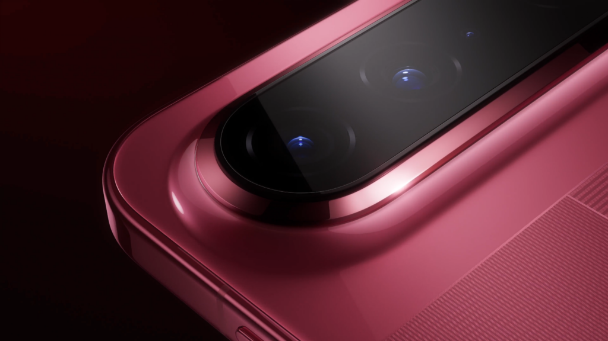

Huawei's Pura X View — the «wide candybar»-format smartphone launched last August — has sold around 449,800 units in China. The figure corresponds to week 39 of 2026 (September 21–27) and comes from digital market-share blogger @RD观测, who has been publishing the terminal's sales pace since its store arrival.

The numbers are solid for a niche product, but the problem is not demand — it's supply. Priced at 5,999 yuan to start, the Pura X View has become hard to buy: Huawei's own official website was already marking an estimated shipping date before November 19 just a few days ago, and the Midnight Black (black) variant was listed as directly out of stock.

## Strong Sales Amid Unit Shortage

According to GizmoChina using data from the aforementioned blogger, the Pura X View sold around 449,800 units in week 39. Reading those figures is conditioned by a recurring detail: users on social media say the device is still out of stock and that some resellers are selling it with a **markup of between 500 and 1,000 yuan** above the official price. The repeated conclusion in comments is simple: if Huawei had more stock, sales would be even higher.

The figure should be read with the usual caution when the source is third-party market tracking rather than the company itself, which has not published official sales data.

## What You Get for That Price

The appeal of the Pura X View lies in its unusual design. It uses a flat 6.39-inch OLED screen with 2232×1320 resolution and a 16:9.5 aspect ratio — wider than that of elongated phones we're used to. The screen has symmetric bezels of 1.05 mm on all four sides (96.1 % useful area), a 120 Hz refresh rate, high-frequency PWM dimming at 2160 Hz, and a local peak brightness of 6,500 nits, protected by Kunlun glass.

Inside lies a Kirin 9030S processor cooled with a 6,400 mm² vapor chamber. The price in China breaks down as follows:

| Configuration | Price in China | Approximate Equivalent |
| --- | --- | --- |
| 12 GB + 256 GB | 5,999 yuanes | ~896 dollars |
| 12 GB + 512 GB | 6,999 yuanes | ~1,045 dollars |
| 12 GB + 1 TB | 8,499 yuanes | ~1,270 dollars |

In the camera department we find a 200-megapixel RYYB main sensor (1/1.28-inch size, f/1.8 aperture, with OIS), a periscope telephoto of 50 megapixels (f/2.6, OIS, equivalent to 88 mm), an 8-megapixel ultra-wide angle lens, and the second generation of Huawei's primary color camera. On the front, a 40-megapixel selfie camera.

The battery is 7,000 mAh with a silicon anode and supports wired charging at 66 W and wireless charging at 50 W. The device measures about 6.68 mm in thickness, weighs around 201 grams, and offers IP68/IP69 dust and water resistance, BeiDou bidirectional satellite messaging, and eSIM compatibility. Available colors are Shadow Red, Linen Gray, Zero White, and Midnight Black.

## What This Means for the Buyer in Spain

Here comes the uncomfortable part for the Spanish reader: the Pura X View is a product of the Chinese market, and **there is no official price or availability in Spain**, nor long-term support data — because, as with the recent Pura range, it is not sold through usual European channels. Anyone wanting one will have to resort to importing, bearing reseller markups, lack of local warranty, and uncertainty about updates.

So at that price: no. The Pura X View is an interesting proposition in terms of format and specifications — wide screen, 7,000 mAh battery, 200-megapixel main camera — but paying between 500 and 1,000 yuan extra above the official price, with no stock and no support in Spain, turns the purchase into an import indulgence rather than a sensible decision. If the wide format truly attracts you, it makes more sense to wait and see whether Huawei normalizes stock or whether another brand carries the idea over to a phone you can actually buy here with warranty.
