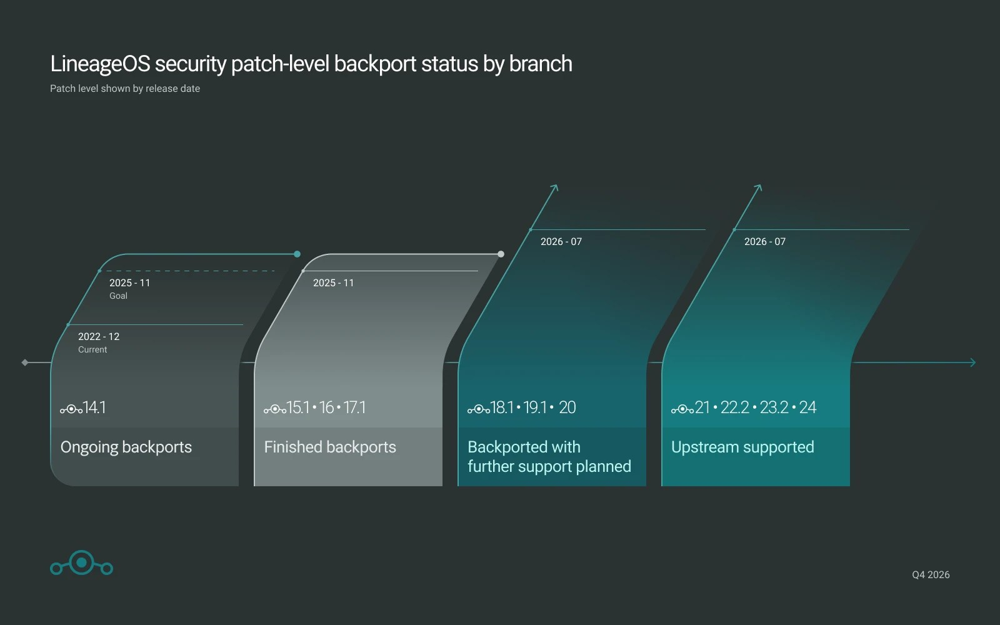

# LineageOS 24 is already official

The new version of the free ROM runs on top of Android 17 —the base that Google released in June— and does so earlier than the project itself had planned: the team confirms they were able to apply their changes to the new code faster than expected. The announcement also arrives as a countdown to LineageOS's tenth anniversary, which falls on December 24, 2026.

The 24.0 branch integrates security patches from August 2025 through October 2026 across system versions 18.1 to 24.0. As always, the download is free: the real cost of extending a phone's life with LineageOS isn't the software itself, but verifying that the device still appears on the support list.

## The project's apps get a refresh

The biggest block of new features lies in the proprietary applications, which have been almost entirely migrated to Material Design 3 Expressive. The most eye-catching addition is **Canvas**, an integrated image editor covering the basics (cropping, white balance, and filters), accompanying the Glimpse gallery and Aperture camera.

The rest of the suite also gets a makeover:

- **Updater**: complete redesign and, above all, updates delivered by default via streaming, which notably reduces installation time on devices with A/B partitions. On non-A/B devices, the recovery partition self-updates after a successful update on subsequent boot.
- **Twelve** (music player): improves load times for large libraries, adds a tab showing your most-played discs and genres, and strengthens Jellyfin support.
- **Jelly** (browser): supports PWA-style apps via a new shortcut, a useful path for users who don't want to go through third-party stores.
- **SetupWizard**: full implementation of Material Design 3 Expressive with a restructured initial setup flow.
- **Catapult** (Android TV launcher) adds a battery indicator, and **Etar** and **Seedvault** update to their latest upstream versions. The **WebView** bumps to version 155.0.8059.30.

## Flashing the ROM from the browser

Installing LineageOS also becomes simpler. The project launches flashing tools based on **WebUSB** that run directly in the browser for several common protocols: ADB, Fastboot, the Amlogic Burn protocol, and Samsung Odin.

These utilities, available at `flash.lineageos.org`, eliminate the need to search for, install, and launch separate desktop programs. That said, they do not replace the wiki guides: device-specific documentation remains the default route and the only fully supported path, and compatibility of these web tools depends on the device, browser, operating system, and USB connection type. Flashing custom software still carries risk, so it's wise to back up and verify that the files and chosen device are correct.

## What changes for you: support and devices

Here is the fine print that truly matters to users. LineageOS formalizes that devices with **Linux kernel 4.4 and 4.9** will no longer be accepted for branches 23.2 and 24.0: only new contributions targeting **LineageOS 22.2** are now accepted, which will continue receiving monthly builds and security patches until Google stops publishing official bulletins for Android 15. The reason is always the same: maintaining those old kernels forward becomes unsustainable.

For everything else, the project has expanded common kernels by manufacturer (Qualcomm and Amlogic) and unified device legacy compatibility shims—a way to distribute maintenance work without duplicating effort.

Regarding updates: if you're coming from an official build, **you don't need to wipe the device** unless your model's page explicitly states otherwise; follow the wiki update guide. If you were on a non-official build, proceed through the installation guide as any new user.

Deployment will reach an expanding selection of devices over the coming weeks as maintainers prepare them. The initial list is broad: it covers most of the Pixel family (from Pixel 4 to Pixel 10), Samsung models, Sony, Xiaomi, OnePlus, Motorola, Fairphone 4 and 5, Nothing Phone (1), and various AYN or Retroid devices, among others.

## Verdict

At this price—zero euros—LineageOS 24 is the best way to keep a phone with expired official support alive, and arriving ahead of schedule on Android 17 is a sign of good project health. Before you dive in, check two things on the wiki: that your model is listed, and above all, that its kernel isn't 4.4 or 4.9. If your terminal falls into that old group, your path ends at LineageOS 22.2; if it's among the new ones, updating is free and extends the device's life by several more years.
