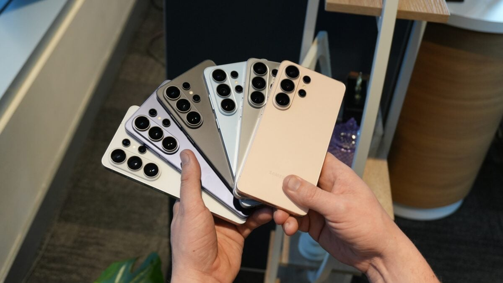

# Samsung retains global mobile leadership in Q3 2026, but the market falls 20% and prices rise another 20%

Samsung returned to being the world’s largest smartphone manufacturer by shipment volume in Q3 2026, with a 23% global share. What matters isn’t that it repeats at the top, but the context: the global smartphone market fell 20% year-on-year to its lowest level in 14 years, and simultaneously, average phone prices rose another 20%. Leadership is sustained over a business shipping far fewer devices while charging significantly more per unit.

The figures come from the latest analysis by Counterpoint Research, reported by SamMobile, painting an uncomfortable quarter for the entire industry, not just the leader.

## A tighter leadership than it appears

- **Samsung:** 23% share, first place globally.
- **Apple:** 22%, barely a point behind.
- **Xiaomi:** 10%, third but far behind now.
- **OPPO:** 9%.
- **Vivo:** 8%.

The reading is twofold. On one hand, Samsung holds first place, but the gap with Apple has narrowed to a single percentage point, making the contest between them something that can be tipped either way by a good or bad quarter. On the other, the gap with the rest is enormous: Chinese manufacturers, who had been pressing hard in the mid-range segment, fell far behind this quarter.

## Why fewer mobiles are sold and they cost more

The 20% drop in sales and the 20% rise in prices aren’t two independent phenomena: they share the same origin. The rising cost of memory chips and processors inside smartphones has been passed directly to the final price, which is now slowing purchases.

When component costs rise with this force, manufacturers have two options: cut margins or raise prices. Almost everyone has chosen the latter, resulting in an aging market: fewer people are switching phones, and those who do hold onto their current device longer before making a switch.

## Samsung leads, but its mobile division loses money

The business isn’t free for the leader. According to analysts, Samsung’s mobile division (Samsung MX) would have closed the quarter with losses of around $1.8 billion, even after raising prices on its devices.

The only counterweight came from the high-end foldable range: the Galaxy Z Fold 8 series signed record sales, with a 50% increase over the previous generation in Europe. In other words, the premium segment works, but it isn’t enough to offset the decline of the rest of the lineup.

## What to expect in the final quarter

Looking ahead to Q4, forecasts suggest brands will prioritize profit over volume: more focus on high-end models, production cuts, and fewer launches. A mix that, in practice, makes a widespread price drop in the short term unlikely.

For anyone considering buying now, the message is clear: if you need a new phone right now, there isn’t a big discount on the horizon and waiting may end up costing more than buying. If your current device holds out and you were just looking for an excuse to switch, this is exactly the quarter where it makes sense to grit your teeth and wait to see if memory costs ease in 2027.
