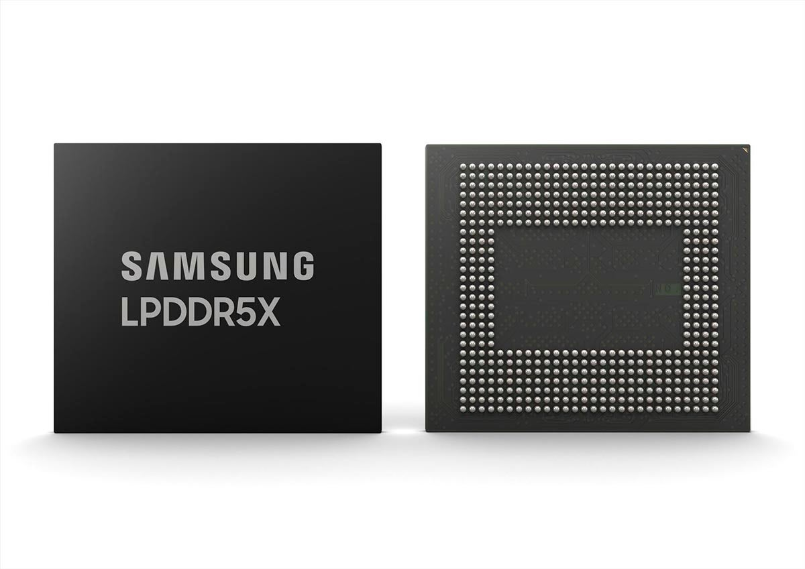

# Samsung to cut mobile production by up to 30% due to 175% rise in RAM costs

RAM memory has become the component that decides how many phones are manufactured. According to South Korean newspaper *Money Today*, Samsung's mobile division would have asked suppliers to reduce volumes for October, November and December 2026 by between 20% and 30%. This is not an official announcement but figures circulating among industry sources, pointing to a serious revision of the production plan to close out the year.

## LPDDR5X RAM: 175% more expensive

The data explaining the decision is striking. According to figures from consulting firm TrendForce, 12 GB LPDDR5X memory modules used in phones rose by 175% year-over-year in Q2, reaching around $145 or $146. The main cause is the enormous demand for memory for data centers and artificial intelligence: manufacturers are concentrating their capacity on more profitable components, leaving less margin for those assembling smartphones.

The paradox is uncomfortable for Samsung. The company makes money selling memory for AI, but at the same time its smartphone business suffers from rising costs of that very same memory. The company had already tried to contain the problem by using other suppliers to manufacture its phones, although pressure on component prices has not eased.

## From 270 million to just over 200 million smartphones

Before this report, estimates were circulating of up to 270 million smartphones produced during 2026. The new estimate points to closing the year with just over 200 million units, according to industry sources and without a definitive figure.

It is worth contextualizing: Samsung usually manufactures fewer phones at the end of the year because many buyers wait for the next Galaxy S series, which arrive between January and February. What is unusual now would not be the decline itself, but its magnitude and its direct link to component costs rather than the usual launch calendar.

## What changes for someone thinking about buying a Galaxy

For anyone considering switching phones, this news does not mean all Galaxies will immediately go up in price. What it adds is real pressure on margins that, if memory cost increases persist, will eventually be passed through to final prices or the availability of some models.

While waiting for Samsung to specify how much it cuts and whether prices are affected, the advice remains the same in a cycle like this: if you need the phone now and the model you're interested in maintains its price, go ahead; if you can wait for the next Galaxy S, prudence says to wait and see whether the production adjustment translates into price increases or stock problems over the coming quarter.
