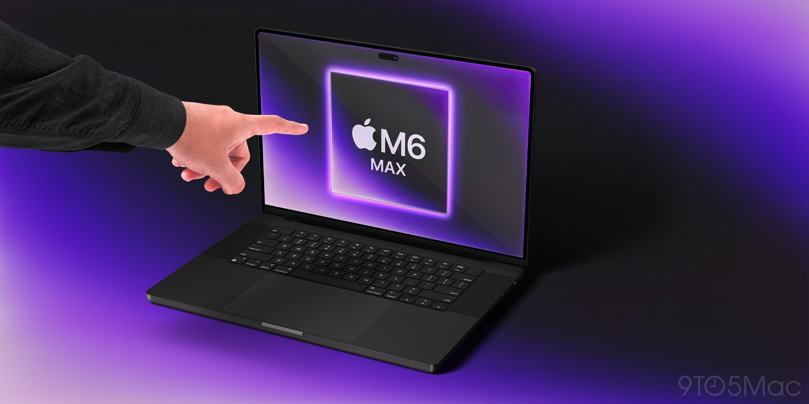

After more than a decade without being touched, the MacBook Pro's display might finally accept a finger: the most recent reports point to the first MacBook Pro with a touchscreen going on sale on November 6. This updates the leak we already covered about Apple testing touchscreen displays in its laptops, and it does so with more than a stray hint: a concrete schedule, with an announcement as early as October 27 and a package that includes an OLED panel, Dynamic Island and the current Pro-line chips.

## The debut date: November 6

The date comes from Mark Gurman's Power On newsletter (Bloomberg), picked up by 9to5Mac. According to that report, Apple would plan a "reset" in its stores from the night of Thursday, November 5, through Friday, November 6: new signage and product on the tables. Since there is no other Apple release scheduled for the 6th that week, it fits that at least part of what was announced on October 27 becomes available that day.

The context matters as much as the date itself: the new MacBook Pro would not be an isolated launch, but part of a four-week streak of consecutive releases —iPhone Duo, HomePod mini 2, the MacBook Pro itself and HomeView alongside the Apple TV 4K—. When the store calendar moves like that, the "reset" tip carries as much weight as the leaked date.

## Touchscreen, Tandem OLED and Dynamic Island

On the panel, the redesign bets on a Tandem OLED: two stacked OLEDs, the same approach as the iPad Pro, which delivers the contrast and blacks inherent to backlight-free technology. The reports also place a Dynamic Island smaller than the iPhone's and rule out Face ID in this first generation.

The software layer is as much part of the product as the hardware. Clues have already appeared in the macOS 27 betas —touch support in Sidecar, the swipe-down gesture to refresh and somewhat larger interface elements—, and according to Gurman the system would open menus around the finger, choose controls based on the user's prior usage and expand the menu bar's options when an item is tapped. In other words: controls designed for the finger, not adapted at the last minute from the cursor.

## M5 Pro and M5 Max, not the M6

Although the initial leaks placed the debut of the M6 Pro and M6 Max in this redesign, the more recent reports point to Apple skipping them to fast-track the M7. The first touchscreen MacBook Pro would carry the current M5 Pro and M5 Max: without the 2 nm chips and without a base model for now. That base model, already with the M7, could arrive in spring 2027. It is the same turn we already anticipated in [our piece on the MacBook Pro's M6](/en/news/portatiles/macbook-pro-m6-three-improvements-more-cores-dual-neural-engine-and-2nm/).

## A lighter chassis and who it makes sense for

The same reports point to a somewhat thinner and, above all, considerably lighter chassis, the result of re-engineering the internal components. The caution is the usual one in laptops: fewer grams lighten the backpack, but the margin is set by sustained thermals, not the first minute of a demo load —and a redesign with touch and OLED does not by itself reduce the heat that has to be dissipated.

As for who each scenario fits: anyone who needs an Apple laptop immediately and is not waiting for touch still has more reason today to look at the MacBook Pro with M5 at a discounted price; anyone who wants a touchscreen and OLED should wait until November 6 is confirmed; and anyone prioritizing 2 nm efficiency has more reason than ever to look toward spring, when the base model with the M7 could arrive. The rest of buyers gain nothing by rushing: between the October 27 announcement and the sale date there is little room to judge with real battery-life and thermal data what currently exists only in reports.
