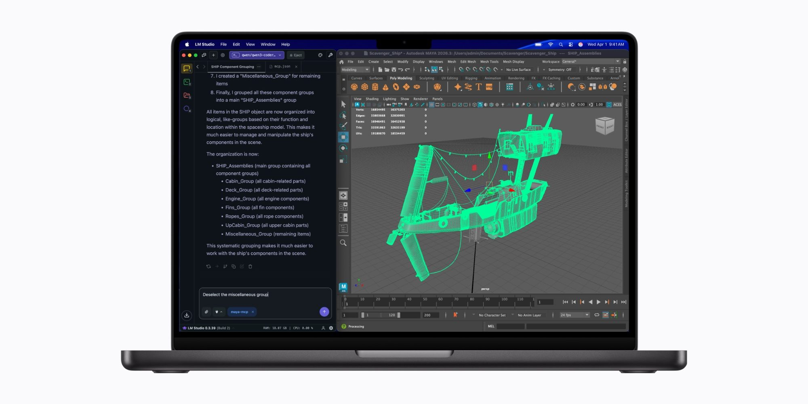

Apple plans to launch a new MacBook Pro with the **M6** chip later this month, featuring a 14-inch display and the industrial design we already know, according to 9to5Mac. The interesting change isn't in the chassis, but inside: the M6 introduces three improvements that affect how the machine will behave away from the test lab.

It's worth remembering that the M6 is already in the new **Mac mini**, a device that doesn't depend on a battery. Its jump to a laptop is exactly the scenario where those improvements can be valued in real use.

## A dual 16-core Neural Engine

The M6 incorporates a **Dual 16-core Neural Engine**, versus the standard 16-core Neural Engine of the M5 and previous generations. Apple states that the change offers up to double maximum compute compared to previous generations, and some system frameworks can leverage both engines at once to accelerate model execution.

For those who work with local AI—and with macOS 27's AI features, which according to the company will affect more users—that dual engine is the chip's most impactful advancement. The important nuance: in sustained use, what will mark the experience won't be the announced peak, but how long that pace can hold before thermal throttling kicks in.

## 12 CPU and GPU cores, with three core types

The base M6 jumps to **12 CPU cores and 12 GPU cores**, versus 10 of each type in the M5. But the most relevant detail is in the CPU: for the first time, a base Apple chip combines three types of core in the same die.

- **Super cores**: designed for single-threaded loads.
- **Performance cores**: consume less and add to super cores in demanding multithreaded loads.
- **Efficiency cores**: handle everyday background tasks.

Until now, that mix of super cores and performance cores in a single chip was exclusive to the M5 Pro, M5 Max, and M5 Ultra. Its arrival at the standard-range M6 brings capabilities previously reserved for high-end versions.

## 2nm: the efficiency that should be noticeable in battery life

The M6 is Apple's first chip manufactured on a **2nm** process, and the company describes the result as "a big leap in performance and energy efficiency." This is the improvement most likely to be noticed with the lid open and hours passing, because efficiency is exactly what determines how long a work session lasts.

That leap hasn't yet been measured on a battery-powered device, since the only M6 product so far is the Mac mini. In the MacBook Pro, longer battery life is already expected, though as always it depends on a manufacturer decision: Apple could maintain consumption and enlarge the battery, or cut physical capacity and stay at similar duration. Until there are units to test, this part should be treated as a reasonable promise, not a figure.

## Who it's for, and who isn't

If your workflow depends on local AI, compiling, or long unplugged sessions, the M6 with its dual Neural Engine and 2nm efficiency is the generation that justifies waiting. Anyone who just bought an M5 or lives comfortably with their M4 has no reason to rush: these are platform improvements, not a change that redefines the product.

The point to watch when the first units arrive is measured battery life and thermal performance under sustained load. That's where it will become clear whether the efficiency leap translates into real hours or stays on the slide.
