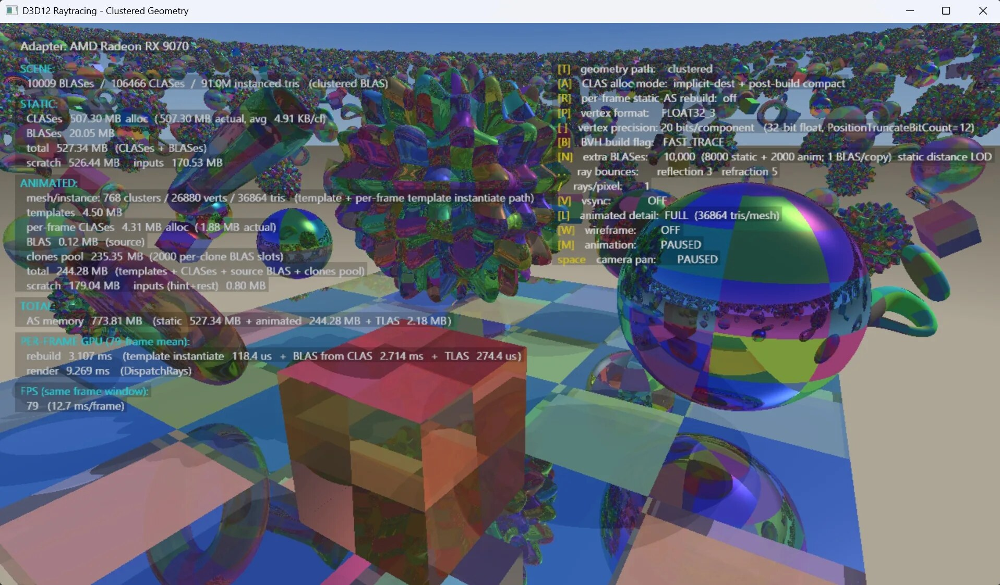
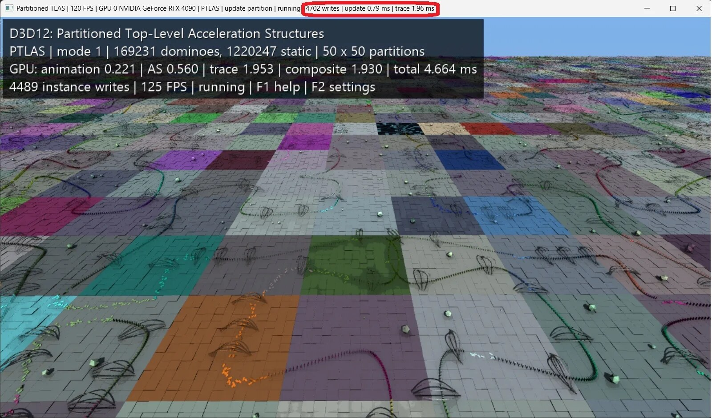

Microsoft published on October 28 a preview of two new features for DirectX Raytracing (DXR): **Clustered Geometry** and **Partitioned TLAS**. The company describes them in its developer blog as «the most significant DXR update since its debut in 2018», backed by the memory figure: in their own demo on an RX 9070, the ray tracing acceleration structure set dropped from 7.519 MiB to 774 MiB, a 89.7% reduction. The headline number needs careful reading because the full title requires two nuances: it is ray tracing *structure* memory, not total VRAM, and it comes from a test environment, not a finished game.

## What changes in DirectX: Clustered Geometry and Partitioned TLAS

Raytracing does not cast rays against the game's original mesh. It casts them against an acceleration structure (BLAS per object, TLAS for the full scene) that is reconstructed when geometry changes. With animation, level-of-detail streaming, or procedurally generated terrain, that reconstruction repeats frame by frame and its cost grows with world size.

Clustered Geometry attacks the problem from below. It divides geometry into **CLAS** (*Cluster Level Acceleration Structure*) blocks of up to 256 triangles and 256 vertices, assembling the object BLAS from references to those blocks. Since work repeats between frames, it can be reused instead of reconstructed, and according to Microsoft that makes tracing against full-detail geometry viable: shadows and reflections traced match what is seen on screen. The API does not support *refits*, so for deformable meshes there are **cluster templates** that precalculate position-independent work and only receive new positions.

Partitioned TLAS does the same from above. It divides the scene into spatial partitions with persistent instance records, so reconstruction costs in proportion to what changed rather than scene size. Instances that move constantly can go to a **global partition**, where each is managed separately to avoid dragging its whole group.

## The test breakdown: where the 90% comes from

Microsoft published the full table of their `D3D12RaytracingClusteredGeometry` example on an RX 9070, comparing traditional BLAS reconstruction with clustered geometry mode. These are the numbers as they appear in Microsoft's blog:

| Metric | Traditional BLAS | Clustered Geometry | Difference |
| --- | --- | --- | --- |
| Frames per second | 1.2 | 79 | ~66× more |
| Structure preparation per frame | 788 ms | 3.11 ms | ~254× less time |
| Ray tracing per frame | 72.6 ms | 9.27 ms | ~7.8× less time |
| Static structure memory | 723 MiB | 527 MiB | 27.0% less |
| Animated structure memory | 6.794 MiB | 244 MiB | 96.4% less |
| Total memory, including TLAS | 7.519 MiB | 774 MiB | **89.7% less** |
| Build scratch (animated) | 8.25 MiB | 179 MiB | More demanding |

Two readings matter more than the 89.7%. The first: the savings do not come from the static case, which drops only 27%, but from the animated one, where traditional reconstruction explodes. A game with little animated geometry will see a fraction of that gain. The second: the temporary memory needed for construction **rises**, from 8.25 MiB to 179 MiB in the animated case, because grouping and assembling has its own logistical cost. Microsoft warns in caps in the post itself: do not assume games will see improvements of this magnitude; that is only a testbed. It also points out the inverse case, where raytracing comes slightly more expensive but scene preparation per frame more than compensates.

## What hardware supports it and when it arrives

Neither function requires new capabilities: they work on the raytracing support the GPU already has. What is needed is for each manufacturer to implement and validate the driver, and there the split is uneven:

- **NVIDIA**: all RTX GPUs.
- **AMD**: Radeon RX 9000 series.
- **Intel**: Arc B-Series and the Core Ultra 200V and Series 3 families.
- **Qualcomm**: Snapdragon X2, with driver support expected in Q1 or Q2 of 2027.

Support on older raytracing GPUs is to be determined, and Microsoft warns that implementation work may uncover performance issues making it unviable. To test it today requires Agility SDK 1.722.0-preview, the shader compiler with Shader Model 6.10 in preview, a compatible driver, and Windows developer mode enabled. There is no date for the final release.

## What it means for your VRAM

Acceleration structure memory is only part of what a graphics card occupies in a raytracing game, so an 89.7% reduction there does not translate to 89.7% less VRAM used. But in scenes with lots of animated geometry it is the line that grows most, and thus the one that most constrains cards with less memory.

The real interest lies in that the savings do not come from buying hardware: they come from updating drivers and from studios adopting the API, and that second step is the slow one. *Gears of War: E-Day* already uses clustered geometry via NVIDIA's own API, RTX Mega Geometry; standardizing it in DirectX extends the same integration path to AMD and Intel and, above all, decouples the technique from a brand. In a year where memory and GPUs are not dropping in price, squeezing more out of what is already installed is the strongest argument for the announcement.

The direct comparison is [AMD's "Tetrahedral Cages" technique](/noticias/amd-tetrahedral-cages/), which also attacks raytracing memory by reusing static structures: that is a manufacturer solution, and this is a common API that needs each driver to validate it. For the reader with a mid-range card, the open question is not how much memory is saved, but when games using it will arrive and how long until they reach the drivers already installed. Anyone wanting to follow the same toolset trail can also read how [Advanced Shader Delivery cuts shader compilation](/noticias/tarjetas-graficas/microsoft-advanced-shader-delivery-compilacion/) in Microsoft's Agility SDK.
